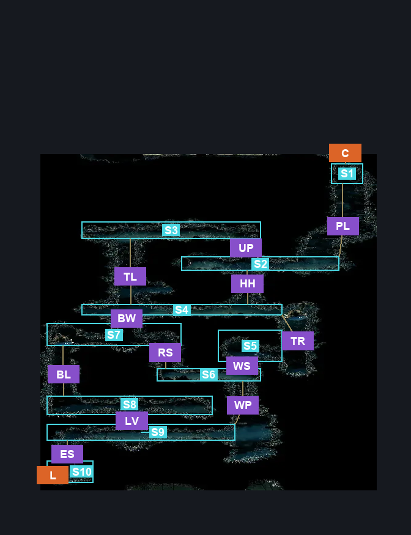
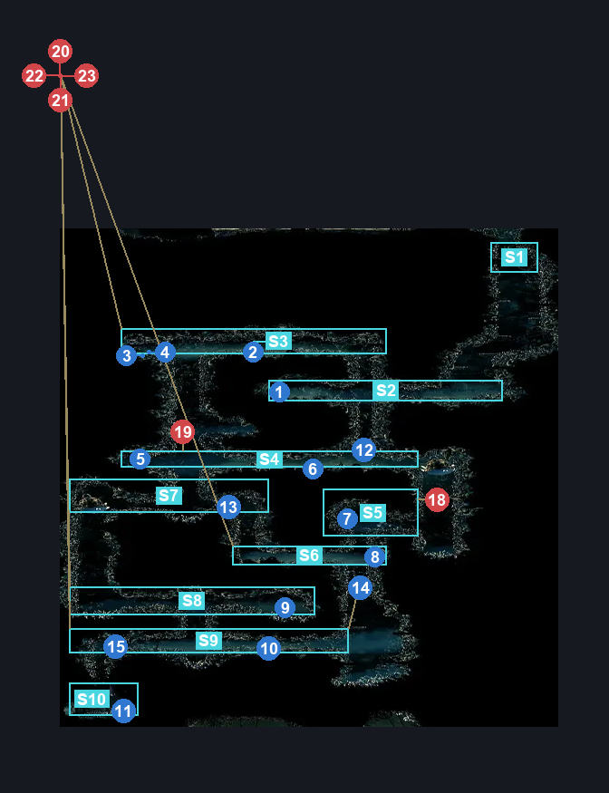
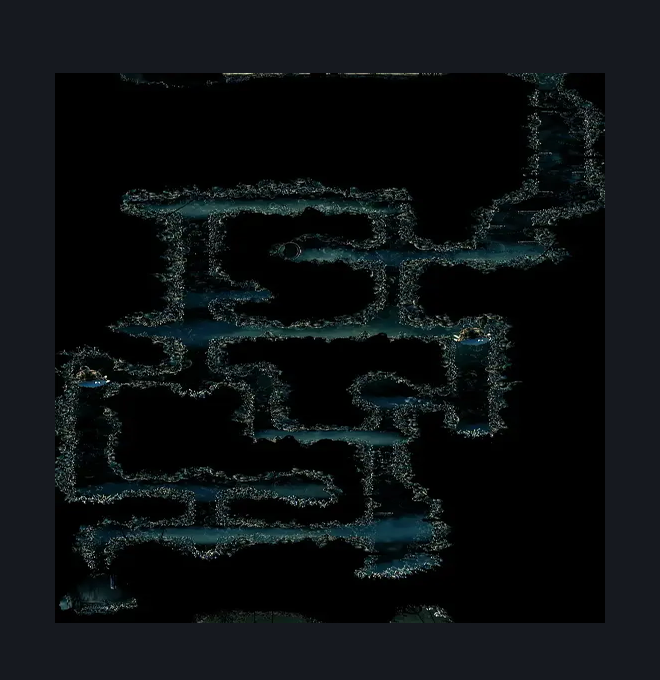

# Bellhart Lower (Belltown_basement_03)

**Game ID:** Belltown_basement_03

**Contributors:** Pyxl

## Subrooms

| No. | Subroom | Annotated |
| --- | --- | --- |
| S1 | Top Exit | ✓ |
| S2 | Hermit | ✓ |
| S3 | Upper Hall | ✓ |
| S4 | Under Hermit Hall | ✓ |
| S5 | Rosary Room | ✓ |
| S6 | Passage below rosary | ✓ |
| S7 | Breakable Wall Passage | ✓ |
| S8 | Lower Passage 1 | ✓ |
| S9 | Lower Passage 2 | ✓ |
| S10 | Bottom Exit | ✓ |

## Room Transitions

| Alias | Name | From subroom | Destination | Destination alias | Requirements | TODO | Verification | Annotated | Notes |
| --- | --- | --- | --- | --- | --- | --- | --- | --- | --- |
| C | top1 | Top Exit | [Bellhart Bellway (Belltown_basement)](bellhart-bellway.md) | F | None |  | Verified | ✓ |  |
| L | left1 | Bottom Exit | [The Marrow Jail Pathway (Bone_08)](../the-marrow/the-marrow-jail-pathway.md) | UR | None |  | Verified | ✓ |  |

## Subroom Connections

| Alias | Name | Source | Destination | Requirements | TODO | Verification | Annotated | Notes |
| --- | --- | --- | --- | --- | --- | --- | --- | --- |
| PL | Platforms Upper | Top Exit | Hermit | None |  | Verified | ✓ |  |
| PL | Platforms Upper | Hermit | Top Exit | Cling Grip Right OR ( Ledge Grab Right AND Ledge Grab Left ) OR Faydown Cloak OR Silk Soar |  | Verified | ✓ |  |
| UP | Upper Hall | Hermit | Upper Hall | Cling Grip Right OR Cling Grip Left OR Scuttlebrace OR Silk Soar |  | Verified | ✓ |  |
| UP | Upper Hall | Upper Hall | Hermit | None |  | Verified | ✓ |  |
| TL | Tall Passage Left | Upper Hall | Under Hermit Hall | None |  | Verified | ✓ |  |
| TL | Tall Passage Left | Under Hermit Hall | Upper Hall | Cling Grip Left OR Scuttlebrace OR ( Cling Grip Right AND Faydown Cloak ) |  | Verified | ✓ |  |
| HH | Hermit Hole | Hermit | Under Hermit Hall | prereq Hermit hole breakable wall |  | Verified | ✓ |  |
| HH | Hermit Hole | Under Hermit Hall | Hermit | prereq Hermit hole breakable wall  AND ( Cling Grip Right OR Silk Soar OR Scuttlebrace OR ( Cling Grip Left AND Faydown Cloak ) ) |  | Verified | ✓ |  |
| TR | Tall Passage Right | Under Hermit Hall | Rosary Room | None |  | Verified | ✓ |  |
| TR | Tall Passage Right | Rosary Room | Under Hermit Hall | Cling Grip Right OR Cling Grip Left OR Scuttlebrace |  | Verified | ✓ |  |
| WS | Wide Shaft | Rosary Room | Passage below rosary | None |  | Verified | ✓ |  |
| WS | Wide Shaft | Passage below rosary | Rosary Room | Cling Grip Right OR Cling Grip Left OR Scuttlebrace OR Silk Soar |  | Verified | ✓ |  |
| RS | Shaft near Rosary Cache | Passage below rosary | Breakable Wall Passage | Cling Grip Right OR Cling Grip Left OR Scuttlebrace OR Silk Soar |  | Verified | ✓ |  |
| RS | Shaft near Rosary Cache | Breakable Wall Passage | Passage below rosary | None |  | Verified | ✓ |  |
| BW | Broken Floor Shaft | Breakable Wall Passage | Under Hermit Hall | prereq Breakable Wall Passage Breakable Wall AND ( Cling Grip left OR Cling Grip Right OR Scuttlebrace ) |  | Verified | ✓ |  |
| BW | Broken Floor Shaft | Under Hermit Hall | Breakable Wall Passage | prereq Breakable Wall Passage Breakable Wall |  | Verified | ✓ |  |
| BL | Tall Passage Bottom Left | Breakable Wall Passage | Lower Passage 1 | None |  | Verified | ✓ |  |
| BL | Tall Passage Bottom Left | Lower Passage 1 | Breakable Wall Passage | Cling Grip Left OR Scuttlebrace OR ( Faydown Cloak AND Cling Grip Right ) |  | Verified | ✓ |  |
| LV | Lower Passages Shaft | Lower Passage 1 | Lower Passage 2 | None |  | Verified | ✓ |  |
| LV | Lower Passages Shaft | Lower Passage 2 | Lower Passage 1 | Cling Grip Right OR Cling Grip Left OR Scuttlebrace |  | Verified | ✓ |  |
| WP | Wide Platform Shaft | Lower Passage 2 | Passage below rosary | prereq Lower Passage 2 Breakable Wall AND ( Cling Grip Right OR Silk Soar OR Scuttlebrace OR ( Cling Grip Left AND Faydown Cloak ) ) |  | Verified | ✓ |  |
| WP | Wide Platform Shaft | Passage below rosary | Lower Passage 2 | prereq Lower Passage 2 Breakable Wall AND ( Dash Left OR Sprint Left OR Ledge grab Left OR Clawline Left OR Drifters Cloak OR Faydown Cloak OR Cling grip Left OR easy Shaman Crest pogo OR easy Architect Crest pogo OR easy Beast Crest pogo ) |  | Verified | ✓ |  |
| ES | Exit Shaft | Lower Passage 2 | Bottom Exit | prereq Lower Passage 2 Breakable  Wall To Exit |  | Verified | ✓ |  |
| ES | Exit Shaft | Bottom Exit | Lower Passage 2 | prereq Lower Passage 2 Breakable  Wall To Exit AND ( Cling Grip Right OR Cling Grip Left OR ( Scuttlebrace AND ( Medium Shaman Pogo OR Faydown Cloak ) ) OR Silk Soar ) |  | Verified | ✓ |  |

## Check Locations

| No. | Check | Subroom | Requirements | TODO | Verification | Location Type | Annotated | Notes |
| --- | --- | --- | --- | --- | --- | --- | --- | --- |
| 1 | Hermits Soul | Hermit | prereq Wish: Silk And Soul Started |  | Verified | collectible | ✓ |  |
| 2 | Silver Bell Spawn Location #6 | Upper Hall | prereq Wish: Silver Bells Started |  | Verified | collectible | ✓ |  |
| 3 | Rosary Cache: Bellhart #6 | Upper Hall | None |  | Verified | collectible | ✓ |  |
| 4 | Silver Bell Spawn Location #7 | Upper Hall | prereq Wish: Silver Bells Started |  | Verified | collectible | ✓ |  |
| 5 | Silver Bell Spawn Location #8 | Under Hermit Hall | prereq Wish: Silver Bells Started |  | Verified | collectible | ✓ |  |
| 6 | Silver Bell Spawn Location #12 | Under Hermit Hall | prereq Wish: Silver Bells Started |  | Verified | collectible | ✓ |  |
| 7 | Rosary Cache: Bellhart #7 | Rosary Room | None |  | Verified | collectible | ✓ |  |
| 8 | Silver Bell Spawn Location #9 | Passage below rosary | prereq Wish: Silver Bells Started |  | Verified | collectible | ✓ |  |
| 9 | Silver Bell Spawn Location #10 | Lower Passage 1 | prereq Wish: Silver Bells Started |  | Verified | collectible | ✓ |  |
| 10 | Silver Bell Spawn Location #11 | Lower Passage 2 | prereq Wish: Silver Bells Started |  | Verified | collectible | ✓ |  |
| 11 | Rosary Cache: Bellhart #5 | Bottom Exit | None |  | Verified | collectible | ✓ |  |
| 12 | Hermit Hole Breakable Wall | Under Hermit Hall | None |  | Verified | blockade | ✓ |  |
| 13 | Breakable Wall Passage Breakable Wall | Breakable Wall Passage | None |  | Verified | blockade | ✓ |  |
| 14 | Lower Passage 2 Breakable Wall | Lower Passage 2 | None |  | Verified | blockade | ✓ |  |
| 15 | Lower Passage 2 Breakable  Wall To Exit | Lower Passage 2 | None |  | Verified | blockade | ✓ |  |
| 16 | Wish: Silver Bells Started | Top Exit | None |  | Verified | event |  |  |
| 17 | Wish: Silk And Soul Started | Top Exit | None |  | Verified | event |  |  |
| 18 | Winged Furm 1 | Rosary Room | None |  | Verified | enemy | ✓ |  |
| 19 | Winged Furm 2 | Under Hermit Hall | None |  | Verified | enemy | ✓ |  |
| 20 | Furm 1 | Lower Passage 1 | None |  | Verified | enemy | ✓ | Can randomly spawn near player in most sub rooms including the 4 mentioned here |
| 21 | Furm 2 | Lower Passage 2 | None |  | Verified | enemy | ✓ | Can randomly spawn near player in most sub rooms including the 4 mentioned here |
| 22 | Furm 3 | Passage below rosary | None |  | Verified | enemy | ✓ | Can randomly spawn near player in most sub rooms including the 4 mentioned here |
| 23 | Furm 4 | Upper Hall | None |  | Verified | enemy | ✓ | Can randomly spawn near player in most sub rooms including the 4 mentioned here |

## Room Images

### Connections

### Checks

### Scene

