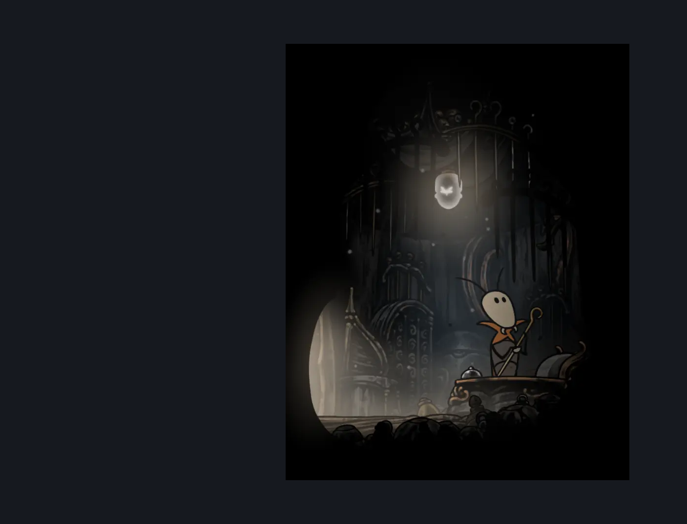

# Bellhart Pinsmith (Belltown_Room_pinsmith)

**Game ID:** Belltown_Room_pinsmith

**Contributors:** Pyxl

## Subrooms

No subrooms defined.

## Room Transitions

| Alias | Name | From subroom | Destination | Destination alias | Requirements | TODO | Verification | Annotated | Notes |
| --- | --- | --- | --- | --- | --- | --- | --- | --- | --- |
| L | left1 |  | [Belltown (Belltown)](belltown.md) | ND | None |  | Verified | ✓ |  |

## Subroom Connections

No subroom connections defined.

## Check Locations

| No. | Check | Subroom | Requirements | TODO | Verification | Location Type | Annotated | Notes |
| --- | --- | --- | --- | --- | --- | --- | --- | --- |
| 1 | Progressive Needle Upgrade 1 |  | None |  | Verified | collectible |  |  |
| 2 | Progressive Needle Upgrade 2 |  | get 1 pale oils |  | Verified | collectible |  | cumulative requirement |
| 3 | Progressive Needle Upgrade 3 |  | get 2 pale oils |  | Verified | collectible |  | cumulative requirement |
| 4 | Progressive Needle Upgrade 4 |  | get 3 pale oils |  | Verified | collectible |  | cumulative requirement |
| 5 | Pinmaster's Oil Wish Granted |  | complete THE Pinmaster's Oil Wish Promised AND get 1 pale oils |  | Verified | event |  | can be missed, but counts towards silk and soul regardless of completion after second needle upgrade |
| 6 | import enemies |  |  | TODO | Needs verification |  |  |  |

## Room Images

### Connections

### Checks

### Scene

