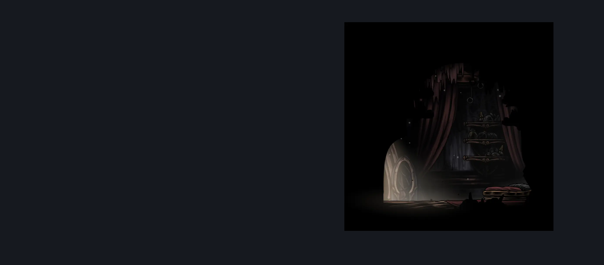

# Bellhome (Belltown_room_spare)

**Game ID:** Belltown_room_spare

**Contributors:** Pyxl

## Subrooms

No subrooms defined.

## Room Transitions

| Alias | Name | From subroom | Destination | Destination alias | Requirements | TODO | Verification | Annotated | Notes |
| --- | --- | --- | --- | --- | --- | --- | --- | --- | --- |
| L | Left1 |  | [Belltown (Belltown)](belltown.md) | HD | None |  | Verified | ✓ |  |

## Subroom Connections

No subroom connections defined.

## Check Locations

| No. | Check | Subroom | Requirements | TODO | Verification | Location Type | Annotated | Notes |
| --- | --- | --- | --- | --- | --- | --- | --- | --- |
| 1 | bench |  | none |  | Verified | bench |  |  |
| 2 | act toggle |  | act 3 |  | Verified | bench |  | probably need to flag this as requiring act 3 |

## Room Images

### Connections

### Checks

### Scene

