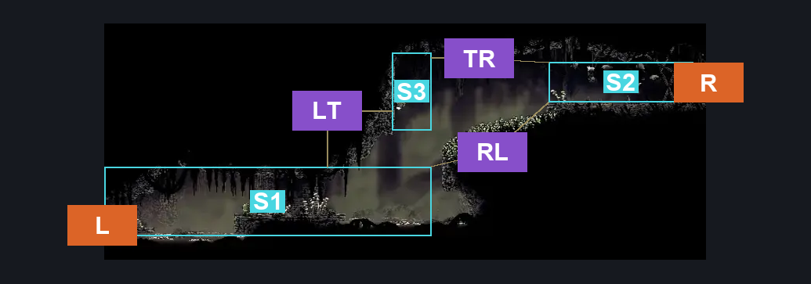
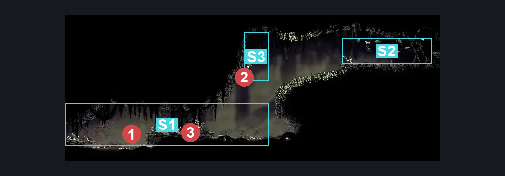
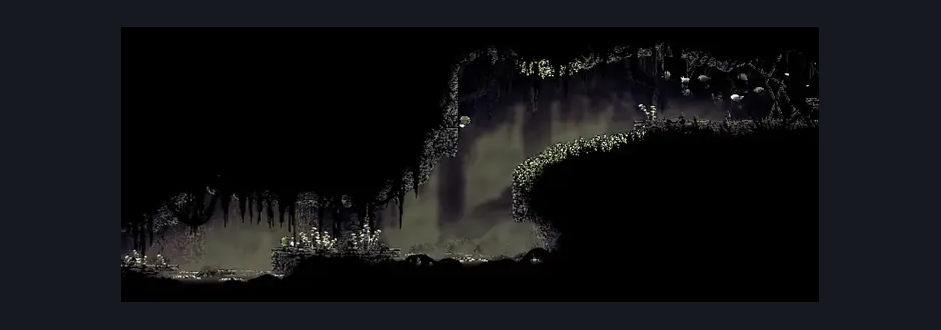

# Bilewater Hanging Corpse Room (Shadow_16)

**Game ID:** Shadow_16

**Contributors:** Herchey and Dude (his neighbor's cat)

## Subrooms

| No. | Subroom | Annotated |
| --- | --- | --- |
| S1 | left | ✓ |
| S2 | right | ✓ |
| S3 | top wall | ✓ |

## Room Transitions

| Alias | Name | From subroom | Destination | Destination alias | Requirements | TODO | Verification | Annotated | Notes |
| --- | --- | --- | --- | --- | --- | --- | --- | --- | --- |
| R | right | right | [Bilewater Lower Trap Gauntlet Hall (Shadow_10)](bilewater-lower-trap-gauntlet-hall.md) | L | none |  | Verified | ✓ |  |
| L | left | left | [Bilewater Upper Bloatroach Tower (Shadow_01)](bilewater-upper-bloatroach-tower.md) | MR | none |  | Verified | ✓ |  |

## Subroom Connections

| Alias | Name | Source | Destination | Requirements | TODO | Verification | Annotated | Notes |
| --- | --- | --- | --- | --- | --- | --- | --- | --- |
| LT | left to top | left | top wall | cling grip AND (clawline x 2 OR faydown cloak) |  | Verified | ✓ |  |
| LT | left to top | top wall | left | none |  | Verified | ✓ |  |
| TR | top to right | top wall | right | faydown cloak AND (clawline OR (drifter's cloak AND (ledge grab OR sharpdart OR dash))) |  | Verified | ✓ |  |
| TR | top to right | right | top wall | (faydown cloak AND (clawline OR (sharpdart AND proficient movement)))  OR  (drifter's cloak AND (dash OR clawline OR sharpdart))  OR  clawline x 2 |  | Verified | ✓ |  |
| RL | right to left | right | left | drifter's cloak OR (clawline AND (proficient movement OR swim)) OR ((sharpdart OR faydown cloak) AND dash) |  | Verified | ✓ |  |
| RL | right to left | left | right | invalid |  | Verified | ✓ |  |

## Check Locations

| No. | Check | Subroom | Requirements | TODO | Verification | Location Type | Annotated | Notes |
| --- | --- | --- | --- | --- | --- | --- | --- | --- |
| 1 | Stilkin Trapper 1 | left | invalid |  | Verified | enemy | ✓ | swampMuckmanTallInvades == true |
| 2 | Miremite 1 | top wall | none |  | Verified | enemy | ✓ |  |
| 3 | Miremite 2 | left | none |  | Verified | enemy | ✓ |  |

## Room Images

### Connections

### Checks

### Scene

