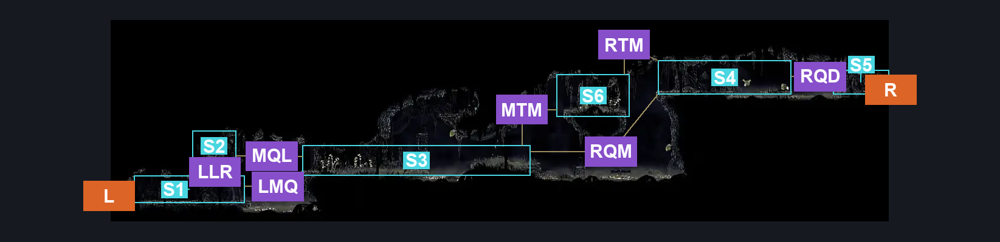
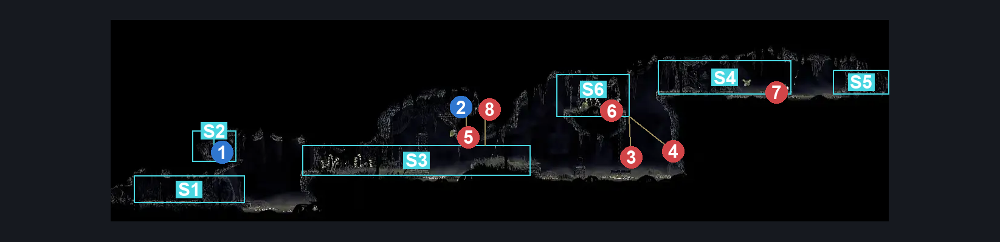
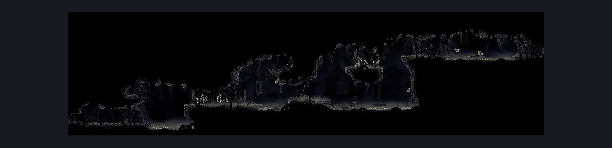

# Bilewater Sinner's Entrance (Shadow_05)

**Game ID:** Shadow_05

**Contributors:** Herchey and the big man upstairs (Jesus)

## Subrooms

| No. | Subroom | Annotated |
| --- | --- | --- |
| S1 | left quarter | ✓ |
| S2 | left rosary platform | ✓ |
| S3 | middle quarter | ✓ |
| S4 | right quarter | ✓ |
| S5 | right door | ✓ |
| S6 | top mid plat | ✓ |

## Room Transitions

| Alias | Name | From subroom | Destination | Destination alias | Requirements | TODO | Verification | Annotated | Notes |
| --- | --- | --- | --- | --- | --- | --- | --- | --- | --- |
| R | right | right door | [Bilewater East Column (Shadow_09)](bilewater-east-column.md) | LL | none |  | Verified | ✓ |  |
| L | left | left quarter | [Sinner's Road Vertical Hall East (Dust_06)](../sinner-s-road/sinner-s-road-vertical-hall-east.md) | UR | none |  | Verified | ✓ |  |

## Subroom Connections

| Alias | Name | Source | Destination | Requirements | TODO | Verification | Annotated | Notes |
| --- | --- | --- | --- | --- | --- | --- | --- | --- |
| LLR | left quarter to left rosary | left quarter | left rosary platform | silk soar OR (faydown cloak AND ledge grab left) |  | Verified | ✓ |  |
| LLR | left quarter to left rosary | left rosary platform | left quarter | none |  | Verified | ✓ |  |
| LMQ | left quarter to middle quarter | left quarter | middle quarter | (cling grip right AND (drifter’s cloak OR clawline right OR sharpdart OR (faydown cloak AND swim))) OR (faydown cloak AND (scuttlebrace OR easy beast pogo)) OR ((clawline right OR sharpdart OR run right) AND scuttlebrace) |  | Verified | ✓ |  |
| LMQ | left quarter to middle quarter | middle quarter | left quarter | Drifter’s cloak OR faydown cloak OR clawline OR sharpdart OR scuttlebrace OR run OR dash OR swim OR easy hunter pogo OR easy beast pogo OR easy architect pogo OR easy shaman pogo |  | Verified | ✓ |  |
| MQL | middle quarter to left rosary | middle quarter | left rosary platform | Clawline OR sharpdart OR (ledge grab AND (drifter’s cloak OR run)) OR (faydown cloak AND (drifter's cloak OR easy beast pogo OR run OR scuttlebrace)) OR (run AND scuttlebrace) |  | Verified | ✓ | (run AND scuttlebrace) is possible, but probably easy_skips |
| MQL | middle quarter to left rosary | left rosary platform | middle quarter | Clawline right OR drifter’s cloak OR sharpdart OR dash right OR (run right AND (faydown cloak OR cling grip right OR scuttlebrace OR easy architect pogo OR easy beast pogo)) |  | Verified | ✓ |  |
| RQM | right quarter to middle quarter | right quarter | middle quarter | Drifter’s cloak OR faydown cloak OR sharpdart OR clawline right OR swim OR scuttlebrace OR run right OR easy beast pogo OR easy architect pogo |  | Verified | ✓ |  |
| RQM | right quarter to middle quarter | middle quarter | right quarter | (silk soar AND (easy beast pogo OR dash right OR clawline right OR sharpdart OR drifter’s cloak OR faydown OR scuttlebrace)) OR (cling grip right AND (clawline right OR sharpdart OR faydown cloak OR (drifter’s cloak AND ledge grab right))) |  | Verified | ✓ |  |
| RQD | right quarter to door | right quarter | right door | run OR clawline OR sharpdart OR drifter's cloak OR faydown cloak OR easy scuttlebrace OR (proficient movement AND enemy pogo) |  | Verified | ✓ |  |
| RQD | right quarter to door | right door | right quarter | run left OR clawline left OR sharpdart OR drifter's cloak OR faydown cloak OR easy scuttlebrace OR elite ball knowledge |  | Verified | ✓ | You can slap the ceiling on the right to prematurely trigger the spike trap and pogo it. |
| RTM | right to top mid | right quarter | top mid plat | none |  | Verified | ✓ |  |
| RTM | right to top mid | top mid plat | right quarter | faydown cloak OR (drifter's cloak AND proficient movement) OR (drifter's cloak AND ledge grab right) OR run right OR clawline right OR sharpdart OR scuttlebrace |  | Verified | ✓ |  |
| MTM | mid to top mid | middle quarter | top mid plat | (faydown cloak AND cling grip left) OR (silk soar AND (dash right OR clawline right OR sharpdart OR easy beast pogo OR faydown cloak OR drifter's cloak)) |  | Verified | ✓ |  |
| MTM | mid to top mid | top mid plat | middle quarter | none |  | Verified | ✓ |  |

## Check Locations

| No. | Check | Subroom | Requirements | TODO | Verification | Location Type | Annotated | Notes |
| --- | --- | --- | --- | --- | --- | --- | --- | --- |
| 1 | Box Of Rosaries Right Inside Bilewater | left rosary platform | none |  | Verified | collectible | ✓ | Formerly: Bilewater - Rosary Cache #1 |
| 2 | A Few Remaining Rosaries Next To A Dead Guy In Bilewater | middle quarter | (Faydown cloak AND (ledge grab right OR scuttlebrace OR (proficient movement AND easy beast pogo))) OR silk soar OR cling grip either |  | Verified | collectible | ✓ | Formerly: Bilewater - Rosary Cache #2 |
| 3 | Mosquitony, the Swamp Squit | top mid plat | none |  | Verified | enemy | ✓ | Formerly: Swamp Squit 1 |
| 4 | Colt, the Swamp Squit | top mid plat | none |  | Verified | enemy | ✓ | Formerly: Swamp Squit 2 |
| 5 | Gideon, the Swamp Squit | middle quarter | none |  | Verified | enemy | ✓ | Formerly: Swamp Squit 3 |
| 6 | Skorg, the Miremite | top mid plat | none |  | Verified | enemy | ✓ | Formerly: Miremite 1 |
| 7 | Gargamel, the Miremite | right quarter | Normal World Spawn |  | Verified | enemy | ✓ | Formerly: Miremite 2 |
| 8 | Void Mass 1 | middle quarter | Black Thread World Spawn AND ((Faydown cloak AND (ledge grab right OR scuttlebrace)) OR silk soar OR cling grip right) |  | Verified | enemy | ✓ |  |

## Room Images

### Connections

### Checks

### Scene

