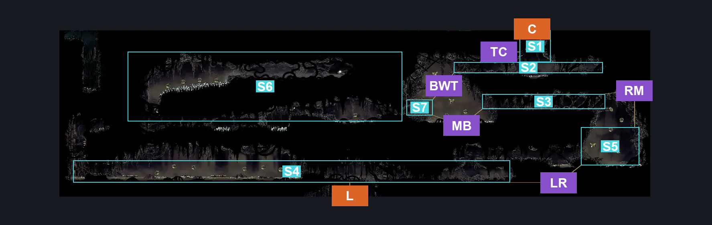
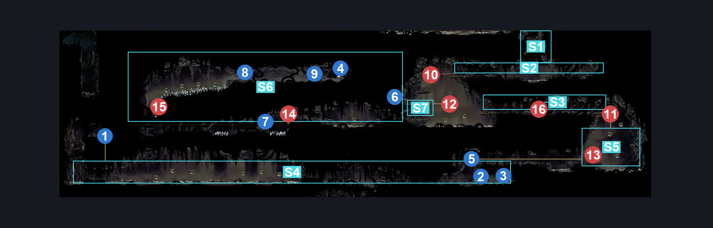
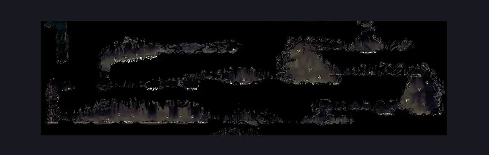

# Bilewater West Secret Rooms (Shadow_20)

**Game ID:** Shadow_20

**Contributors:** Herchey and someone else

## Subrooms

| No. | Subroom | Annotated |
| --- | --- | --- |
| S1 | ceiling exit | ✓ |
| S2 | top floor | ✓ |
| S3 | middle floor | ✓ |
| S4 | bottom floor | ✓ |
| S5 | right room | ✓ |
| S6 | bud hall | ✓ |
| S7 | bud wall plat | ✓ |

## Room Transitions

| Alias | Name | From subroom | Destination | Destination alias | Requirements | TODO | Verification | Annotated | Notes |
| --- | --- | --- | --- | --- | --- | --- | --- | --- | --- |
| L | lower | bottom floor | [Bilewater Organ Entrance (Shadow_04)](bilewater-organ-entrance.md) | C | none |  | Verified | ✓ |  |
| C | ceiling | ceiling exit | [Bilewater Citadel Exit (Shadow_22)](bilewater-citadel-exit.md) | B | cling grip AND medium enemy pogo AND faydown cloak |  | Verified | ✓ | Requires an annoying enemy lure. Medium_skips. Should be one-way normally. |

## Subroom Connections

| Alias | Name | Source | Destination | Requirements | TODO | Verification | Annotated | Notes |
| --- | --- | --- | --- | --- | --- | --- | --- | --- |
| TC | top to ceiling | top floor | ceiling exit | (enemy pogo OR clawline) AND (ledge grab OR cling grip OR faydown cloak) |  | Verified | ✓ |  |
| TC | top to ceiling | ceiling exit | top floor | (faydown cloak AND (swim OR enemy pogo)) OR drifter's cloak OR clawline OR sharpdart |  | Verified | ✓ |  |
| LR | lower to right | bottom floor | right room | complete lowerable hatch AND (faydown cloak OR silk soar OR scuttlebrace OR cling grip) |  | Verified | ✓ |  |
| LR | lower to right | right room | bottom floor | none |  | Verified | ✓ |  |
| MB | mid to bud | middle floor | bud wall plat | swim OR dash OR drifter's cloak OR enemy pogo OR clawline OR (faydown cloak AND (run OR sharpdart)) |  | Verified | ✓ |  |
| MB | mid to bud | bud wall plat | middle floor | enemy pogo OR clawline OR (faydown cloak AND (swim OR drifter's cloak OR sharpdart)) |  | Verified | ✓ |  |
| BWT | bud wall to top | bud wall plat | top floor | faydown cloak OR (ledge grab AND (clawline OR run OR (cling grip AND (clawline OR sharpdart)))) |  | Verified | ✓ |  |
| BWT | bud wall to top | top floor | bud wall plat | none |  | Verified | ✓ | falling |
| RM | right to mid | right room | middle floor | ((enemy pogo OR clawline x 5) AND (ledge grab OR cling grip)) OR (faydown cloak AND ((ledge grab OR cling grip) AND (silk soar OR enemy pogo))) |  | Verified | ✓ |  |
| RM | right to mid | middle floor | right room | none |  | Verified | ✓ | falling |
| BWA | bud wall access | bud wall plat | bud hall | complete breakable wall to bud |  | Verified | ✓ |  |
| BWA | bud wall access | bud hall | bud wall plat | complete breakable wall to bud |  | Verified | ✓ |  |

## Check Locations

| No. | Check | Subroom | Requirements | TODO | Verification | Location Type | Annotated | Notes |
| --- | --- | --- | --- | --- | --- | --- | --- | --- |
| 1 | Bilewater West - Memory Locket | bottom floor | cling grip AND (swim OR clawline OR easy hunter pogo OR easy beast pogo OR easy architect pogo OR ((easy wanderer pogo OR easy witch pogo OR easy reaper pogo) AND (dash OR faydown cloak OR drifter's cloak))) |  | Verified | collectible | ✓ |  |
| 2 | Bilewater - Rosary Cache #6 | bottom floor | none |  | Verified | collectible | ✓ |  |
| 3 | Bilewater - Rosary Cache #7 | bottom floor | none |  | Verified | collectible | ✓ |  |
| 4 | Twisted Bud | bud hall | complete bud hall wall 3 AND (dash OR clawline OR sharpdart OR drifter's cloak OR spike pogo) |  | Verified | collectible | ✓ |  |
| 5 | lowerable hatch | right room | attack left |  | Verified | blockade | ✓ |  |
| 6 | breakable wall to bud | bud wall plat | attack left |  | Verified | blockade | ✓ |  |
| 7 | bud hall wall 1 | bud hall | attack left AND complete breakable wall to bud AND (clawline OR sharpdart OR swim OR enemy pogo OR dash OR (proficient movement AND run AND ledge grab)) |  | Verified | blockade | ✓ |  |
| 8 | bud hall wall 2 | bud hall | attack right AND complete bud hall wall 1 AND  (((cling grip OR silk soar) AND (spike pogo OR enemy pogo OR clawline x 2)) OR (scuttlebrace AND (clawline x 3 OR spike pogo))) |  | Verified | blockade | ✓ |  |
| 9 | bud hall wall 3 | bud hall | attack right AND complete bud hall wall 2 |  | Verified | blockade | ✓ |  |
| 10 | Swamp Squit 1 | top floor | none |  | Verified | enemy | ✓ |  |
| 11 | Swamp Squit 2 | right room | none |  | Verified | enemy | ✓ |  |
| 12 | Swamp Squit 3 | bud wall plat | none |  | Verified | enemy | ✓ |  |
| 13 | Swamp Squit 4 | right room | none |  | Verified | enemy | ✓ |  |
| 14 | Miremite 1 | bud hall | none |  | Verified | enemy | ✓ |  |
| 15 | Miremite 2 | bud hall | complete bud hall wall 2 |  | Verified | enemy | ✓ |  |
| 16 | Miremite 3 | middle floor | none |  | Verified | enemy | ✓ |  |

## Room Images

### Connections

### Checks

### Scene

