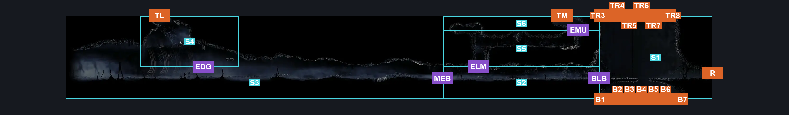
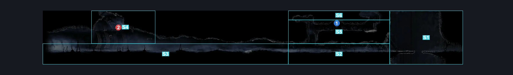
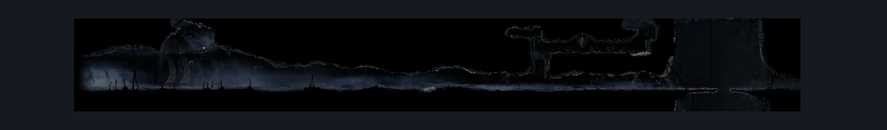

# Blasted Steps Map Edge (Coral_19)

**Game ID:** Coral_19

**Contributors:** skai, MayaXTG

## Subrooms

| No. | Subroom | Annotated |
| --- | --- | --- |
| S1 | Lace Bridge | ✓ |
| S2 | Before Map Edge (Lower) | ✓ |
| S3 | Map Lower Edge | ✓ |
| S4 | Map Upper Edge | ✓ |
| S5 | Before Map Edge (Middle) | ✓ |
| S6 | Before Map Edge (Top) | ✓ |

## Room Transitions

| Alias | Name | From subroom | Destination | Destination alias | Requirements | TODO | Verification | Annotated | Notes |
| --- | --- | --- | --- | --- | --- | --- | --- | --- | --- |
| B1 | Bottom | Lace Bridge | [The Big Fall (Aspid_01)](../bone-bottom/the-big-fall.md) | T1 | Nothing (Falling) |  | Verified | ✓ |  |
| B2 | bot2 | Lace Bridge | [The Big Fall (Aspid_01)](../bone-bottom/the-big-fall.md) | T2 | Nothing (Falling) |  | Verified | ✓ |  |
| B3 | bot3 | Lace Bridge | [The Big Fall (Aspid_01)](../bone-bottom/the-big-fall.md) | T3 | Nothing (Falling) |  | Verified | ✓ |  |
| B4 | bot4 | Lace Bridge | [The Big Fall (Aspid_01)](../bone-bottom/the-big-fall.md) | T4 | Nothing (Falling) |  | Verified | ✓ |  |
| B5 | bot5 | Lace Bridge | [The Big Fall (Aspid_01)](../bone-bottom/the-big-fall.md) | T5 | Nothing (Falling) |  | Verified | ✓ |  |
| B6 | bot6 | Lace Bridge | [The Big Fall (Aspid_01)](../bone-bottom/the-big-fall.md) | T6 | Nothing (Falling) |  | Verified | ✓ |  |
| B7 | bot7 | Lace Bridge | [The Big Fall (Aspid_01)](../bone-bottom/the-big-fall.md) | T7 | Nothing (Falling) |  | Verified | ✓ |  |
| R | Right | Lace Bridge | [Shellwood Connection To Blasted steps (Shellwood_08)](../shellwood/shellwood-connection-to-blasted-steps.md) | L | Nothing |  | Verified | ✓ |  |
| TR3 | Top Right (3) | Lace Bridge | [Blasted Steps Wide Long Vertical (Coral_03)](blasted-steps-wide-long-vertical.md) | B3 | Silk Soar |  | Verified | ✓ |  |
| TR4 | Top Right (4) | Lace Bridge | [Blasted Steps Wide Long Vertical (Coral_03)](blasted-steps-wide-long-vertical.md) | B4 | Silk Soar |  | Verified | ✓ |  |
| TR5 | Top Right (5) | Lace Bridge | [Blasted Steps Wide Long Vertical (Coral_03)](blasted-steps-wide-long-vertical.md) | B5 | Silk Soar |  | Verified | ✓ |  |
| TR6 | Top Right (6) | Lace Bridge | [Blasted Steps Wide Long Vertical (Coral_03)](blasted-steps-wide-long-vertical.md) | B6 | Silk Soar |  | Verified | ✓ |  |
| TR7 | Top Right (7) | Lace Bridge | [Blasted Steps Wide Long Vertical (Coral_03)](blasted-steps-wide-long-vertical.md) | B7 | Silk Soar |  | Verified | ✓ |  |
| TR8 | Top Right (8) | Lace Bridge | [Blasted Steps Wide Long Vertical (Coral_03)](blasted-steps-wide-long-vertical.md) | B8 | Silk Soar |  | Verified | ✓ |  |
| TM | Top Middle | Before Map Edge (Top) | [Blasted Steps Toll Bench Bottom (Coral_02)](blasted-steps-toll-bench-bottom.md) | BR | Nothing |  | Verified | ✓ |  |
| TL | Top Left | Map Upper Edge | [Blasted Steps Mask Shard (Coral_19b)](blasted-steps-mask-shard.md) | B | Nothing |  | Verified | ✓ |  |

## Subroom Connections

| Alias | Name | Source | Destination | Requirements | TODO | Verification | Annotated | Notes |
| --- | --- | --- | --- | --- | --- | --- | --- | --- |
| MEB | Map Edge to Before (Lower) | Map Lower Edge | Before Map Edge (Lower) | Nothing |  | Verified | ✓ |  |
| MEB | Map Edge to Before (Lower) | Before Map Edge (Lower) | Map Lower Edge | Nothing |  | Verified | ✓ |  |
| BLB | Before to Lace Bridge | Before Map Edge (Lower) | Lace Bridge | Nothing |  | Verified | ✓ |  |
| BLB | Before to Lace Bridge | Lace Bridge | Before Map Edge (Lower) | Nothing |  | Verified | ✓ |  |
| ELM | Map Edge (Lower) to Middle | Before Map Edge (Lower) | Before Map Edge (Middle) | silk soar OR (cling grip right AND (ledge grab right OR faydown cloak OR cling grip left OR scuttlebrace)) |  | Verified | ✓ |  |
| ELM | Map Edge (Lower) to Middle | Before Map Edge (Middle) | Before Map Edge (Lower) | Nothing (Fall) |  | Verified | ✓ |  |
| EMU | Map Edge (Middle) to Upper | Before Map Edge (Middle) | Before Map Edge (Top) | (((spike pogo AND ledge grab right) OR ((spike pogo OR proficient movement) AND cling grip right)) AND (ledge grab left OR cling grip left OR silk soar)) OR faydown cloak OR easy scuttlebrace OR (flea brew AND ledge grab both) |  | Verified | ✓ | 🥀 |
| EMU | Map Edge (Middle) to Upper | Before Map Edge (Top) | Before Map Edge (Middle) | Nothing (Fall) |  | Verified | ✓ |  |
| EDG | Map Upper Edge to Map Lower Edge | Map Upper Edge | Map Lower Edge | Nothing (fall) |  | Verified | ✓ |  |
| EDG | Map Upper Edge to Map Lower Edge | Map Lower Edge | Map Upper Edge | (run left AND faydown cloak AND run left AND ledge grab left AND cling grip right AND clawline right x 1) OR silk soar |  | Verified | ✓ |  |

## Check Locations

| No. | Check | Subroom | Requirements | TODO | Verification | Location Type | Annotated | Notes |
| --- | --- | --- | --- | --- | --- | --- | --- | --- |
| 1 | Blasted Steps - Shellwood Entrance Sign | Before Map Edge (Middle) | Nothing |  | Verified | lore | ✓ |  |
| 2 | Pharlid 1 | Map Upper Edge | Nothing |  | Verified | enemy | ✓ |  |

## Room Images

### Connections

### Checks

### Scene

