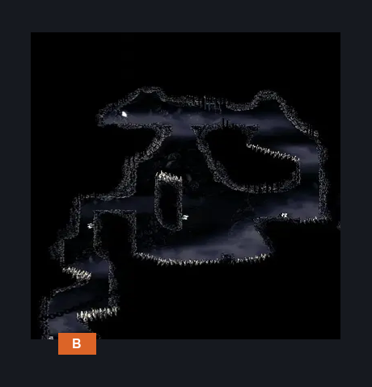
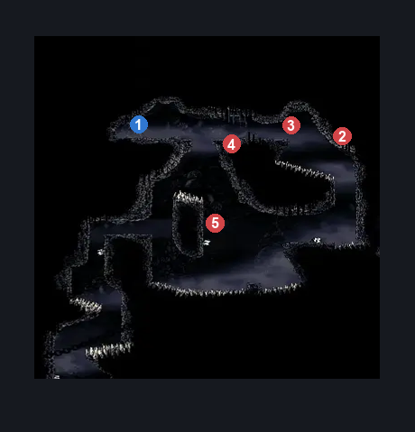
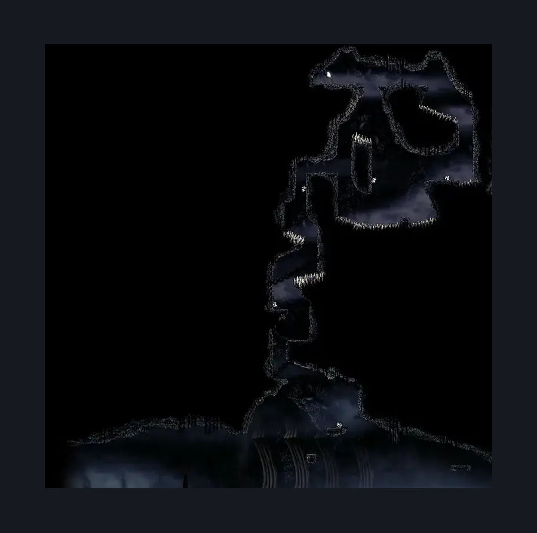

# Blasted Steps Mask Shard (Coral_19b)

**Game ID:** Coral_19b

**Contributors:** skai, MayaXTG

## Subrooms

| No. | Subroom | Annotated |
| --- | --- | --- |
| S1 | Entrance | ✓ |
| S2 | Pharlid1 | ✓ |
| S3 | Pharlid2 | ✓ |
| S4 | Pharlid4 | ✓ |
| S5 | MaskShard | ✓ |

## Room Transitions

| Alias | Name | From subroom | Destination | Destination alias | Requirements | TODO | Verification | Annotated | Notes |
| --- | --- | --- | --- | --- | --- | --- | --- | --- | --- |
| B | Bottom | Entrance | [Blasted Steps Map Edge (Coral_19)](blasted-steps-map-edge.md) | TL | Nothing |  | Verified |  |  |

## Subroom Connections

| Alias | Name | Source | Destination | Requirements | TODO | Verification | Annotated | Notes |
| --- | --- | --- | --- | --- | --- | --- | --- | --- |
| EP1 | EntrancePharlid1 | Entrance | Pharlid1 | silk soar OR faydown cloak OR cling grip right OR (medium shaman pogo AND ledge grab left) |  | Verified | ✓ |  |
| EP1 | EntrancePharlid1 | Pharlid1 | Entrance | Nothing (Fall) |  | Verified | ✓ |  |
| P12 | Pharlid1to2 | Pharlid1 | Pharlid2 | cling grip right AND (easy shaman pogo OR medium beast pogo OR ((medium enemy pogo OR silk soar OR faydown cloak OR cling grip left) AND (spike pogo OR dash right OR clawline right x 1 OR sharpdart x 1))) |  | Verified | ✓ | include up slash to kill pharlid? |
| P12 | Pharlid1to2 | Pharlid2 | Pharlid1 | sharpdart x 1 OR clawline left x 1 OR dash left OR faydown cloak OR drifters cloak |  | Verified | ✓ |  |
| P24 | Pharlid2to4 | Pharlid2 | Pharlid4 | (ledge grab right AND faydown cloak AND (easy shaman pogo OR easy hunter pogo OR medium reaper pogo OR medium witch pogo OR hard beast pogo OR hard architect pogo OR hard wanderer pogo)) OR ((cling grip either OR (faydown cloak AND spike pogo)) AND (drifters cloak OR faydown cloak OR clawline right x 1 OR dash right OR sharpdart x 1)) |  | Verified | ✓ | crossing the spike pit is easier or harder with some crests (the platform in the map falls and is unreliable) |
| P24 | Pharlid2to4 | Pharlid4 | Pharlid2 | ((faydown cloak OR clawline left x 1 OR dash left OR sharpdart x 1) AND cling grip left (above)) OR (spike pogo AND scuttlebrace (below)) |  | Verified | ✓ |  |
| P4M | Pharlid4MaskShard | Pharlid4 | MaskShard | (cling grip right OR scuttlebrace) AND ((spike pogo OR dash left OR clawline left x 1 OR sharpdart x 1) AND (ledge grab left OR faydown cloak OR easy hazard respawn)) |  | Verified | ✓ |  |
| P4M | Pharlid4MaskShard | MaskShard | Pharlid4 | dash right OR drifter's cloak OR clawline right x 1 OR sharpdart x 1 OR faydown cloak OR spike pogo |  | Verified | ✓ |  |
| P2M | Pharlid2MaskSHard | MaskShard | Pharlid2 | spike pogo OR dash left OR clawline left x 1 OR sharpdart x 1 OR faydown cloak OR drifter's cloak |  | Verified | ✓ | falling |

## Check Locations

| No. | Check | Subroom | Requirements | TODO | Verification | Location Type | Annotated | Notes |
| --- | --- | --- | --- | --- | --- | --- | --- | --- |
| 1 | Mask Shard: Blasted Steps | MaskShard | Nothing |  | Verified | collectible | ✓ |  |
| 2 | Pharlid 1 | Pharlid4 | none |  | Verified | enemy | ✓ | The subroom doesn't match, I know, don't ask |
| 3 | Pharlid 2 | Pharlid4 | none |  | Verified | enemy | ✓ |  |
| 4 | Pharlid 3 | Pharlid2 | none |  | Verified | enemy | ✓ |  |
| 5 | Pharlid 4 | Pharlid1 | none |  | Verified | enemy | ✓ |  |

## Room Images

### Connections

### Checks

### Scene

