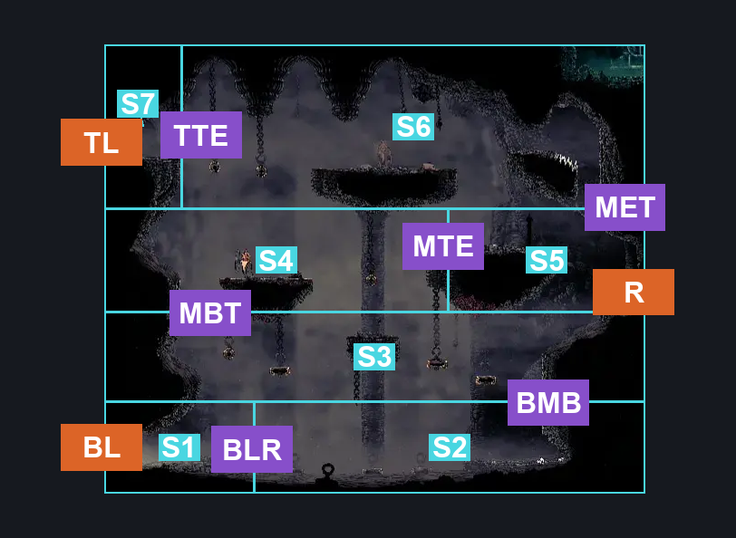
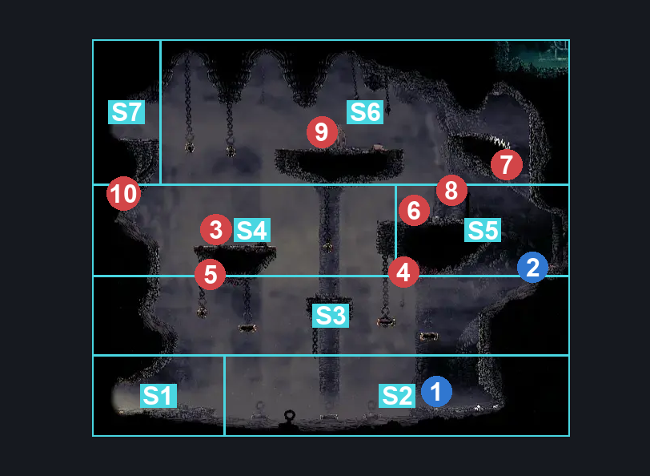
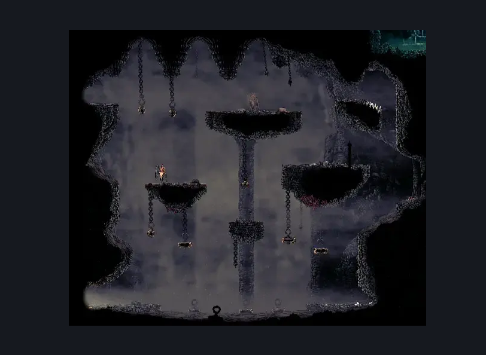

# Blasted Steps Shakra Room (Coral_12)

**Game ID:** Coral_12

**Contributors:** skai, MayaXTG

## Subrooms

| No. | Subroom | Annotated |
| --- | --- | --- |
| S1 | Bottom Third (Left) | ✓ |
| S2 | Bottom Third (Right) | ✓ |
| S3 | Middle Third (Bottom) | ✓ |
| S4 | Middle Third (Top) | ✓ |
| S5 | Middle Third (Entrance) | ✓ |
| S6 | Top Third | ✓ |
| S7 | Top Third (Entrance) | ✓ |

## Room Transitions

| Alias | Name | From subroom | Destination | Destination alias | Requirements | TODO | Verification | Annotated | Notes |
| --- | --- | --- | --- | --- | --- | --- | --- | --- | --- |
| BL | Bottom Left | Bottom Third (Left) | [Blasted Steps Wide Long Vertical (Coral_03)](blasted-steps-wide-long-vertical.md) | BR | Nothing |  | Verified | ✓ |  |
| R | Right | Middle Third (Entrance) | [Blasted Steps Steel Soul (Coral_37)](blasted-steps-steel-soul.md) | L | Nothing |  | Verified | ✓ |  |
| TL | Top Left | Top Third (Entrance) | [Blasted Steps Wide Long Vertical (Coral_03)](blasted-steps-wide-long-vertical.md) | MR | Nothing |  | Verified | ✓ |  |

## Subroom Connections

| Alias | Name | Source | Destination | Requirements | TODO | Verification | Annotated | Notes |
| --- | --- | --- | --- | --- | --- | --- | --- | --- |
| BLR | Bottom Third Left to Right | Bottom Third (Left) | Bottom Third (Right) | run OR Faydown OR Clawline right x 1 OR Flea Brew OR Sharpdart x 1 OR Easy Beast Crest Pogo OR easy beast needle strike OR drifter's cloak |  | Verified | ✓ | You can glide across with the wind |
| BLR | Bottom Third Left to Right | Bottom Third (Right) | Bottom Third (Left) | run OR Faydown OR Clawline left x 1 OR Flea Brew OR Sharpdart x 1 OR Easy Beast Crest Pogo OR easy beast needle strike |  | Verified | ✓ |  |
| BMB | Bottom to Middle Bottom | Bottom Third (Right) | Middle Third (Bottom) | Cling Grip right OR Scuttlebrace OR Silk Soar |  | Verified | ✓ |  |
| BMB | Bottom to Middle Bottom | Middle Third (Bottom) | Bottom Third (Right) | Nothing (Falling) |  | Verified | ✓ |  |
| MBT | Middle Bottom to Middle Top | Middle Third (Bottom) | Middle Third (Top) | ((dash left OR Faydown OR Clawline left x 1 OR Sharpdart OR ledge grab left) AND Cling Grip left) OR ((Hard Scuttlebrace AND Ledge Grab left) OR (Medium Scuttlebrace AND (Flea Brew OR Faydown OR Clawline left x 1) AND Ledge Grab left)) OR Silk Soar |  | Verified | ✓ | I feel like I'm deciphering runes - Maya |
| MBT | Middle Bottom to Middle Top | Middle Third (Top) | Middle Third (Bottom) | Nothing (Falling) |  | Verified | ✓ |  |
| MTE | Middle Top to Middle Entrance | Middle Third (Top) | Middle Third (Entrance) | Clawline right x 1 OR Faydown OR Scuttlebrace OR Cling Grip right OR Silk Soar OR Sharpdart OR ((Drifter's OR (dash right AND Flea Brew) OR (Flea Brew AND Medium Flea Brew Stall)) AND Ledge Grab right) |  | Verified | ✓ |  |
| MTE | Middle Top to Middle Entrance | Middle Third (Entrance) | Middle Third (Top) | dash left OR Faydown OR Clawline left x 1 OR  Sharpdart OR (Flea Brew AND Easy Flea Brew Stall) |  | Verified | ✓ |  |
| MET | Middle Entrance to Top | Middle Third (Entrance) | Top Third | Cling Grip right OR Silk Soar OR (Scuttlebrace AND Spike Pogo) OR (Faydown AND Easy Enemy Pogo) |  | Verified | ✓ |  |
| MET | Middle Entrance to Top | Top Third | Middle Third (Entrance) | Nothing (Falling) |  | Verified | ✓ |  |
| TTE | Top to Top Entrance | Top Third | Top Third (Entrance) | Nothing |  | Verified | ✓ |  |
| TTE | Top to Top Entrance | Top Third (Entrance) | Top Third | dash left OR Faydown OR Clawline left x 1 OR Sharpdart OR Flea Brew |  | Verified | ✓ |  |

## Check Locations

| No. | Check | Subroom | Requirements | TODO | Verification | Location Type | Annotated | Notes |
| --- | --- | --- | --- | --- | --- | --- | --- | --- |
| 1 | Map Purchase: Blasted Steps | Bottom Third (Right) | none |  | Verified | collectible | ✓ | This can be purchased at Bellhart if Shakra has moved. |
| 2 | Blasted Steps: Rosary Cache Above Shakra | Middle Third (Entrance) | none |  | Verified | collectible | ✓ | This may need moving |
| 3 | Judge 1 | Middle Third (Top) | none |  | Verified | enemy | ✓ |  |
| 4 | Driznit 1 | Middle Third (Bottom) | none |  | Verified | enemy | ✓ | Technically inside Entrance but can be reached in Bottom |
| 5 | Driznit 2 | Middle Third (Top) | none |  | Verified | enemy | ✓ |  |
| 6 | Pilgrim Hiker 1 | Middle Third (Entrance) | none |  | Verified | enemy | ✓ |  |
| 7 | Pharlid 1 | Top Third | none |  | Verified | enemy | ✓ |  |
| 8 | Winged Pilgrim Bellbearer 1 | Middle Third (Entrance) | none |  | Verified | enemy | ✓ |  |
| 9 | Judge 2 | Top Third | none |  | Verified | enemy | ✓ | Gets replaced with a void variant in act 3 |
| 10 | Void Mass 1 | Middle Third (Top) | Act 3 |  | Verified | enemy | ✓ |  |

## Room Images

### Connections

### Checks

### Scene

