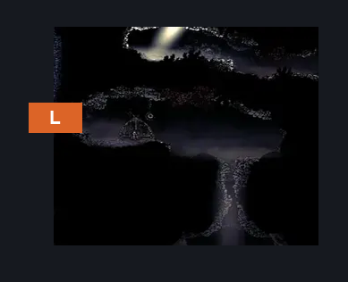
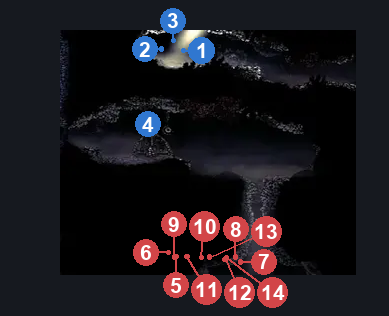
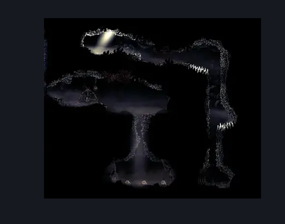

# Blasted Steps Shell / Beast Shard (Coral_36)

**Game ID:** Coral_36

**Contributors:** skai, MayaXTG

## Subrooms

| No. | Subroom | Annotated |
| --- | --- | --- |
| S1 | Lore | ✓ |
| S2 | Squirms | ✓ |
| S3 | Beast | ✓ |

## Room Transitions

| Alias | Name | From subroom | Destination | Destination alias | Requirements | TODO | Verification | Annotated | Notes |
| --- | --- | --- | --- | --- | --- | --- | --- | --- | --- |
| L | Left | Lore | [Blasted Steps Thin Long Vertical (Coral_35)](blasted-steps-thin-long-vertical.md) | MR | Nothing |  | Verified | ✓ |  |

## Subroom Connections

| Alias | Name | Source | Destination | Requirements | TODO | Verification | Annotated | Notes |
| --- | --- | --- | --- | --- | --- | --- | --- | --- |
| LS | LoreSquirm | Lore | Squirms | None (falling) |  | Verified | ✓ |  |
| LS | LoreSquirm | Squirms | Lore | silk soar |  | Verified | ✓ | cannot cling to wall |
| SB | SquirmBeast | Squirms | Beast | (silk soar OR cling grip left OR (faydown cloak AND (scuttlebrace OR (cling grip right AND spike pogo)))) AND (clawline left x 1 OR dash left OR spike pogo OR sharpdart x 1 OR faydown cloak) |  | Verified | ✓ |  |
| SB | SquirmBeast | Beast | Squirms | None (falling) |  | Verified | ✓ |  |
| BL | BeastLore | Beast | Lore | None (falling) |  | Verified | ✓ | one-way fall (cannot silk soar) |

## Check Locations

| No. | Check | Subroom | Requirements | TODO | Verification | Location Type | Annotated | Notes |
| --- | --- | --- | --- | --- | --- | --- | --- | --- |
| 1 | Shell Shard Cache: Blasted Steps #4 | Beast | none |  | Verified | collectible | ✓ |  |
| 2 | Shell Shard Cache: Blasted Steps #5 | Beast | none |  | Verified | collectible | ✓ |  |
| 3 | Blasted Steps - Judge Nursery Record | Lore | Nothing |  | Verified | lore | ✓ |  |
| 4 | Blasted Steps: Beast Shard | Beast | none |  | Verified | collectible | ✓ |  |
| 5 | Squirrm 1 | Squirms | invalid |  | Verified | enemy | ✓ | cannot be killed |
| 6 | Squirrm 2 | Squirms | needolin AND (silkspear OR sharpdart OR thread storm OR get 4 needle upgrades) |  | Verified | enemy | ✓ | you need at least 2 silk for needolin, then more for skills if necessary |
| 7 | Squirrm 3 | Squirms | invalid |  | Verified | enemy | ✓ | cannot be killed |
| 8 | Squirrm 4 | Squirms | needolin AND (silkspear OR sharpdart OR thread storm OR get 4 needle upgrades) |  | Verified | enemy | ✓ |  |
| 9 | Squirrm 5 | Squirms | needolin AND (silkspear OR sharpdart OR thread storm OR get 4 needle upgrades) |  | Verified | enemy | ✓ |  |
| 10 | Squirrm 6 | Squirms | invalid |  | Verified | enemy | ✓ | cannot be killed |
| 11 | Squirrm 7 | Squirms | needolin AND (silkspear OR sharpdart OR thread storm OR get 4 needle upgrades) |  | Verified | enemy | ✓ |  |
| 12 | Squirrm 8 | Squirms | invalid |  | Verified | enemy | ✓ | cannot be killed |
| 13 | Squirrm 9 | Squirms | needolin AND (silkspear OR sharpdart OR thread storm OR get 4 needle upgrades) |  | Verified | enemy | ✓ |  |
| 14 | Squirrm 10 | Squirms | invalid |  | Verified | enemy | ✓ | cannot be killed |

## Room Images

### Connections

### Checks

### Scene

