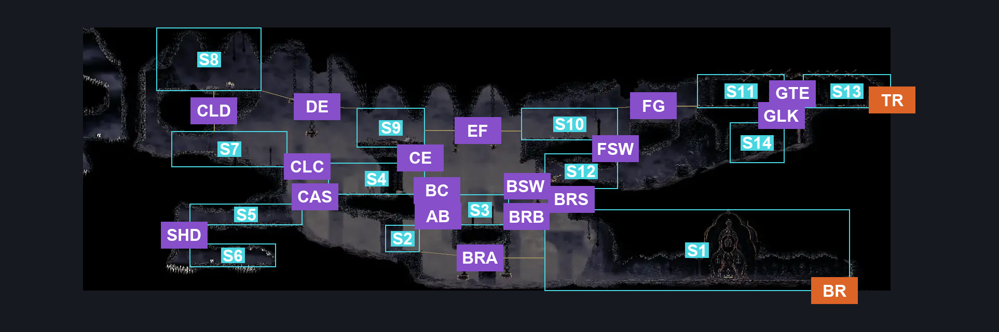
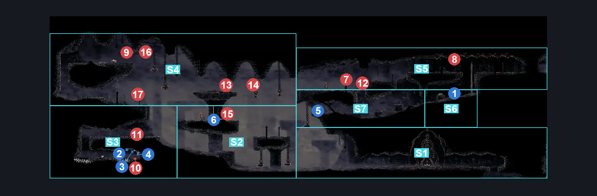
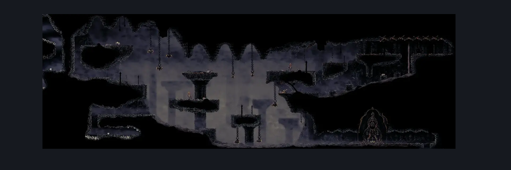

# Blasted Steps Toll Bench Bottom (Coral_02)

**Game ID:** Coral_02

**Contributors:** skai, MayaXTG

## Subrooms

| No. | Subroom | Annotated |
| --- | --- | --- |
| S1 | Bottom Right | ✓ |
| S2 | Platform A | ✓ |
| S3 | Platform B | ✓ |
| S4 | Platform C | ✓ |
| S5 | Above Shell Shards | ✓ |
| S6 | Shell Shards | ✓ |
| S7 | Left Corner | ✓ |
| S8 | Platform D | ✓ |
| S9 | Platform E | ✓ |
| S10 | Platform F | ✓ |
| S11 | Platform G | ✓ |
| S12 | Switch | ✓ |
| S13 | Top Entrance | ✓ |
| S14 | Locket | ✓ |

## Room Transitions

| Alias | Name | From subroom | Destination | Destination alias | Requirements | TODO | Verification | Annotated | Notes |
| --- | --- | --- | --- | --- | --- | --- | --- | --- | --- |
| BR | Bottom Right | Bottom Right | [Blasted Steps Map Edge (Coral_19)](blasted-steps-map-edge.md) | TM | Nothing |  | Verified | ✓ |  |
| TR | Top Right | Top Entrance | [Blasted Steps Wide Long Vertical (Coral_03)](blasted-steps-wide-long-vertical.md) | BL | Nothing |  | Verified | ✓ |  |

## Subroom Connections

| Alias | Name | Source | Destination | Requirements | TODO | Verification | Annotated | Notes |
| --- | --- | --- | --- | --- | --- | --- | --- | --- |
| BRA | BottomRightA | Bottom Right | Platform A | (clawline left AND (ledge grab left OR cling grip left)) OR (((flea brew AND ledge grab left) OR run OR dash left OR sharpdart x 3 OR easy beast needle strike OR hard beast pogo) AND cling grip left) OR faydown cloak |  | Verified | ✓ |  |
| BRA | BottomRightA | Platform A | Bottom Right | flea brew OR drifter's cloak OR faydown cloak OR run OR dash right |  | Verified | ✓ |  |
| AB | PlatformAtoB | Platform A | Platform B | scuttlebrace OR faydown cloak OR ((flea brew OR run OR dash left OR medium heal stall OR easy reaper needle strike OR clawline right OR sharpdart x 1) AND cling grip right) |  | Verified | ✓ |  |
| AB | PlatformAtoB | Platform B | Platform A | None (falling) |  | Verified | ✓ |  |
| BRB | BottomRightB | Bottom Right | Platform B | silk soar AND (faydown cloak OR (drifter's cloak AND (ledge grab left OR cling grip left)) OR dash left OR clawline left OR sharpdart x 1 OR prereq Top Right Pit Lever) |  | Verified | ✓ |  |
| BRB | BottomRightB | Platform B | Bottom Right | None (falling) |  | Verified | ✓ |  |
| BC | PlatformBtoC | Platform B | Platform C | faydown cloak OR cling grip left OR scuttlebrace OR silk soar |  | Verified | ✓ |  |
| BC | PlatformBtoC | Platform C | Platform B | None (falling) |  | Verified | ✓ |  |
| CAS | PlatformCShellShards | Platform C | Above Shell Shards | None (falling) |  | Verified | ✓ |  |
| CAS | PlatformCShellShards | Above Shell Shards | Platform C | (cling grip left AND (flea brew OR run OR clawline right OR sharpdart x 1 OR drifter's cloak)) OR faydown cloak OR hard scuttlebrace OR (medium scuttlebrace AND (flea brew OR run)) |  | Verified | ✓ |  |
| SHD | ShellShards | Above Shell Shards | Shell Shards | None (falling) |  | Verified | ✓ |  |
| SHD | ShellShards | Shell Shards | Above Shell Shards | cling grip either OR easy scuttlebrace |  | Verified | ✓ |  |
| CLC | PlatformCLeftCorner | Platform C | Left Corner | silk soar OR (cling grip left AND (faydown cloak OR drifter's cloak OR sharpdart x 1 OR clawline left OR run OR (flea brew AND medium heal stall))) |  | Verified | ✓ |  |
| CLC | PlatformCLeftCorner | Left Corner | Platform C | run OR flea brew OR faydown cloak OR silk soar OR drifter's cloak OR clawline right OR sharpdart x 1 OR easy scuttlebrace OR easy [beast, wanderer, witch, architect, reaper] needle strike OR easy [beast, hunter] pogo OR medium [heal, flintslate, flea brew, plasmium, voltvessels, thread storm, rune rage, pale nails, parry] stall OR ((easy [heal, flintslate, flea brew, plasmium, voltvessels, thread storm, rune rage, pale nails, parry] stall OR medium shaman needle strike OR easy reaper pogo) AND (ledge grab right OR cling grip right)) OR ((architect needle right OR medium [architect, witch] pogo OR hard shaman pogo) AND cling grip right) |  | Verified | ✓ |  |
| CLD | PlatformDLeftCorner | Left Corner | Platform D | (cling grip left AND (clawline left OR sharpdart x 1 OR faydown cloak)) OR (faydown cloak AND cling grip right) OR easy scuttlebrace |  | Verified | ✓ |  |
| CLD | PlatformDLeftCorner | Platform D | Left Corner | None (falling) |  | Verified | ✓ |  |
| DE | PlatformDtoE | Platform D | Platform E | None |  | Verified | ✓ |  |
| DE | PlatformDtoE | Platform E | Platform D | faydown cloak OR (((easy [heal, flea brew, thread storm, rune rage, pale nails, parry] stall AND flea brew AND ledge grab left) OR run) AND ledge grab right) OR (silk soar AND (run OR clawline left OR sharpdart x 1 OR flea brew OR (ledge grab left AND (cling grip left OR easy [heal, flintslate, flea brew, plasmium, voltvessels, thread storm, rune rage, pale nails, parry] stall)))) |  | Verified | ✓ |  |
| EF | PlatformEtoF | Platform E | Platform F | medium shaman pogo OR dash right OR faydown cloak OR drifter's cloak OR clawline right |  | Verified | ✓ | This might be improveable? |
| EF | PlatformEtoF | Platform F | Platform E | medium shaman pogo OR dash left OR faydown cloak OR drifter's cloak OR clawline left |  | Verified | ✓ |  |
| CE | PlatformCtoE | Platform C | Platform E | silk soar |  | Verified | ✓ |  |
| CE | PlatformCtoE | Platform E | Platform C | None (falling) |  | Verified | ✓ |  |
| FG | PlatformFtoG | Platform F | Platform G | None |  | Verified | ✓ | You can just straight up walk and jump there |
| FG | PlatformFtoG | Platform G | Platform F | None |  | Verified | ✓ |  |
| GLK | PlatformGLocket | Platform G | Locket | None (Falling) |  | Verified | ✓ |  |
| GLK | PlatformGLocket | Locket | Platform G | cling grip right OR (faydown cloak AND (cling grip right OR ledge grab either)) OR easy scuttlebrace |  | Verified | ✓ |  |
| GTE | PlatformGTop | Platform G | Top Entrance | None |  | Verified | ✓ |  |
| GTE | PlatformGTop | Top Entrance | Platform G | None |  | Verified | ✓ |  |
| FSW | PlatformFSwitch | Platform F | Switch | None (Falling) |  | Verified | ✓ |  |
| FSW | PlatformFSwitch | Switch | Platform F | cling grip left OR (faydown cloak AND cling grip right) OR easy scuttlebrace |  | Verified | ✓ |  |
| BSW | PlatformBSwitch | Switch | Platform B | prereq Top Right Pit Lever OR run OR (proficient movement AND cling grip right) OR faydown cloak |  | Verified | ✓ |  |
| BSW | PlatformBSwitch | Platform B | Switch | (prereq Top Right Pit Lever AND (faydown cloak OR ledge grab right)) OR (faydown cloak AND cling grip right AND clawline right) |  | Verified | ✓ |  |
| BRS | BottomRightSwitch | Bottom Right | Switch | silk soar AND faydown cloak |  | Verified | ✓ |  |
| BRS | BottomRightSwitch | Switch | Bottom Right | None (falling) |  | Verified | ✓ |  |

## Check Locations

| No. | Check | Subroom | Requirements | TODO | Verification | Location Type | Annotated | Notes |
| --- | --- | --- | --- | --- | --- | --- | --- | --- |
| 1 | Memory Locket: Blasted Steps | Locket | None |  | Verified | collectible | ✓ |  |
| 2 | Shell Shard Cache: Blasted Steps #1 | Shell Shards | proficient movement OR spike pogo OR ledge grab right OR easy beast needle strike OR easy beast pogo OR clawline right x 1 OR sharpdart x 1 OR run OR flea brew OR faydown cloak OR drifter's cloak |  | Verified | collectible | ✓ |  |
| 3 | Shell Shard Cache: Blasted Steps #2 | Shell Shards | proficient movement OR spike pogo OR ledge grab right OR easy beast needle strike OR easy beast pogo OR clawline right x 1 OR sharpdart x 1 OR run OR flea brew OR faydown cloak OR drifter's cloak |  | Verified | collectible | ✓ |  |
| 4 | Shell Shard Cache: Blasted Steps #3 | Shell Shards | proficient movement OR spike pogo OR ledge grab right OR easy beast needle strike OR easy beast pogo OR clawline right x 1 OR sharpdart x 1 OR run OR flea brew OR faydown cloak OR drifter's cloak |  | Verified | collectible | ✓ |  |
| 5 | Top Right Pit Lever | Switch | None |  | Verified | switch | ✓ |  |
| 6 | Bench | Bottom Right | unlock bell_toll_machine |  | Verified | bench | ✓ |  |
| 7 | bell_toll_machine | Bottom Right | spend 60 rosaries |  | Verified | lock | ✓ |  |
| 8 | Garmond Act 3 Encounter | Platform C | Act 3 |  | Verified | event | ✓ |  |
| 9 | Judge 1 | Platform F | none |  | Verified | enemy | ✓ |  |
| 10 | Judge 2 | Platform G | none |  | Verified | enemy | ✓ |  |
| 11 | Pilgrim Bellbearer 1 | Platform D | none |  | Verified | enemy | ✓ |  |
| 12 | Pharlid 1 | Shell Shards | none |  | Verified | enemy | ✓ |  |
| 13 | Pharlid 2 | Above Shell Shards | none |  | Verified | enemy | ✓ |  |
| 14 | Pilgrim Pouncer 1 | Platform F | none |  | Verified | enemy | ✓ |  |
| 15 | Pilgrim Groveller 1 | Platform E | Normal World Spawn |  | Verified | enemy | ✓ |  |
| 16 | Pilgrim Pouncer 2 | Platform E | Normal World Spawn |  | Verified | enemy | ✓ |  |
| 17 | Judge 3 | Platform C | Normal World Spawn |  | Verified | enemy | ✓ |  |
| 18 | Pilgrim Hiker 1 | Platform D | Normal World Spawn |  | Verified | enemy | ✓ |  |
| 19 | Pilgrim Hiker 2 | Left Corner | Black Thread World Spawn |  | Verified | enemy | ✓ |  |

## Notes

https://discord.com/channels/522404910445232130/1539856853159387137/1563471501490004078
wind skip worth adding?

## Room Images

### Connections

### Checks

### Scene

