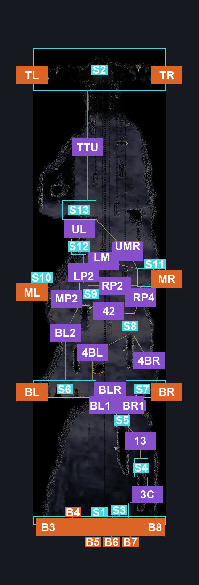
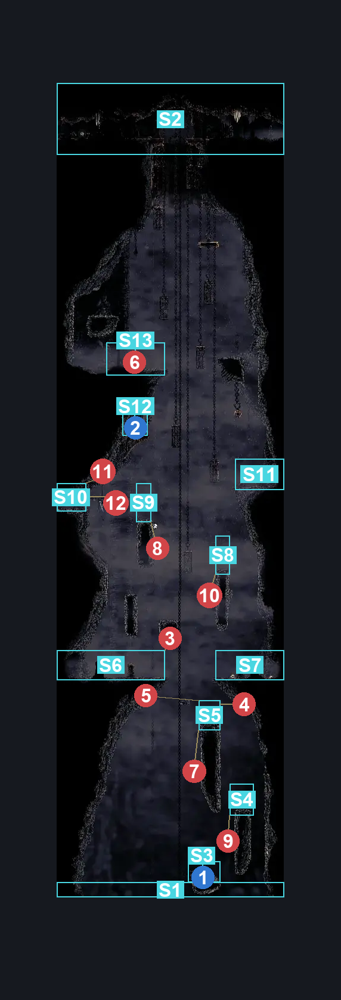
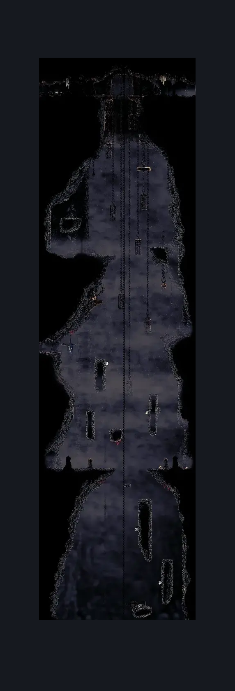

# Blasted Steps Wide Long Vertical (Coral_03)

**Game ID:** Coral_03

**Contributors:** skai, MayaXTG

## Subrooms

| No. | Subroom | Annotated |
| --- | --- | --- |
| S1 | Pit | ✓ |
| S2 | Top Third Entrances | ✓ |
| S3 | Broken Cage | ✓ |
| S4 | Pharlid 3 | ✓ |
| S5 | Pharlid 1 | ✓ |
| S6 | Bottom Left | ✓ |
| S7 | Bottom Right | ✓ |
| S8 | Pharlid 4 | ✓ |
| S9 | Pharlid 2 | ✓ |
| S10 | Middle Left | ✓ |
| S11 | Middle Right | ✓ |
| S12 | Lever | ✓ |
| S13 | Upper | ✓ |

## Room Transitions

| Alias | Name | From subroom | Destination | Destination alias | Requirements | TODO | Verification | Annotated | Notes |
| --- | --- | --- | --- | --- | --- | --- | --- | --- | --- |
| BL | Bottom Left | Bottom Left | [Blasted Steps Toll Bench Bottom (Coral_02)](blasted-steps-toll-bench-bottom.md) | TR | Nothing |  | Verified | ✓ |  |
| B3 | Bottom (3) | Pit | [Blasted Steps Map Edge (Coral_19)](blasted-steps-map-edge.md) | TR3 | Nothing |  | Verified | ✓ |  |
| B4 | Bottom (4) | Pit | [Blasted Steps Map Edge (Coral_19)](blasted-steps-map-edge.md) | TR4 | Nothing |  | Verified | ✓ |  |
| B5 | Bottom (5) | Pit | [Blasted Steps Map Edge (Coral_19)](blasted-steps-map-edge.md) | TR5 | Nothing |  | Verified | ✓ |  |
| B6 | Bottom (6) | Pit | [Blasted Steps Map Edge (Coral_19)](blasted-steps-map-edge.md) | TR6 | Nothing |  | Verified | ✓ |  |
| B7 | Bottom (7) | Pit | [Blasted Steps Map Edge (Coral_19)](blasted-steps-map-edge.md) | TR7 | Nothing |  | Verified | ✓ |  |
| B8 | Bottom (8) | Pit | [Blasted Steps Map Edge (Coral_19)](blasted-steps-map-edge.md) | TR8 | Nothing |  | Verified | ✓ |  |
| BR | Bottom Right | Bottom Right | [Blasted Steps Shakra Room (Coral_12)](blasted-steps-shakra-room.md) | BL | Nothing |  | Verified | ✓ |  |
| ML | Middle Left | Middle Left | [Great Conchflies (Coral_11)](great-conchflies.md) | R | Nothing |  | Verified | ✓ |  |
| MR | Middle Right | Middle Right | [Blasted Steps Shakra Room (Coral_12)](blasted-steps-shakra-room.md) | TL | Nothing |  | Verified | ✓ |  |
| TR | Top Right | Top Third Entrances | [Pre Last Judge Room (Coral_32)](pre-last-judge-room.md) | L | Nothing |  | Verified | ✓ |  |
| TL | Top Left | Top Third Entrances | [Blasted Steps Bellway (Bellway_08)](blasted-steps-bellway.md) | R | Nothing |  | Verified | ✓ |  |

## Subroom Connections

| Alias | Name | Source | Destination | Requirements | TODO | Verification | Annotated | Notes |
| --- | --- | --- | --- | --- | --- | --- | --- | --- |
| PIT | The Pit | Top Third Entrances | Pit | None |  | Verified |  |  |
| PIT | The Pit | Pit | Top Third Entrances | Silk Soar |  | Verified |  |  |
| TTU | TopUpper | Top Third Entrances | Upper | None |  | Verified | ✓ |  |
| TTU | TopUpper | Upper | Top Third Entrances | ((flea brew OR run OR clawline both) AND cling grip both) OR (faydown cloak AND cling grip right AND (cling grip left OR ledge grab left)) |  | Verified | ✓ |  |
| UL | UpperLever | Upper | Lever | None |  | Verified | ✓ |  |
| UMR | UpperMiddleRight | Upper | Middle Right | None |  | Verified | ✓ |  |
| UMR | UpperMiddleRight | Middle Right | Upper | (cling grip right AND (faydown cloak OR ((dash both OR clawline both OR sharpdart x 2) AND cling grip left))) OR silk soar | TODO | Verified | ✓ | Requirements are defined as if you do not hit the lever, requirements change if you do |
| LM | LeverMid | Lever | Middle Right | None | TODO | Verified | ✓ | Requirements are defined as if you do not hit the lever, requirements change if you do |
| LM | LeverMid | Middle Right | Lever | faydown cloak OR ((dash left OR clawline left OR sharpdart x 1) AND cling grip left) | TODO | Verified | ✓ | Requirements are defined as if you do not hit the lever, requirements change if you do |
| LP2 | LeverPharlid2 | Lever | Pharlid 2 | None (Fall) |  | Verified | ✓ | No definition for Upper as you can just drop straight to Lever and then to Pharlid 2 |
| LP2 | LeverPharlid2 | Pharlid 2 | Lever | Silk Soar |  | Verified | ✓ |  |
| MP2 | MiddlePharlid2 | Middle Left | Pharlid 2 | run OR clawline right OR sharpdart x 1 OR drifter's cloak OR faydown cloak OR ((cling grip left OR easy [heal, thread storm, parry, rune rage, pale nails, flea brew, plasmium, voltvessels, flintslate] stall OR easy [hunter, reaper, architect, witch] pogo OR easy [wanderer, reaper, witch, shaman] needle strike OR architect hit right) AND cling grip right) OR (flea brew AND (ledge grab right OR cling grip right)) OR hard pogo off [Driznit] OR easy [beast] pogo OR easy [beast, architect] needle strike |  | Verified | ✓ | Driznit pogo is labelled as hard because FUCK getting these guys to move into the correct position |
| MP2 | MiddlePharlid2 | Pharlid 2 | Middle Left | run OR clawline left OR sharpdart x 1 OR faydown cloak OR hard pogo off [Driznit] OR ((medium [voltvessels] stall OR hard [parry, pale nails] stall) AND cling grip left) OR ((hard [beast] pogo OR easy [beast] needle strike) AND (cling grip left OR ledge grab left)) | TODO | Verified | ✓ | You can rip 3 stalls in neutral to cross the gap Spell stalls need to be moved into CBT category |
| RP2 | MiddlePharlid2Right | Pharlid 2 | Middle Right | (clawline right OR (drifter's cloak AND dash right AND proficient movement)) AND (ledge grab right OR cling grip right) AND faydown cloak |  | Verified | ✓ | Has no reverse route since you can just drop to Pharlid 4 |
| RP4 | MiddlePharlid4Right | Middle Right | Pharlid 4 | None (Fall) |  | Verified | ✓ |  |
| RP4 | MiddlePharlid4Right | Pharlid 4 | Middle Right | Silk Soar |  | Verified | ✓ |  |
| 42 | Pharlid2to4 | Pharlid 4 | Pharlid 2 | (easy pogo off [Pharlid] AND (ledge grab left OR have: Crest: Shaman)) OR faydown cloak OR silk soar OR cling grip left |  | Verified | ✓ |  |
| 42 | Pharlid2to4 | Pharlid 2 | Pharlid 4 | None |  | Verified | ✓ |  |
| 4BL | Pharlid4BottomLeft | Pharlid 4 | Bottom Left | None (Fall) |  | Verified | ✓ |  |
| 4BR | Pharlid4BottomRight | Pharlid 4 | Bottom Right | None (Fall) |  | Verified | ✓ |  |
| 4BR | Pharlid4BottomRight | Bottom Right | Pharlid 4 | cling grip right OR silk soar |  | Verified | ✓ |  |
| BLR | BottomLeftRight | Bottom Left | Bottom Right | run OR clawline right OR sharpdart OR medium [voltvessels] stall OR easy [beast] pogo OR easy [beast, architect] needle strike OR drifter's cloak OR (flea brew AND (ledge grab right OR easy [hunter, architect, witch] pogo OR architect hit right)) OR hard [parry, pale nails] stall OR (flea brew AND easy [hunter] pogo) OR (proficient movement AND hard [hunter] pogo) OR medium scuttlebrace |  | Verified | ✓ |  |
| BLR | BottomLeftRight | Bottom Right | Bottom Left | run OR clawline left OR sharpdart OR medium [voltvessels] stall OR easy [beast] pogo OR easy [beast, architect] needle strike OR drifter's cloak OR (flea brew AND (ledge grab left OR easy [hunter, architect, witch] pogo OR architect hit left)) OR hard [parry, pale nails] stall OR (flea brew AND easy [hunter] pogo) OR (proficient movement AND hard [hunter] pogo) OR medium scuttlebrace |  | Verified | ✓ |  |
| BL2 | BottomLeftPharlid2 | Bottom Left | Pharlid 2 | Silk Soar |  | Verified | ✓ |  |
| BL2 | BottomLeftPharlid2 | Pharlid 2 | Bottom Left | None (Fall) |  | Verified | ✓ |  |
| BL1 | BottomLeftPharlid1 | Pharlid 1 | Bottom Left | ledge grab left OR faydown cloak OR silk soar |  | Verified | ✓ |  |
| BL1 | BottomLeftPharlid1 | Bottom Left | Pharlid 1 | None (Fall) |  | Verified | ✓ |  |
| BR1 | BottomRightPhrlid1 | Bottom Right | Pharlid 1 | None (Fall) |  | Verified | ✓ |  |
| 13 | Pharlid1to3 | Pharlid 1 | Pharlid 3 | None (Fall) |  | Verified | ✓ |  |
| 13 | Pharlid1to3 | Pharlid 3 | Pharlid 1 | easy scuttlebrace OR cling grip left OR silk soar |  | Verified | ✓ |  |
| 3C | 3Cage | Pharlid 3 | Broken Cage | None (Fall) |  | Verified | ✓ |  |
| 3C | 3Cage | Broken Cage | Pharlid 3 | cling grip right OR silk soar |  | Verified | ✓ |  |
| FIN | PitFinale | Broken Cage | Pit | None (Fall) |  | Verified |  |  |

## Check Locations

| No. | Check | Subroom | Requirements | TODO | Verification | Location Type | Annotated | Notes |
| --- | --- | --- | --- | --- | --- | --- | --- | --- |
| 1 | Frayed Rosary String: Blasted Steps | Broken Cage | None |  | Verified | collectible | ✓ |  |
| 2 | Top Third Lever | Lever | None |  | Verified | switch | ✓ |  |
| 3 | Driznit 1 | Bottom Left | None |  | Verified | enemy | ✓ |  |
| 4 | Driznit 2 | Pharlid 1 | None |  | Verified | enemy | ✓ |  |
| 5 | Driznit 3 | Pharlid 1 | None |  | Verified | enemy | ✓ |  |
| 6 | Pilgrim Hiker 1 | Upper | None |  | Verified | enemy | ✓ |  |
| 7 | Pharlid 1 | Pharlid 1 | None |  | Verified | enemy | ✓ |  |
| 8 | Pharlid 2 | Pharlid 2 | None |  | Verified | enemy | ✓ |  |
| 9 | Pharlid 3 | Pharlid 3 | None |  | Verified | enemy | ✓ |  |
| 10 | Pharlid 4 | Pharlid 4 | None |  | Verified | enemy | ✓ |  |
| 11 | Driznit 4 | Middle Left | Normal World Spawn |  | Verified | enemy | ✓ |  |
| 12 | Driznit 5 | Middle Left | Black Thread World Spawn |  | Verified | enemy | ✓ |  |

## Notes

todo: redo this room

## Room Images

### Connections

### Checks

### Scene

