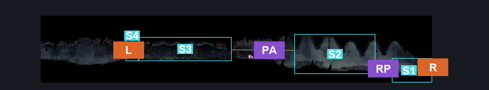
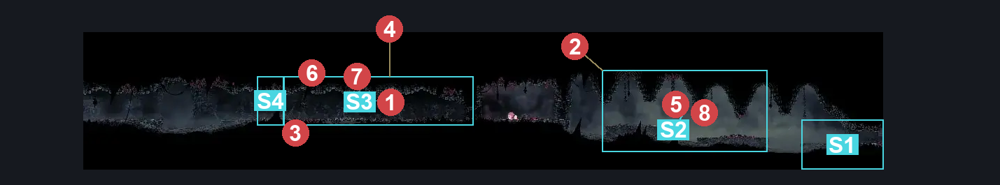
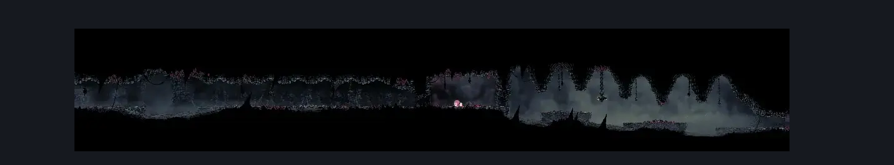

# Great Conchflies (Coral_11)

**Game ID:** Coral_11

**Contributors:** skai, MayaXTG

## Subrooms

| No. | Subroom | Annotated |
| --- | --- | --- |
| S1 | Right | ✓ |
| S2 | Platforms | ✓ |
| S3 | Arena | ✓ |
| S4 | LeftDoor | ✓ |

## Room Transitions

| Alias | Name | From subroom | Destination | Destination alias | Requirements | TODO | Verification | Annotated | Notes |
| --- | --- | --- | --- | --- | --- | --- | --- | --- | --- |
| R | Right | Right | [Blasted Steps Wide Long Vertical (Coral_03)](blasted-steps-wide-long-vertical.md) | ML | Nothing |  | Verified | ✓ |  |
| L | Left | LeftDoor | [Horizontal Room with Sand Pit (Coral_11b)](horizontal-room-with-sand-pit.md) | R | Nothing |  | Verified | ✓ |  |

## Subroom Connections

| Alias | Name | Source | Destination | Requirements | TODO | Verification | Annotated | Notes |
| --- | --- | --- | --- | --- | --- | --- | --- | --- |
| RP | RightPlatforms | Right | Platforms | run OR ((dash left OR flea brew) AND ledge grab left) OR faydown cloak OR clawline left x 1 OR sharpdart x 1 OR medium enemy pogo |  | Verified | ✓ |  |
| RP | RightPlatforms | Platforms | Right | dash right OR faydown cloak OR clawline right x 1 OR sharpdart x 1 OR medium enemy pogo |  | Verified | ✓ |  |
| PA | PlatformsArena | Platforms | Arena | run OR dash left OR faydown cloak OR clawline left x 1 OR sharpdart x 1 OR medium enemy pogo |  | Verified | ✓ |  |
| PA | PlatformsArena | Arena | Platforms | (run OR dash right OR faydown cloak OR clawline right x 1 OR sharpdart x 1) AND defeat Boss: Great Conchflies |  | Verified | ✓ |  |
| LA | LeftArena | LeftDoor | Arena | Nothing |  | Verified |  |  |
| LA | LeftArena | Arena | LeftDoor | defeat Boss: Great Conchflies |  | Verified |  |  |

## Check Locations

| No. | Check | Subroom | Requirements | TODO | Verification | Location Type | Annotated | Notes |
| --- | --- | --- | --- | --- | --- | --- | --- | --- |
| 1 | Boss: Great Conchflies | Arena | defeat Coral Conch Driller Giant 1 AND Combat Requirements |  | Verified | boss | ✓ |  |
| 2 | Driznit 1 | Platforms | ledge grab right OR faydown cloak OR medium enemy pogo OR silk soar |  | Verified | enemy | ✓ | upper ceiling spawn |
| 3 | Coral Conch Driller Giant 1 | Arena | act 1 OR act 2 |  | Verified | enemy | ✓ |  |
| 4 | Coral Conch Driller Giant 2 | Arena | act 1 OR act 2 |  | Verified | enemy | ✓ |  |
| 5 | Driznit 2 | Platforms | act 1 OR act 2 |  | Verified | enemy | ✓ |  |
| 6 | Void Mass 1 | Arena | act 3 |  | Verified | enemy | ✓ |  |
| 7 | Driznarga 1 | Arena | invalid |  | Verified | enemy | ✓ | despawns after defeating the void mass |
| 8 | Driznit 3 | Platforms | act 3 |  | Verified | enemy | ✓ |  |

## Room Images

### Connections

### Checks

### Scene

