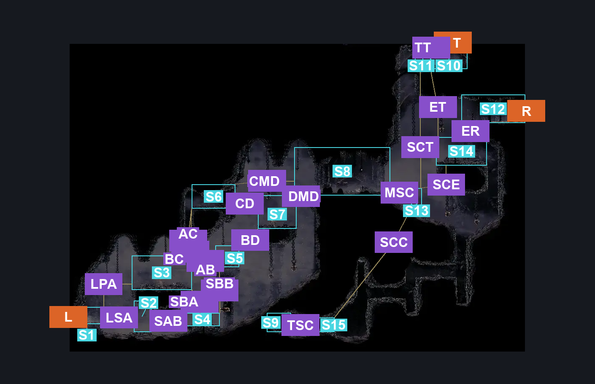
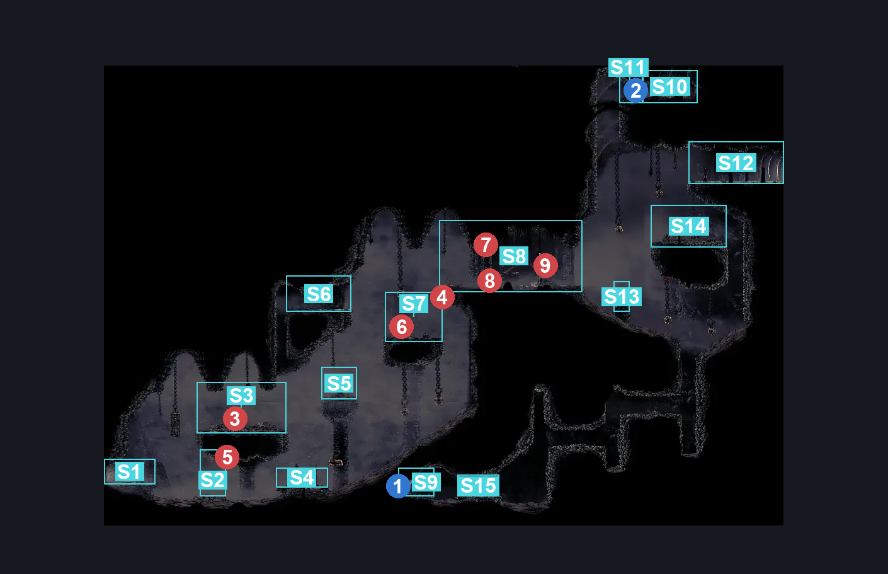
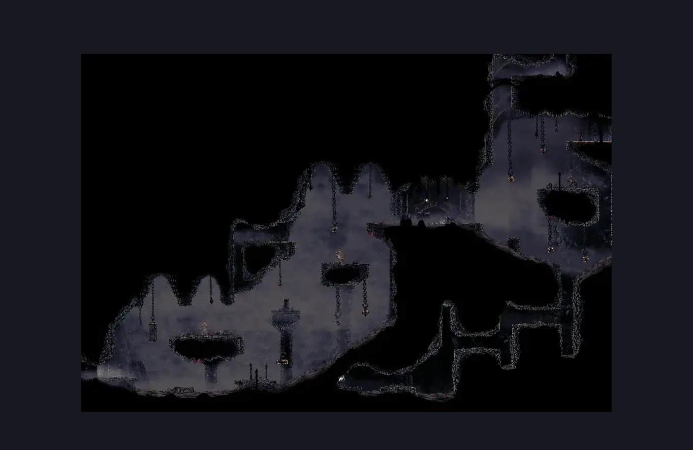

# Pre Last Judge Room (Coral_32)

**Game ID:** Coral_32

**Contributors:** skai, MayaXTG

## Subrooms

| No. | Subroom | Annotated |
| --- | --- | --- |
| S1 | Left Entrance | ✓ |
| S2 | SubPlatA | ✓ |
| S3 | Platform A | ✓ |
| S4 | SubPlatB | ✓ |
| S5 | Platform B | ✓ |
| S6 | Platform C | ✓ |
| S7 | Platform D | ✓ |
| S8 | Mid | ✓ |
| S9 | Craftmetal | ✓ |
| S10 | Top Entrance | ✓ |
| S11 | Top | ✓ |
| S12 | Right Entrance | ✓ |
| S13 | SubPlatC | ✓ |
| S14 | Platform E | ✓ |
| S15 | ThisShit | ✓ |

## Room Transitions

| Alias | Name | From subroom | Destination | Destination alias | Requirements | TODO | Verification | Annotated | Notes |
| --- | --- | --- | --- | --- | --- | --- | --- | --- | --- |
| L | Left | Left Entrance | [Blasted Steps Wide Long Vertical (Coral_03)](blasted-steps-wide-long-vertical.md) | TR | Nothing |  | Verified | ✓ |  |
| T | Top | Top Entrance | [Sands of Karak Elevator to Blasted Steps (Coral_38)](../sands-of-karak/sands-of-karak-elevator-to-blasted-steps.md) | F | Nothing |  | Verified | ✓ | Have to come from Coral_38 side |
| R | Right | Right Entrance | [Last Judge Arena (Coral_Judge_Arena)](last-judge-arena.md) | L | Nothing |  | Verified | ✓ |  |

## Subroom Connections

| Alias | Name | Source | Destination | Requirements | TODO | Verification | Annotated | Notes |
| --- | --- | --- | --- | --- | --- | --- | --- | --- |
| LSA | LeftSubPlatA | Left Entrance | SubPlatA | easy [hunter, beast] pogo OR run OR sharpdart x 1 OR medium [architect] pogo OR clawline right OR faydown cloak OR easy [plasmium, voltvessels, flea brew] stall OR easy [wanderer, beast, architect, witch] needle strike OR sharpdart x 1 OR flea brew OR drifter's cloak OR architect needle right OR easy scuttlebrace |  | Verified | ✓ |  |
| LSA | LeftSubPlatA | SubPlatA | Left Entrance | run OR clawline left OR faydown cloak OR easy [beast] needle strike OR ((easy [beast] pogo OR medium [architect] needle strike) AND ledge grab left) |  | Verified | ✓ |  |
| LPA | LeftPlatformA | Left Entrance | Platform A | (faydown cloak AND (cling grip left OR (easy scuttlebrace AND clawline right AND cling grip right))) OR silk soar |  | Verified | ✓ |  |
| LPA | LeftPlatformA | Platform A | Left Entrance | None |  | Verified | ✓ |  |
| SAB | SubPlatAtoB | SubPlatA | SubPlatB | run OR clawline right OR faydown cloak OR easy [beast] needle strike OR easy [beast] pogo OR (hard scuttlebrace AND (hard hazard respawn OR proficient movement)) OR (flea brew AND (medium scuttlebrace OR (easy [heal, thread storm, cross stitch, rune rage, pale nails, flea brew] stall AND ledge grab right))) OR sharpdart x 1 |  | Verified | ✓ |  |
| SAB | SubPlatAtoB | SubPlatB | SubPlatA | medium scuttlebrace OR run OR clawline left OR sharpdart x 1 OR (flea brew AND (medium [heal, thread storm, cross stitch, rune rage, pale nails, flea brew] stall OR medium [wanderer] needle strike OR easy [hunter] pogo)) OR easy [plasmium] stall OR easy [beast, architect] needle strike OR easy [beast] pogo |  | Verified | ✓ | plasmium stall does not need tool pouch upgrades to cross gap |
| SBA | SubPlatBtoPlatA | SubPlatB | Platform A | faydown cloak OR silk soar OR ((ledge grab right OR easy [shaman] pogo) AND (((run OR easy [beast] needle strike OR flea brew OR easy [plasmium, flintslate, flea brew, voltvessels, cross stitch, pale nails] stall) AND cling grip left) OR medium scuttlebrace OR (sharpdart x 1 AND (ledge grab left OR cling grip left)))) |  | Verified | ✓ | voltvessels and flea brew require 2 uses, other tool stall requires 3 uses, parry stall requires 2 uses |
| SBA | SubPlatBtoPlatA | Platform A | SubPlatB | None (fall) |  | Verified | ✓ |  |
| AB | PlatformAtoB | Platform A | Platform B | faydown cloak OR ((medium [heal, rune rage, thread storm, parry, pale nails, flintslate] stall OR easy [voltvessels, flea brew, plasmium] stall OR easy [beast, architect] needle strike OR sharpdart x 1 OR clawline right OR run OR flea brew OR (proficient movement AND architect hit right)) AND cling grip right) OR easy scuttlebrace |  | Verified | ✓ | I chose proficient architect hit right because it's a bit difficult for the average player, even though it might be pretty easy to us (and I can't specify difficulty for needle strikes) |
| AB | PlatformAtoB | Platform B | Platform A | None (Fall) |  | Verified | ✓ |  |
| SBB | SubPlatBtoPlatB | SubPlatB | Platform B | silk soar |  | Verified | ✓ |  |
| SBB | SubPlatBtoPlatB | Platform B | SubPlatB | None (fall) |  | Verified | ✓ |  |
| AC | PlatformAtoC | Platform A | Platform C | silk soar |  | Verified | ✓ |  |
| AC | PlatformAtoC | Platform C | Platform A | None (Fall) |  | Verified | ✓ |  |
| BC | PlatformBtoC | Platform B | Platform C | (easy scuttlebrace AND (faydown cloak OR clawline right OR run OR easy [plasmium] stall OR medium [heal] stall)) OR (cling grip left AND (faydown cloak OR run OR clawline right OR easy [plasmium] stall)) |  | Verified | ✓ |  |
| BC | PlatformBtoC | Platform C | Platform B | None (Fall) |  | Verified | ✓ |  |
| BD | PlatformBtoD | Platform B | Platform D | silk soar OR (faydown cloak AND (cling grip right OR easy scuttlebrace)) |  | Verified | ✓ |  |
| BD | PlatformBtoD | Platform D | Platform B | None (Fall) |  | Verified | ✓ |  |
| CD | PlatformCtoD | Platform C | Platform D | None (Jump) |  | Verified | ✓ |  |
| CD | PlatformCtoD | Platform D | Platform C | faydown cloak OR ((clawline left OR run OR silk soar) AND (ledge grab left OR cling grip left)) |  | Verified | ✓ |  |
| CMD | PlatformCMid | Platform C | Mid | dash right OR clawline right x 2 OR faydown cloak OR sharpdart x 2 |  | Verified | ✓ |  |
| DMD | PlatformDMid | Platform D | Mid | faydown cloak OR silk soar |  | Verified | ✓ |  |
| DMD | PlatformDMid | Mid | Platform D | None (Fall) |  | Verified | ✓ |  |
| MSC | MidSubPlatC | Mid | SubPlatC | None (Fall) |  | Verified | ✓ |  |
| MSC | MidSubPlatC | SubPlatC | Mid | run OR easy scuttlebrace OR faydown cloak OR clawline left OR sharpdart OR silk soar OR flea brew OR ((ledge grab left OR cling grip left) AND (proficient movement OR (needolin AND elite ball knowledge) OR easy [heal, thread storm, parry, rune rage, pale nails, flea brew, flintslate, plasmium] stall OR easy [reaper] needle strike OR architect hit left)) OR easy [voltvessels] stall OR easy [wanderer, beast, architect] needle strike OR medium beast pogo OR (cling grip left AND (easy [shaman] needle strike OR easy [hunter] pogo)) |  | Verified | ✓ | Thus marks the beginning of my insanity |
| SCC | SubPlatCCraftmetal | SubPlatC | ThisShit | (run AND (ledge grab left OR easy [heal, thread storm, parry, rune rage, pale nails, plasmium, voltvessels, flintslate, flea brew] stall OR easy [hunter, shaman] pogo OR easy [wanderer, reaper, witch] needle strike)) OR dash left OR clawline left OR faydown cloak OR drifter's cloak OR sharpdart OR easy [beast] pogo OR easy scuttlebrace OR easy [beast, architect] needle strike |  | Verified | ✓ |  |
| SCC | SubPlatCCraftmetal | ThisShit | SubPlatC | run AND cling grip right AND faydown cloak |  | Verified | ✓ |  |
| TSC | FuckassPlatform | ThisShit | Craftmetal | None (jump) |  | Verified | ✓ | You can jump right over |
| TSC | FuckassPlatform | Craftmetal | ThisShit | ledge grab right OR easy [heal, thread storm, parry, rune rage, pale nails, plasmium, voltvessels, flintslate, flea brew] stall OR flea brew OR easy [hunter, reaper, beast, witch, shaman] pogo OR easy [wanderer, reaper, beast, architect, witch, shaman] needle strike OR sharpdart OR clawline right OR run OR architect hit right OR drifter's cloak OR faydown cloak |  | Verified | ✓ | You can NOT jump right over. fucking tc |
| SCE | SubPlatCtoPlatE | SubPlatC | Platform E | ((faydown cloak OR clawline right OR dash right OR sharpdart OR easy [heal, thread storm, parry, pale nails, flea brew, voltvessels, flintslate, plasmium] stall) AND cling grip right) OR silk soar |  | Verified | ✓ | I couldn't get rune rage to hit here |
| SCE | SubPlatCtoPlatE | Platform E | SubPlatC | None (Fall) |  | Verified | ✓ |  |
| ET | PlatformEtoTop | Platform E | Top | cling grip right OR medium scuttlebrace |  | Verified | ✓ |  |
| ET | PlatformEtoTop | Top | Platform E | dash right OR clawline right OR faydown cloak OR easy scuttlebrace OR sharpdart OR drifter's cloak OR easy [heal, thread storm, parry, rune rage, pale nails, plasmium, voltvessels, flintslate, flea brew] stall OR easy [hunter, beast, reaper, architect, witch, shaman] pogo OR easy [wanderer, reaper, beast, architect, witch, shaman] needle strike OR architect hit right |  | Verified | ✓ |  |
| SCT | SubPlatCtoTop | SubPlatC | Top | silk soar |  | Verified | ✓ |  |
| SCT | SubPlatCtoTOp | Top | SubPlatC | None (Fall) |  | Verified | ✓ |  |
| TT | TippityTop | Top | Top Entrance | clear Spiky Blockade |  | Verified | ✓ |  |
| TT | TippityTop | Top Entrance | Top | clear Spiky Blockade |  | Verified | ✓ |  |
| ER | PlatformERight | Platform E | Right Entrance | silk soar OR (cling grip right AND (clawline right OR drifter's cloak OR faydown cloak OR sharpdart OR dash right OR easy [beast] pogo)) |  | Verified | ✓ |  |
| ER | PlatformERight | Right Entrance | Platform E | None (Fall) |  | Verified | ✓ |  |

## Check Locations

| No. | Check | Subroom | Requirements | TODO | Verification | Location Type | Annotated | Notes |
| --- | --- | --- | --- | --- | --- | --- | --- | --- |
| 1 | Craftmetal: Blasted Steps | Craftmetal | None |  | Verified | collectible | ✓ |  |
| 2 | Spiky Blockade | Top Entrance | break wall left |  | Verified | blockade | ✓ |  |
| 3 | Judge 1 | Platform A | None |  | Verified | enemy | ✓ |  |
| 4 | Driznit 1 | Platform D | None |  | Verified | enemy | ✓ |  |
| 5 | Driznit 2 | SubPlatA | None |  | Verified | enemy | ✓ |  |
| 6 | Judge 2 | Platform D | Normal World Spawn |  | Verified | enemy | ✓ |  |
| 7 | Void Mass 1 | Mid | Black Thread World Spawn |  | Verified | enemy | ✓ |  |
| 8 | Pilgrim Hiker 1 | Mid | Black Thread World Spawn |  | Verified | enemy | ✓ |  |
| 9 | Winged Pilgrim 1 | Mid | Black Thread World Spawn |  | Verified | enemy | ✓ |  |

## Notes

todo: Rewrite this room

## Room Images

### Connections

### Checks

### Scene

