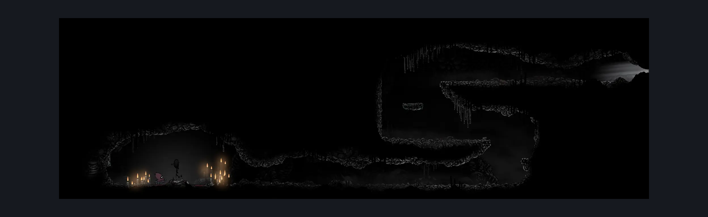

# Bonegrave Passage (Bone_Steel_Servant)

**Game ID:** Bone_Steel_Servant

**Contributors:** herounit

## Subrooms

No subrooms defined.

## Room Transitions

| Alias | Name | From subroom | Destination | Destination alias | Requirements | TODO | Verification | Annotated | Notes |
| --- | --- | --- | --- | --- | --- | --- | --- | --- | --- |
| R | right |  | [Bonegrave (Bonegrave)](bonegrave.md) | LL | steel soul on |  | Verified |  |  |

## Subroom Connections

No subroom connections defined.

## Check Locations

| No. | Check | Subroom | Requirements | TODO | Verification | Location Type | Annotated | Notes |
| --- | --- | --- | --- | --- | --- | --- | --- | --- |
| 1 | need a scene dump for this room |  | invalid | TODO | Needs verification | logic-point |  |  |
| 2 | summoned savior boss fight |  | complete THE a vassal lost wish promised AND at least 3 resting sites visited AND Combat Requirements |  | Verified | boss |  |  |

## Room Images

### Connections

### Checks

### Scene

