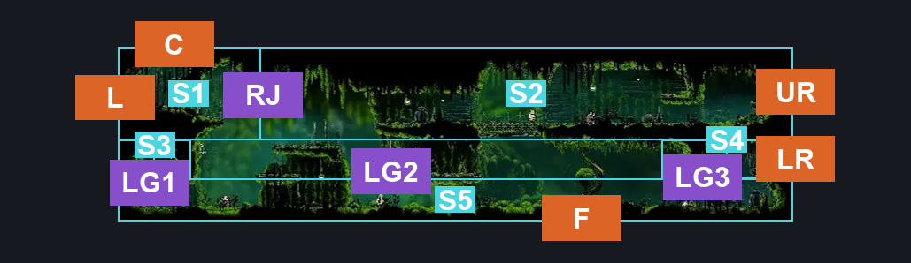
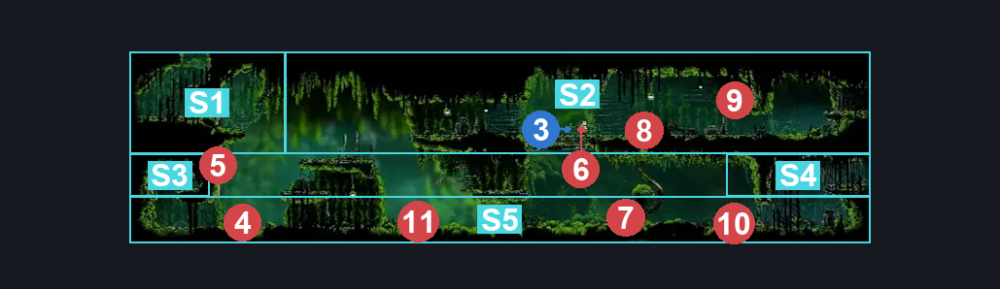
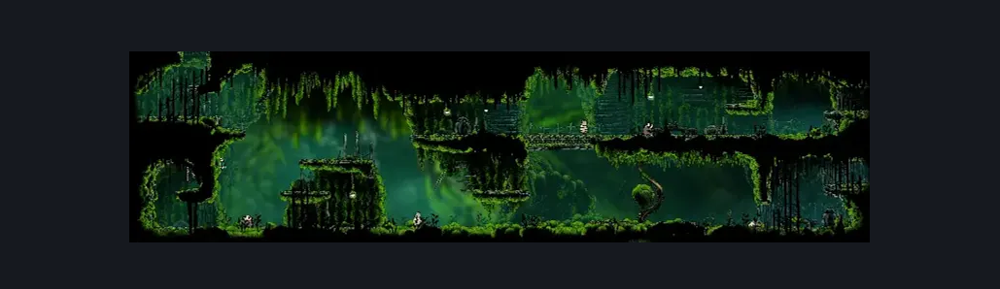

# Mosshome Lower (Bone_11)

**Game ID:** Bone_11

**Contributors:** herounit, hutyrix 

## Subrooms

| No. | Subroom | Annotated |
| --- | --- | --- |
| S1 | upper left exit | ✓ |
| S2 | upper right level | ✓ |
| S3 | lower right exit | ✓ |
| S4 | ground floor | ✓ |

## Room Transitions

| Alias | Name | From subroom | Destination | Destination alias | Requirements | TODO | Verification | Annotated | Notes |
| --- | --- | --- | --- | --- | --- | --- | --- | --- | --- |
| LR | lower right | lower right exit | [The Marrow Map Shop (Bone_04)](../the-marrow/the-marrow-map-shop.md) | LL | none |  | Verified | ✓ |  |
| UR | upper right | upper right level | [The Marrow Map Shop (Bone_04)](../the-marrow/the-marrow-map-shop.md) | UL | none |  | Verified | ✓ |  |
| L | left | upper left exit | [The Big Fall (Aspid_01)](the-big-fall.md) | LR | none |  | Verified | ✓ |  |
| C | ceiling | upper left exit | [Mosshome Middle (Mosstown_01)](mosshome-middle.md) | F | activate floor exit switch IN mosshome middle |  | Verified | ✓ |  |
| F | floor | ground floor | [Mosshome Basement (Bone_11b)](mosshome-basement.md) | C | activate pressure plate IN mosshome basement |  | Verified | ✓ |  |

## Subroom Connections

| Alias | Name | Source | Destination | Requirements | TODO | Verification | Annotated | Notes |
| --- | --- | --- | --- | --- | --- | --- | --- | --- |
| RJ | running jump | upper right level | upper left exit | run  OR ( dash left AND ( ledge grab left OR cling grip left ) ) OR faydown  OR silk soar  OR clawline left OR sharpdart  OR easy beast pogo  OR easy enemy pogo |  | Verified | ✓ |  |
| RJ | running jump | upper left exit | upper right level | none (falling) |  | Verified | ✓ |  |
| LG2 | ledge grab 2 | ground floor | upper right level | ledge grab right OR cling grip right OR faydown OR silk soar |  | Verified | ✓ |  |
| LG2 | ledge grab 2 | upper right level | ground floor | none (falling) |  | Verified | ✓ |  |
| LG3 | ledge grab 3 | ground floor | lower right exit | ledge grab right OR cling grip right OR faydown cloak OR silk soar |  | Verified | ✓ |  |
| LG3 | ledge grab 3 | lower right exit | ground floor | none (falling) |  | Verified | ✓ |  |

## Check Locations

| No. | Check | Subroom | Requirements | TODO | Verification | Location Type | Annotated | Notes |
| --- | --- | --- | --- | --- | --- | --- | --- | --- |
| 1 | rosary cache bone bottom 4 | ground floor | ledge grab right OR cling grip either OR faydown cloak OR silk soar OR easy shaman pogo OR attack right |  | Verified | collectible | ✓ | complain to Hutyrix in the ap discord about this; can just attack to get it, even naked - hero, 10/28 |
| 2 | rosary cache bone bottom 5 | ground floor | ledge grab right OR cling grip either OR faydown cloak OR silk soar OR easy shaman pogo OR easy pogo off aknid OR easy pogo off pilgrim pouncer OR easy pogo off pilgrim groveller OR [reaper, witch, shaman] needle right OR ( elite ball knowledge AND (  [hunter] longclaw right OR easy [wanderer, architect, beast, hunter] charge OR ( beast needle right AND easy heal stall ) ) ) |  | Verified | collectible | ✓ | per Hutyrix, these can reach from the ground floor just by jumping: Reaper [attack] Witch [attack] Shaman [attack] (pogo not required) Wanderer + Needle Strike Architect + Needle Strike Beast + Needle Strike Beast: Technique Heal Stall (pogo after bind) Hunter + Needle Strike Hunter + Longclaw 😄 |
| 3 | Garmond and Zaza Act 3 Meeting Bone Bottom | upper right level | Act 3 |  | Verified | event | ✓ |  |
| 4 | Pilgrim Groveller 1 | ground floor | None |  | Verified | enemy | ✓ |  |
| 5 | Aknid 1 | ground floor | None |  | Verified | enemy | ✓ |  |
| 6 | Pilgrim Pouncer 1 | upper right level | None |  | Verified | enemy | ✓ |  |
| 7 | Pilgrim Groveller 2 | ground floor | None |  | Verified | enemy | ✓ |  |
| 8 | Pilgrim Groveller 3 | upper right level | None |  | Verified | enemy | ✓ |  |
| 9 | Pilgrim Groveller 4 | upper right level | None |  | Verified | enemy | ✓ |  |
| 10 | Pilgrim Groveller 5 | ground floor | None |  | Verified | enemy | ✓ |  |
| 11 | Pilgrim Pouncer 2 | ground floor | Normal World Spawn |  | Verified | enemy | ✓ |  |

## Room Images

### Connections

### Checks

### Scene

