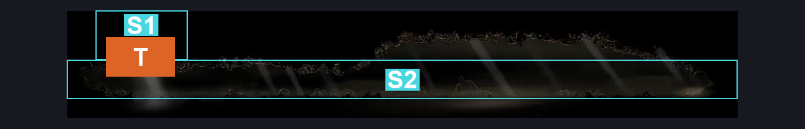
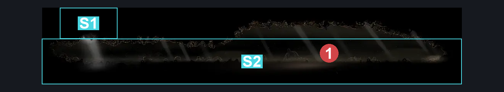
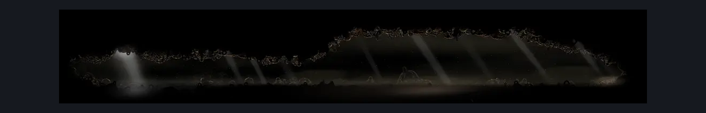

# Bellway Centipede Arena (Bellway_Centipede_Arena)

**Game ID:** Bellway_Centipede_Arena

**Contributors:** Gallos

## Subrooms

| No. | Subroom | Annotated |
| --- | --- | --- |
| S1 | Entrance | ✓ |
| S2 | Arena | ✓ |

## Room Transitions

| Alias | Name | From subroom | Destination | Destination alias | Requirements | TODO | Verification | Annotated | Notes |
| --- | --- | --- | --- | --- | --- | --- | --- | --- | --- |
| T | top1 | Entrance | [Grand Bellway (Bellway_City)](grand-bellway.md) | BB | none |  | Verified | ✓ |  |

## Subroom Connections

No subroom connections defined.

## Check Locations

| No. | Check | Subroom | Requirements | TODO | Verification | Location Type | Annotated | Notes |
| --- | --- | --- | --- | --- | --- | --- | --- | --- |
| 1 | Bell Eater | Arena | defeat bell beast boss fight IN the marrow bellway  AND ACT 3 AND Combat Requirements |  | Verified | boss | ✓ | Bell Eater soul |

## Room Images

### Connections

### Checks

### Scene

