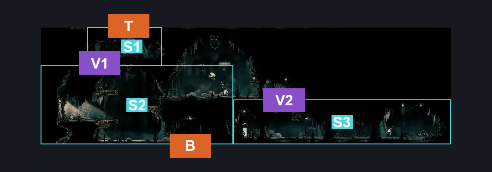
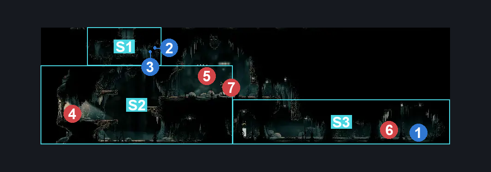
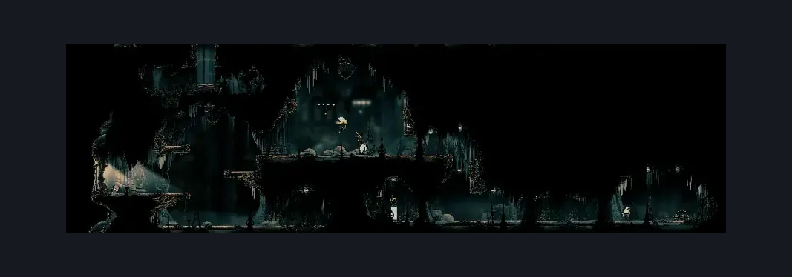

# Choral Chambers Above Ventrica (Song_03)

**Game ID:** Song_03

**Contributors:** samupo,Gallos

## Subrooms

| No. | Subroom | Annotated |
| --- | --- | --- |
| S1 | Top | ✓ |
| S2 | Bottom Left | ✓ |
| S3 | Bottom Right | ✓ |

## Room Transitions

| Alias | Name | From subroom | Destination | Destination alias | Requirements | TODO | Verification | Annotated | Notes |
| --- | --- | --- | --- | --- | --- | --- | --- | --- | --- |
| B | bot1 | Bottom Left | [Choral Chambers Ventrica Room (Song_01b)](choral-chambers-ventrica-room.md) | T | none |  | Verified | ✓ |  |
| T | top1 | Top | [Choral Chambers Outside Spa (Song_04)](choral-chambers-outside-spa.md) | B | Activate Switch - Outside Spa IN Choral chambers outside spa |  | Verified | ✓ |  |

## Subroom Connections

| Alias | Name | Source | Destination | Requirements | TODO | Verification | Annotated | Notes |
| --- | --- | --- | --- | --- | --- | --- | --- | --- |
| V1 | Vertical | Bottom Left | Top | silk soar OR ((ledge grab OR cling grip) AND faydown cloak) OR ((Dash OR easy Shaman pogo) AND cling grip) OR (ledge grab AND easy pogo off Reed AND easy damage boost) |  | Verified | ✓ |  |
| V1 | Vertical | Top | Bottom Left | none |  | Verified | ✓ | falling |
| V2 | Vertical2 | Bottom Left | Bottom Right | none |  | Verified | ✓ | falling |
| V2 | Vertical2 | Bottom Right | Bottom Left | silk soar OR cling grip right OR (cling grip left AND easy pogo off [Reed, Choristor]) OR (ledge grab AND faydown cloak AND easy pogo off [Reed, Choristor]) |  | Verified | ✓ |  |

## Check Locations

| No. | Check | Subroom | Requirements | TODO | Verification | Location Type | Annotated | Notes |
| --- | --- | --- | --- | --- | --- | --- | --- | --- |
| 1 | Rosary Chest - Choral Chambers #1 | Bottom Right | none |  | Verified | collectible | ✓ |  |
| 2 | Rosary Cache - Choral Chambers #8 | Top | none |  | Verified | collectible | ✓ |  |
| 3 | Rosary Cache - Choral Chambers #9 | Top | none |  | Verified | collectible | ✓ |  |
| 4 | Choir Pouncer 1 | Bottom Left | Normal World Spawn |  | Verified | enemy | ✓ |  |
| 5 | Reed 1 | Bottom Left | Normal World Spawn |  | Verified | enemy | ✓ | FSM Boolean flags: marionettesBurned, marionettesMet |
| 6 | Choristor 1 | Bottom Right | Normal World Spawn |  | Verified | enemy | ✓ |  |
| 7 | Envoy 1 | Bottom Left | Normal World Spawn |  | Verified | enemy | ✓ |  |

## Room Images

### Connections

### Checks

### Scene

