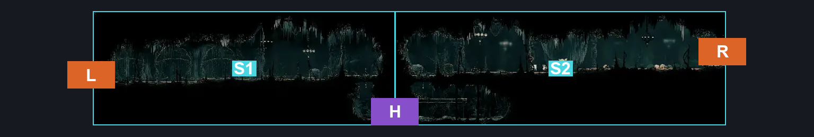
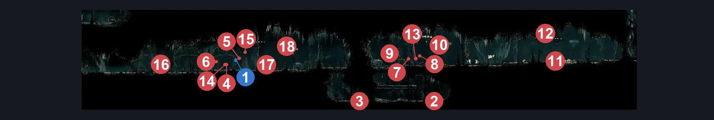
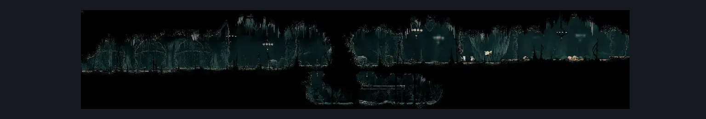

# Choral Chambers Below Spa (Song_02)

**Game ID:** Song_02

**Contributors:** samupo

## Subrooms

| No. | Subroom | Annotated |
| --- | --- | --- |
| S1 | Left |  |
| S2 | Right |  |

## Room Transitions

| Alias | Name | From subroom | Destination | Destination alias | Requirements | TODO | Verification | Annotated | Notes |
| --- | --- | --- | --- | --- | --- | --- | --- | --- | --- |
| R | right1 | Right | [Choral Chambers Eastern Shaft (Song_05)](choral-chambers-eastern-shaft.md) | L1 | none |  |  | ✓ |  |
| L | left2 | Left | [Choral Chambers Ventrica Room (Song_01b)](choral-chambers-ventrica-room.md) | R | none |  |  | ✓ |  |

## Subroom Connections

| Alias | Name | Source | Destination | Requirements | TODO | Verification | Annotated | Notes |
| --- | --- | --- | --- | --- | --- | --- | --- | --- |
| H | Horizontal | Right | Left | cling grip OR silk soar |  |  |  |  |
| H | Horizontal | Left | Right | ledge grab OR faydown cloak OR silk soar |  |  |  |  |

## Check Locations

| No. | Check | Subroom | Requirements | TODO | Verification | Location Type | Annotated | Notes |
| --- | --- | --- | --- | --- | --- | --- | --- | --- |
| 1 | Second Sentinel Encounter | Left | Act 3 AND  complete THE Second Sentinel Activation |  | Verified | event | ✓ | Verified via enemy import.  Spawn conditions: songChevalierActiveInSong_02=true, songChevalierSeenInSong_02=false, songChevalierEncounterCooldown=false, songChevalierQuestReady=false FSM Boolean flags: encounteredSongChevalierBoss |
| 2 | Drapemite 1 |  |  |  |  | enemy | ✓ |  |
| 3 | Drapemite 2 |  | Normal World Spawn |  |  | enemy | ✓ |  |
| 4 | Choir Hornhead 1 |  | Normal World Spawn |  |  | enemy | ✓ |  |
| 5 | Choir Flyer 1 |  | Normal World Spawn |  |  | enemy | ✓ |  |
| 6 | Envoy 1 |  | Normal World Spawn |  |  | enemy | ✓ | FSM Boolean flags: marionettesBurned, marionettesMet |
| 7 | Choir Pouncer 1 |  | Normal World Spawn |  |  | enemy | ✓ |  |
| 8 | Envoy 2 |  | Normal World Spawn |  |  | enemy | ✓ | FSM Boolean flags: marionettesBurned, marionettesMet |
| 9 | Choir Bellbearer 1 |  | Normal World Spawn |  |  | enemy | ✓ |  |
| 10 | Choir Elder 1 |  | Black Thread World Spawn |  |  | enemy | ✓ |  |
| 11 | Envoy 3 |  | Black Thread World Spawn |  |  | enemy | ✓ |  |
| 12 | Choir Bellbearer 2 |  | Black Thread World Spawn |  |  | enemy | ✓ |  |
| 13 | Choir Pouncer 2 |  | Black Thread World Spawn |  |  | enemy | ✓ |  |
| 14 | Choir Hornhead 2 |  | Black Thread World Spawn AND Invalid |  |  | enemy | ✓ | Part of Second Sentinel Encounter and can be missed.  Spawn conditions: songChevalierActiveInSong_02=true, songChevalierSeenInSong_02=false, songChevalierEncounterCooldown=false, songChevalierQuestReady=false |
| 15 | Choir Flyer 2 |  | Black Thread World Spawn AND Invalid |  |  | enemy | ✓ | Part of Second Sentinel Encounter and can be missed.  Spawn conditions: songChevalierActiveInSong_02=true, songChevalierSeenInSong_02=false, songChevalierEncounterCooldown=false, songChevalierQuestReady=false |
| 16 | Envoy 4 |  | Black Thread World Spawn |  |  | enemy | ✓ |  |
| 17 | Choir Hornhead 3 |  | Black Thread World Spawn |  |  | enemy | ✓ |  |
| 18 | Choir Flyer 3 |  | Black Thread World Spawn |  |  | enemy | ✓ |  |

## Room Images

### Connections

### Checks

### Scene

