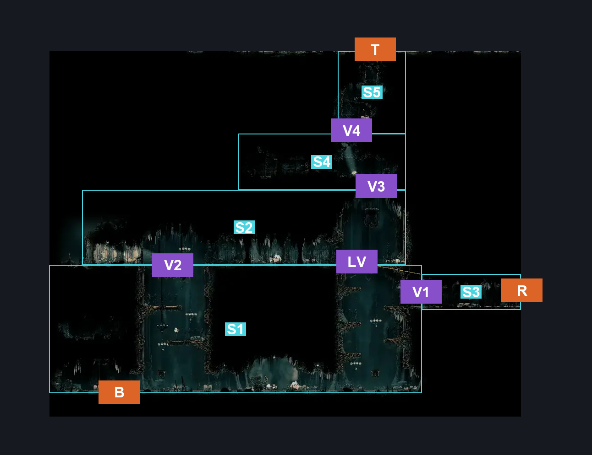
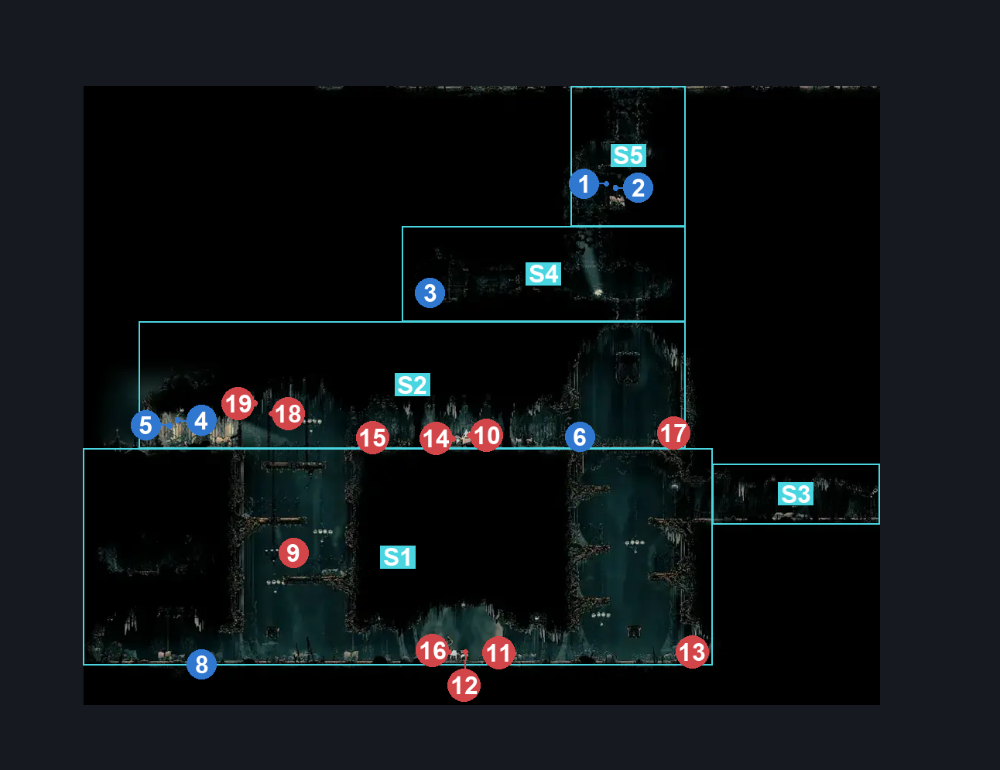
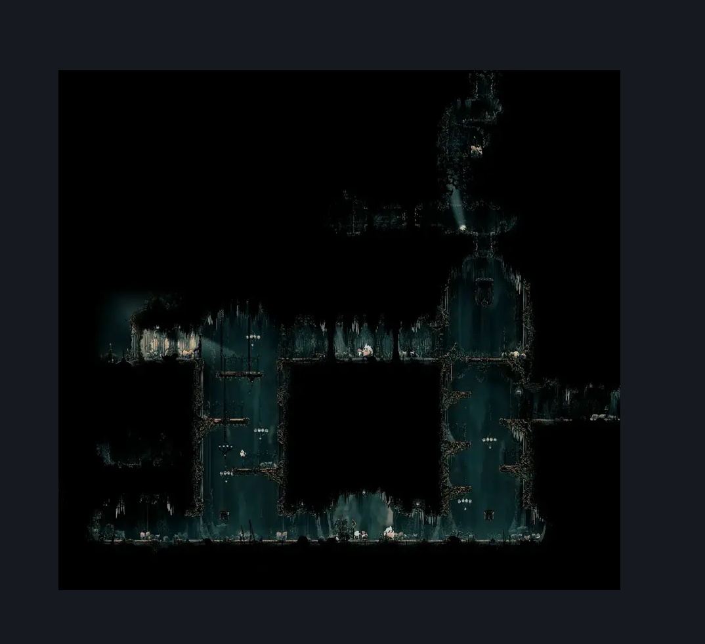

# Choral Chambers Below Ventrica (Song_01)

**Game ID:** Song_01

**Contributors:** samupo, Gallos

## Subrooms

| No. | Subroom | Annotated |
| --- | --- | --- |
| S1 | Bottom | ✓ |
| S2 | Window | ✓ |
| S3 | Right Exit | ✓ |
| S4 | Side Chamber | ✓ |
| S5 | Pre Top | ✓ |
| S6 | Top | ✓ |

## Room Transitions

| Alias | Name | From subroom | Destination | Destination alias | Requirements | TODO | Verification | Annotated | Notes |
| --- | --- | --- | --- | --- | --- | --- | --- | --- | --- |
| B | bot1 | Bottom | [Grand Gate Maintenance Room (Song_01c)](../grand-gate/grand-gate-maintenance-room.md) | T | none |  |  | ✓ |  |
| T | top1 | Top | [Choral Chambers Ventrica Room (Song_01b)](choral-chambers-ventrica-room.md) | B | cling grip OR silk soar |  |  | ✓ |  |
| R | right2 | Right Exit | [Choral Chambers Outisde Underworks (Under_07b)](choral-chambers-outisde-underworks.md) | L | none |  |  | ✓ |  |

## Subroom Connections

| Alias | Name | Source | Destination | Requirements | TODO | Verification | Annotated | Notes |
| --- | --- | --- | --- | --- | --- | --- | --- | --- |
| V1 | Pre Top to Top | Pre Top | Top | cling grip OR faydown cloak |  |  |  |  |
| V2 | Side Chamber to Top | Side Chamber | Top | silk soar OR cling grip |  |  |  |  |
| V3 | Window to Side Chamber | Window | Side Chamber | silk soar OR (easy enemy pogo AND cling grip left) OR (cling grip right AND (faydown cloak OR clawline OR Dash)) OR (ledge grab AND easy Shaman pogo AND easy pogo off Choir Flyer AND faydown cloak) |  |  |  | need to aggro Choir Flyer for Shaman skip |
| V4 | Bottom to Window | Bottom | Window | cling grip OR (cling grip right AND faydown cloak) OR silk soar OR ((ledge grab OR faydown cloak)  AND medium pogo off Choir Flyer AND medium Damage boost) |  |  |  | can exactly hit the Choir flyer 4 times |
| V5 | Bottom to Right Exit | Bottom | Right Exit | (Dash AND ledge grab) OR faydown cloak OR ((easy pogo off [Choir Flyer, Choir Hornhead, Envoy] OR ledge grab OR cling grip) AND clawline) OR silk soar OR (ledge grab AND Hard Shaman pogo) OR (Ledge Grab AND medium Beast pogo AND Hard Heal stall) |  |  |  |  |
| FT | Falling from Top | Top | Pre Top | none |  |  |  | falling |
| FPT | Falling from Pre Top | Pre Top | Side Chamber | none |  |  |  | falling |
| LV | Lever | Window | Right Exit | none |  |  |  | one side lever |
| LV | Lever | Right Exit | Window | silk soar OR faydown cloak OR cling grip left OR ((Dash OR clawline) AND ledge grab AND easy enemy pogo) |  |  |  |  |
| SW | Side Chamber to Window | Side Chamber | Window | none |  |  |  | falling |
| FW | Falling from Window | Window | Bottom | none |  |  |  | falling |
| FR | Falling from Right Exit | Right Exit | Bottom | none |  |  |  | falling |

## Check Locations

| No. | Check | Subroom | Requirements | TODO | Verification | Location Type | Annotated | Notes |
| --- | --- | --- | --- | --- | --- | --- | --- | --- |
| 1 | Rosary Cache: Choral Chambers #3 | Top | none |  |  | collectible | ✓ |  |
| 2 | Rosary Cache: Choral Chambers #4 | Top | none |  |  | collectible | ✓ |  |
| 3 | Shell Shard Cache: Choral Chambers | Side Chamber | none |  |  | collectible | ✓ |  |
| 4 | Rosary Cache: Choral Chambers #1 | Window | none |  |  | collectible | ✓ |  |
| 5 | Rosary Cache: Choral Chambers #2 | Window | none |  |  | collectible | ✓ |  |
| 6 | Choir Flyer 1 | Bottom |  |  |  | enemy | ✓ |  |
| 7 | Choir Hornhead 1 |  |  |  |  | enemy | ✓ |  |
| 8 | Envoy 1 | Bottom |  |  |  | enemy | ✓ | FSM Boolean flags: marionettesBurned, marionettesMet |
| 9 | Choir Pouncer 1 | Bottom |  |  |  | enemy | ✓ |  |
| 10 | Choir Pouncer 2 | Bottom | Normal World Spawn |  |  | enemy | ✓ |  |
| 11 | Choir Pouncer 3 |  | Normal World Spawn |  |  | enemy | ✓ |  |
| 12 | Choir Hornhead 2 |  | Normal World Spawn |  |  | enemy | ✓ |  |
| 13 | Envoy 2 |  | Normal World Spawn |  |  | enemy | ✓ | FSM Boolean flags: marionettesBurned, marionettesMet |
| 14 | Choristor 1 |  | Black Thread World Spawn |  |  | enemy | ✓ |  |
| 15 | Void Mass 1 | Window | Black Thread World Spawn |  |  | enemy | ✓ |  |
| 16 | Reed 1 | Window | Black Thread World Spawn |  |  | enemy | ✓ |  |

## Room Images

### Connections

### Checks

### Scene

