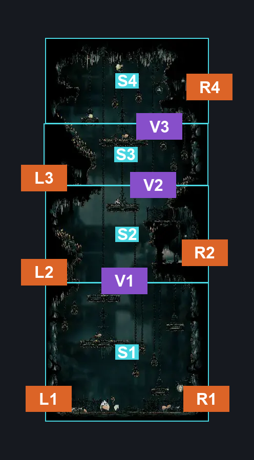
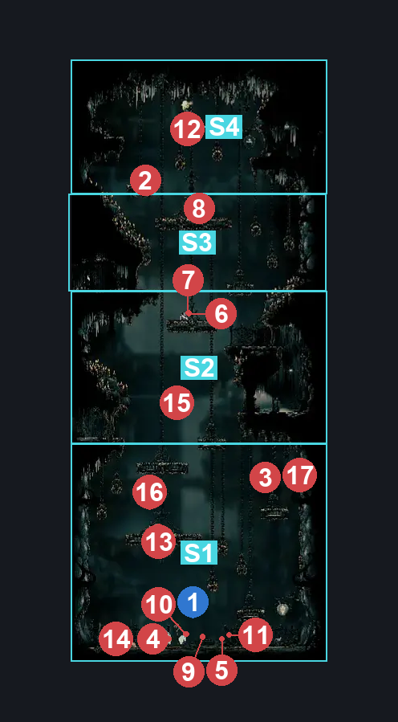
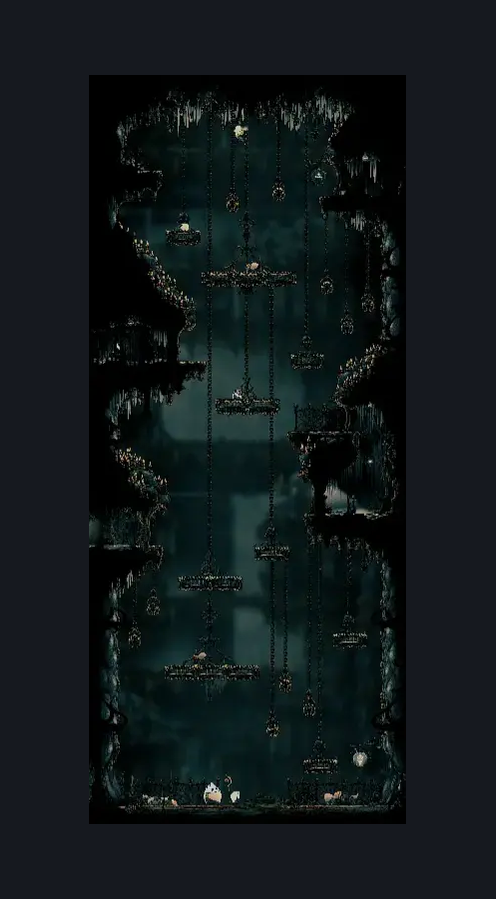

# Choral Chambers Eastern Shaft (Song_05)

**Game ID:** Song_05

**Contributors:** Gallos

## Subrooms

| No. | Subroom | Annotated |
| --- | --- | --- |
| S1 | Section 1 | ✓ |
| S2 | Section 2 | ✓ |
| S3 | Section 3 | ✓ |
| S4 | Section 4 | ✓ |

## Room Transitions

| Alias | Name | From subroom | Destination | Destination alias | Requirements | TODO | Verification | Annotated | Notes |
| --- | --- | --- | --- | --- | --- | --- | --- | --- | --- |
| L1 | left5 | Section 1 | [Choral Chambers Below Spa (Song_02)](choral-chambers-below-spa.md) | R | none |  | Verified | ✓ |  |
| R1 | right3 | Section 1 | [Whiteward Entrance (Ward_01)](../whiteward/whiteward-entrance.md) | TL | none |  | Verified | ✓ |  |
| L2 | left4 | Section 2 | [Choral Chambers Merchant Room (Song_07)](choral-chambers-merchant-room.md) | R | none |  | Verified | ✓ |  |
| R2 | right4 | Section 2 | [Choral Chambers East to West (Song_27)](choral-chambers-east-to-west.md) | L | activate Lever East to West IN choral chambers east to west |  | Verified | ✓ |  |
| L3 | left3 | Section 3 | [Choral Chambers Flea Shaft (Song_11)](choral-chambers-flea-shaft.md) | BR | none |  | Verified | ✓ |  |
| R4 | right2 | Section 4 | [Choral Chambers Below Dining (Song_18)](choral-chambers-below-dining.md) | L | none |  | Verified | ✓ |  |

## Subroom Connections

| Alias | Name | Source | Destination | Requirements | TODO | Verification | Annotated | Notes |
| --- | --- | --- | --- | --- | --- | --- | --- | --- |
| V1 | Section 1 to Section 2 | Section 1 | Section 2 | Cling grip right OR ledge grab right OR silk soar OR easy scuttlebrace OR faydown cloak OR (cling grip left AND (clawline right OR sharpdart)) OR ((easy pogo off [Envoy, Choir Hornhead] OR (Have crest beast AND hard heal stall AND hard plasmium stall)) AND (easy shaman pogo OR easy plasmium stall OR easy pogo off Reed OR (easy [hunter,wanderer,reaper,Beast] pogo AND easy heal stall))) |  | Verified | ✓ |  |
| V1 | Section 1 to Section 2 | Section 2 | Section 1 | none |  | Verified | ✓ | falling |
| V2 | Section 2 to Section 3 | Section 2 | Section 3 | silk soar OR (cling grip  right AND (ledge grab left OR easy pogo off Choir pouncer OR ((easy [wanderer,reaper,beast,architect, witch, shaman] pogo OR clawline right) AND spike pogo))) OR ((easy pogo off Reed AND (easy [heal, voltvessels, plasmium, flintslate] stall )AND easy damage boost off Reed)) OR (easy Shaman pogo AND easy pogo off Reed) OR (faydown cloak AND ((easy pogo off Reed) OR cling grip left)) OR easy scuttlebrace |  | Verified | ✓ |  |
| V2 | Section 2 to Section 3 | Section 3 | Section 2 | none |  | Verified | ✓ | falling |
| V3 | Section 3 to Section 4 | Section 3 | Section 4 | (ledge grab right AND (spike pogo OR ledge grab left OR easy pogo off [Choir bellbearer, Reed, Choristor] )) OR (clawline right AND (spike pogo OR ledge grab left)) OR silk soar OR easy pogo off [Choir pouncer,Reed, Choristor] OR easy [Wanderer,Reaper,Beast,Witch,Architect, Shaman] pogo OR (scuttlebrace AND (easy damage boost off [Choir Bellbearer, Reed, Choristor] OR spike pogo)) |  | Verified | ✓ |  |
| V3 | Section 3 to Section 4 | Section 4 | Section 3 | none |  | Verified | ✓ | falling |

## Check Locations

| No. | Check | Subroom | Requirements | TODO | Verification | Location Type | Annotated | Notes |
| --- | --- | --- | --- | --- | --- | --- | --- | --- |
| 1 | Lace Second Encounter | Section 1 | none |  | Verified | event | ✓ |  |
| 2 | Choir Bellbearer 1 | Section 4 | Normal World Spawn |  | Verified | enemy | ✓ |  |
| 3 | Choir Bellbearer 2 | Section 1 | Black Thread World Spawn |  | Verified | enemy | ✓ |  |
| 4 | Choir Hornhead 1 | Section 1 | (prereq Lace Second Encounter IN choral chambers eastern shaft) OR (prereq Lace Second Encounter IN grand bellway shaft) |  | Verified | enemy | ✓ | Spawn conditions: song05MarchGroupReady=true |
| 5 | Choir Hornhead 2 | Section 1 | Black Thread World Spawn |  | Verified | enemy | ✓ |  |
| 6 | Choir Pouncer 1 | Section 2 | invalid |  | Verified | enemy | ✓ |  |
| 7 | Choir Pouncer 2 | Section 2 | Normal World Spawn |  | Verified | enemy | ✓ |  |
| 8 | Choristor 1 | Section 3 | Normal World Spawn |  | Verified | enemy | ✓ |  |
| 9 | Choristor 2 | Section 1 | invalid |  | Verified | enemy | ✓ | Spawn conditions: song05MarchGroupReady=true |
| 10 | Envoy 1 | Section 1 | (prereq Lace Second Encounter IN choral chambers eastern shaft) OR (prereq Lace Second Encounter IN grand bellway shaft) |  | Verified | enemy | ✓ | Spawn conditions: song05MarchGroupReady=true |
| 11 | Envoy 2 | Section 1 | Normal World Spawn |  | Verified | enemy | ✓ | Spawn conditions: laceMeetCitadel=false |
| 12 | Reed 1 | Section 4 | Normal World Spawn |  | Verified | enemy | ✓ |  |
| 13 | Reed 2 | Section 1 | Normal World Spawn |  | Verified | enemy | ✓ |  |
| 14 | Reed 3 | Section 1 | Normal World Spawn |  | Verified | enemy | ✓ | Spawn conditions: laceMeetCitadel=false |
| 15 | Reed 4 | Section 2 | Black Thread World Spawn |  | Verified | enemy | ✓ |  |
| 16 | Reed 5 | Section 1 | Black Thread World Spawn |  | Verified | enemy | ✓ |  |
| 17 | Void Mass 1 | Section 1 | Black Thread World Spawn |  | Verified | enemy | ✓ |  |

## Room Images

### Connections

### Checks

### Scene

