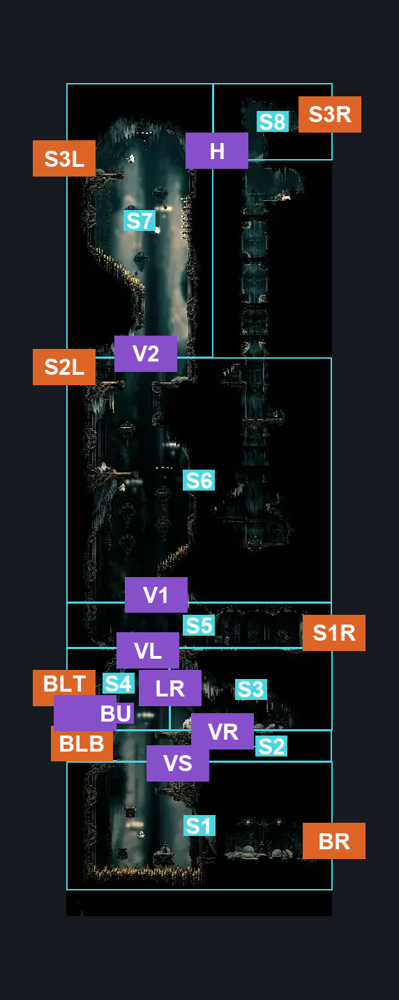
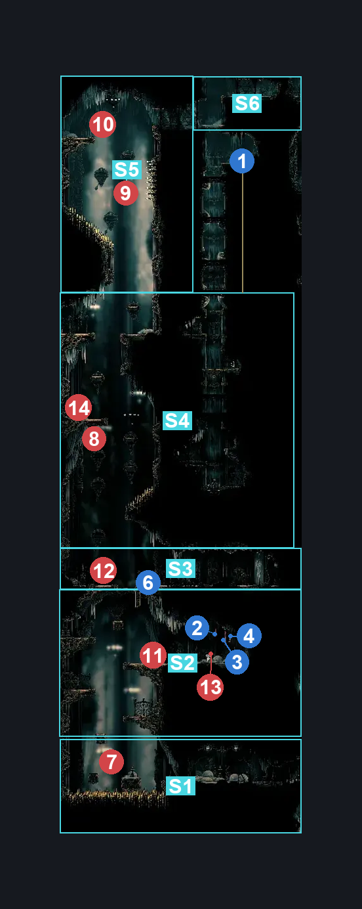
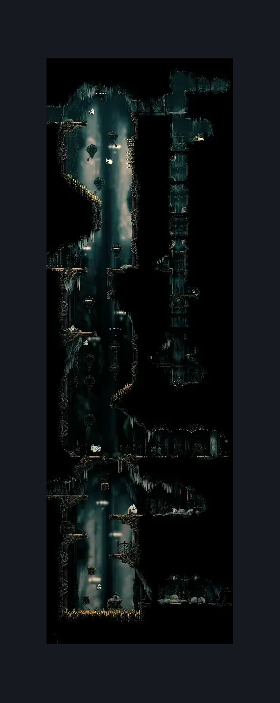

# Choral Chambers Flea Shaft (Song_11)

**Game ID:** Song_11

**Contributors:** samupo, Gallos

## Subrooms

| No. | Subroom | Annotated |
| --- | --- | --- |
| S1 | Base Bottom | ✓ |
| S2 | Base Middle | ✓ |
| S3 | Base Upper Right | ✓ |
| S4 | Base Upper Left | ✓ |
| S5 | Top Section 1 | ✓ |
| S6 | Top Section 2 | ✓ |
| S7 | Top Section 3 Left | ✓ |
| S8 | Top Section 3 Right | ✓ |

- **Base Upper Right:** 

## Room Transitions

| Alias | Name | From subroom | Destination | Destination alias | Requirements | TODO | Verification | Annotated | Notes |
| --- | --- | --- | --- | --- | --- | --- | --- | --- | --- |
| S3L | left1 | Top Section 3 Left | [Corridor to High Halls (Song_17)](corridor-to-high-halls.md) | R | none |  | Verified | ✓ |  |
| S2L | left2 | Top Section 2 | [Choral Chambers Maintenance Tunnel (Song_15)](choral-chambers-maintenance-tunnel.md) | R | none |  | Verified | ✓ |  |
| S3R | right2 | Top Section 3 Right | [High Halls Corridor (Hang_07)](high-halls-corridor.md) | L | activate Lever Flea Shaft 2 |  | Verified | ✓ |  |
| BLB | left4 | Base Middle | [Choral Chambers Spa (Song_10)](choral-chambers-spa.md) | R | activate Lever Chambers Spa 2 IN choral chambers spa |  | Verified | ✓ |  |
| BR | right3 | Base Bottom | [Choral Chambers Eastern Shaft (Song_05)](choral-chambers-eastern-shaft.md) | L3 | none |  | Verified | ✓ |  |
| BLT | left3 | Base Upper Left | [Choral Chambers Above Spa (Song_13)](choral-chambers-above-spa.md) | R | none |  | Verified | ✓ |  |
| S1R | right1 | Top Section 1 | [Choral Chambers Dining Room (Song_09b)](choral-chambers-dining-room.md) | L | none |  | Verified | ✓ |  |

## Subroom Connections

| Alias | Name | Source | Destination | Requirements | TODO | Verification | Annotated | Notes |
| --- | --- | --- | --- | --- | --- | --- | --- | --- |
| VS | Vertical Base | Base Bottom | Base Middle | (cling grip left AND (dash left OR clawline left OR sharpdart OR flea brew)) OR easy pogo off Choir flyer OR (faydown cloak AND (ledge grab either OR easy Shaman pogo OR medium plasmium stall OR cling grip either)) OR silk soar OR  (cling grip both AND drifter's cloak) OR silk soar OR (easy scuttlebrace AND dash both AND (clawline left OR sharpdart OR faydown cloak OR ledge grab left OR cling grip left OR flea brew OR easy shaman pogo OR easy [rune rage, heal, flintslate, cross stitch, thread storm, pale nails] stall)) |  | Verified | ✓ |  |
| VS | Vertical Base | Base Middle | Base Bottom | none |  | Verified | ✓ | falling |
| VR | Vertical Middle | Base Middle | Base Upper Right | faydown cloak OR hard pogo off [Choir hornhead, Choir Pouncer] OR ((Dash right OR sharpdart OR clawline right) AND (ledge grab right OR cling grip right)) OR (run AND (ledge grab right OR cling grip right OR easy Damage boost off Choir hornhead OR (easy Damage boost off Choir pouncer AND (easy [heal, voltvessels, plasmium, flintslate] stall)))) OR silk soar OR easy scuttlebrace OR (clawline right AND easy damage boost off [Choir Hornhead,Choir pouncer]) OR (cling grip left AND ((flea brew AND dash right) OR sharpdart OR clawline right)) OR (flea brew AND medium plasmium stall) |  | Verified | ✓ |  |
| VR | Vertical Middle | Base Upper Right | Base Middle | none |  | Verified | ✓ | falling |
| LR | Base Upper Traversal | Base Upper Right | Base Upper Left | faydown cloak OR silk soar OR ((clawline left OR sharpdart) AND (easy shaman pogo OR ledge grab left OR cling grip left)) OR ((run OR flea brew OR dash left OR easy pogo off Choir Hornhead OR (have crest witch AND hard pogo off Choir pouncer)) AND (ledge grab left OR cling grip left)) OR medium scuttlebrace OR ((have crest wanderer OR have crest reaper OR have crest shaman) AND medium pogo off Choir Pouncer) |  | Verified | ✓ |  |
| LR | Base Upper Traversal | Base Upper Left | Base Upper Right | none |  | Verified | ✓ | falling |
| VL | Vertical Lever | Base Upper Left | Top Section 1 | activate Lever Flea Shaft  1 AND ((easy pogo off Choir Elder) OR faydown cloak OR silk soar OR cling grip right OR easy scuttlebrace) |  | Verified | ✓ |  |
| VL | Vertical Lever | Top Section 1 | Base Upper Left | activate Lever Flea Shaft 1 |  | Verified | ✓ | falling |
| V1 | Section 1 to Section 2 | Top Section 1 | Top Section 2 | silk soar OR (cling grip left AND (faydown cloak OR cling grip right OR (easy  pogo off Choir Flyer AND easy heal stall))) OR (faydown cloak AND ledge grab left AND (easy pogo off Choir Elder OR easy [Hunter,Wanderer,Reaper,Beast, Shaman, Architect] pogo) AND spike pogo) OR (easy pogo off [Choir Flyer, Choir Elder] AND easy heal stall AND spike pogo AND ledge grab either) OR (easy scuttlebrace AND dash right) |  | Verified | ✓ |  |
| V1 | Section 1 to Section 2 | Top Section 2 | Top Section 1 | none |  | Verified | ✓ | falling |
| V2 | Section 2 to Section 3 Left | Top Section 2 | Top Section 3 Left | (silk soar AND (ledge grab left OR clawline left OR dash left OR sharpdart OR faydown cloak OR drifter's cloak  OR easy pogo off Choir Flyer)) OR (cling grip left AND spike pogo) OR (cling grip right AND spike pogo AND (ledge grab left OR easy beast pogo OR run OR flea brew OR easy pogo off Choir Flyer OR faydown cloak)) OR (easy scuttlebrace AND spike pogo AND dash both) |  | Verified | ✓ |  |
| V2 | Section 2 to Section 3 Left | Top Section 3 Left | Top Section 2 | none |  | Verified | ✓ | falling |
| H | Top Horizontal Traversal | Top Section 3 Right | Top Section 3 Left | ledge grab left OR flea brew OR clawline left OR dash left OR drifter's cloak OR sharpdart OR easy scuttlebrace OR easy pogo off Choir Flyer |  | Verified | ✓ |  |
| H | Top Horizontal Traversal | Top Section 3 Left | Top Section 3 Right | Clawline right OR sharpdart OR faydown cloak OR (run AND (easy beast pogo OR architect attack right OR easy wanderer needle strike OR dash right OR ledge grab right OR easy [heal, voltvessels, plasmium, flintslate, rune rage, pale nails, cross stitch, thread storm, flea brew] stall)) OR (silk soar AND (ledge grab right OR dash right OR drifter's cloak  OR easy pogo off Choir Flyer)) OR cling grip right OR easy scuttlebrace OR (easy pogo off Choir Flyer AND (spike pogo OR easy [heal, voltvessels, plasmium, flintslate, rune rage, pale nails, cross stitch, thread storm, flea brew] stall)) |  | Verified | ✓ |  |
| BU | Bottom to upper left | Base Bottom | Base Upper Left | silk soar OR  (hard pogo off Choir Flyer AND (ledge grab both OR easy scuttlebrace) AND hard damage boost off Choir Flyer) |  | Verified | ✓ |  |
| BU | Bottom to upper left | Base Upper Left | Base Bottom | none |  | Verified | ✓ | falling |

## Check Locations

| No. | Check | Subroom | Requirements | TODO | Verification | Location Type | Annotated | Notes |
| --- | --- | --- | --- | --- | --- | --- | --- | --- |
| 1 | Flea: Choral Chambers - Walled Room | Top Section 2 | activate Flea Shaft Flea Wall AND (silk soar OR (drifter's cloak AND activate Air Current Flea Shaft) OR (faydown cloak AND (easy [Hunter, Wanderer, Reaper,Architect,Witch, Shaman] pogo OR hard Beast pogo))) |  | Verified | collectible | ✓ |  |
| 2 | Flea Shaft's stolen rosaries | Base Upper Right | none |  | Verified | collectible | ✓ | rosary cache |
| 3 | Flea Shaft's bounty | Base Upper Right | none |  | Verified | collectible | ✓ | rosary cache |
| 4 | Flea Shaft's kidnappers' bonus | Base Upper Right | none |  | Verified | collectible | ✓ | rosary cache |
| 5 | Lever Flea Shaft 1 | Top Section 1 | none |  | Verified | switch | ✓ |  |
| 6 | Lever Flea Shaft 2 | Top Section 3 Right | none |  | Verified | switch | ✓ |  |
| 7 | Air current Flea shaft | Top Section 2 | attack either |  | Verified | resource | ✓ |  |
| 8 | Flea Shaft Wall Air current | Top Section 2 | break wall right |  | Verified | blockade | ✓ |  |
| 9 | Flea Shaft Flea Wall | Top Section 2 | break wall right |  | Verified | blockade | ✓ |  |
| 10 | Choir Bellbearer 1 | Top Section 3 Left | Normal World Spawn |  | Verified | enemy | ✓ |  |
| 11 | Choir Elder 1 | Top Section 1 | Normal World Spawn |  | Verified | enemy | ✓ |  |
| 12 | Choir Flyer 1 | Base Bottom | Normal World Spawn |  | Verified | enemy | ✓ |  |
| 13 | Choir Flyer 2 | Top Section 2 | Normal World Spawn |  | Verified | enemy | ✓ |  |
| 14 | Choir Flyer 3 | Top Section 3 Left | Normal World Spawn |  | Verified | enemy | ✓ |  |
| 15 | Choir Hornhead 1 | Base Upper Right | Normal World Spawn |  | Verified | enemy | ✓ |  |
| 16 | Choir Pouncer 1 | Base Upper Right | Normal World Spawn |  | Verified | enemy | ✓ |  |
| 17 | Choir Pouncer 2 | Top Section 2 | Normal World Spawn |  | Verified | enemy | ✓ |  |

## Room Images

### Connections

### Checks

### Scene

