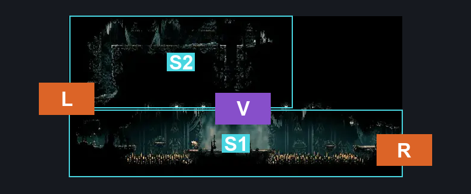
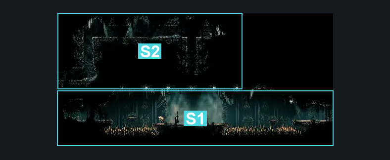
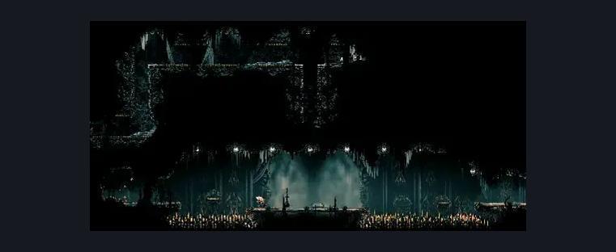

# Choral Chambers Maintenance Tunnel (Song_15)

**Game ID:** Song_15

**Contributors:** samupo, Gallos

## Subrooms

| No. | Subroom | Annotated |
| --- | --- | --- |
| S1 | Base | ✓ |
| S2 | Maintenance Tunnel | ✓ |

## Room Transitions

| Alias | Name | From subroom | Destination | Destination alias | Requirements | TODO | Verification | Annotated | Notes |
| --- | --- | --- | --- | --- | --- | --- | --- | --- | --- |
| R | right1 | Base | [Choral Chambers Flea Shaft (Song_11)](choral-chambers-flea-shaft.md) | S2L | none |  | Verified | ✓ |  |
| L | left1 | Maintenance Tunnel | [Choral Chambers Western Shaft (Song_12)](choral-chambers-western-shaft.md) | S4R | none |  | Verified | ✓ |  |

## Subroom Connections

| Alias | Name | Source | Destination | Requirements | TODO | Verification | Annotated | Notes |
| --- | --- | --- | --- | --- | --- | --- | --- | --- |
| V | Vertical | Base | Maintenance Tunnel | silk soar OR (faydown cloak AND easy pogo off Reed AND (cling grip either OR easy scuttlebrace)) |  | Verified | ✓ |  |
| V | Vertical | Maintenance Tunnel | Base | silk soar OR cling grip either OR easy scuttlebrace |  | Verified | ✓ |  |

## Check Locations

| No. | Check | Subroom | Requirements | TODO | Verification | Location Type | Annotated | Notes |
| --- | --- | --- | --- | --- | --- | --- | --- | --- |
| 1 | Maintenance Worker's Wage Rosary cache | Base | none |  | Verified | collectible | ✓ | rosary cache |
| 2 | Maintenance Tunnel's Rosary cache budget | Base | none |  | Verified | collectible | ✓ | rosary cache |
| 3 | Maintenance Head chief's embezzled Rosary cache | Base | none |  | Verified | collectible | ✓ | rosary cache |
| 4 | Choir Bellbearer 1 | Base | Normal World Spawn |  | Verified | enemy | ✓ |  |
| 5 | Reed 1 | Base | Normal World Spawn |  | Verified | enemy | ✓ | FSM Boolean flags: marionettesBurned, marionettesMet |
| 6 | Reed 2 | Base | Black Thread World Spawn |  | Verified | enemy | ✓ | FSM Boolean flags: marionettesBurned, marionettesMet |
| 7 | Choir Bellbearer 2 | Base | Black Thread World Spawn |  | Verified | enemy | ✓ |  |
| 8 | Void Mass 1 | Base | Black Thread World Spawn |  | Verified | enemy | ✓ |  |

## Room Images

### Connections

### Checks

### Scene

