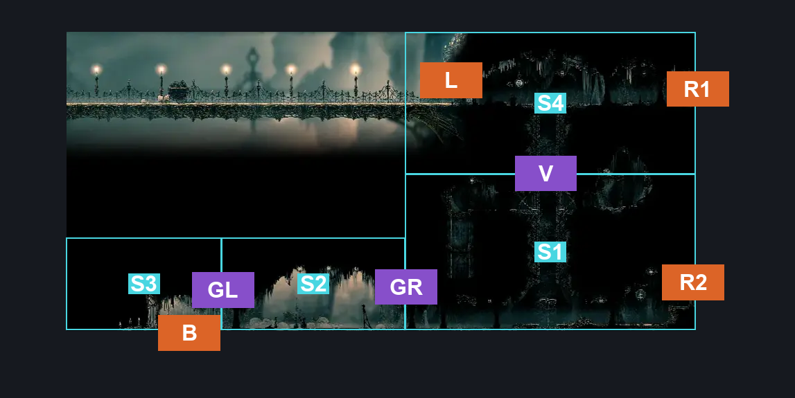
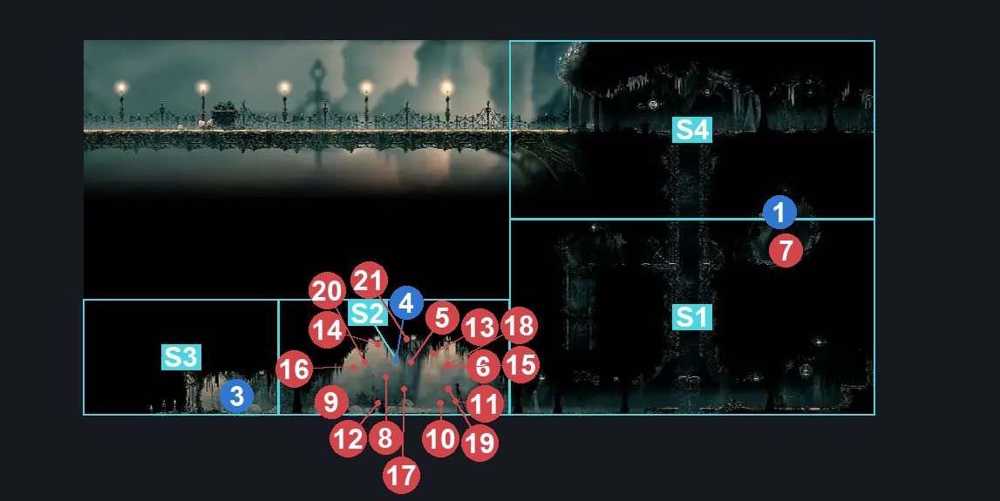
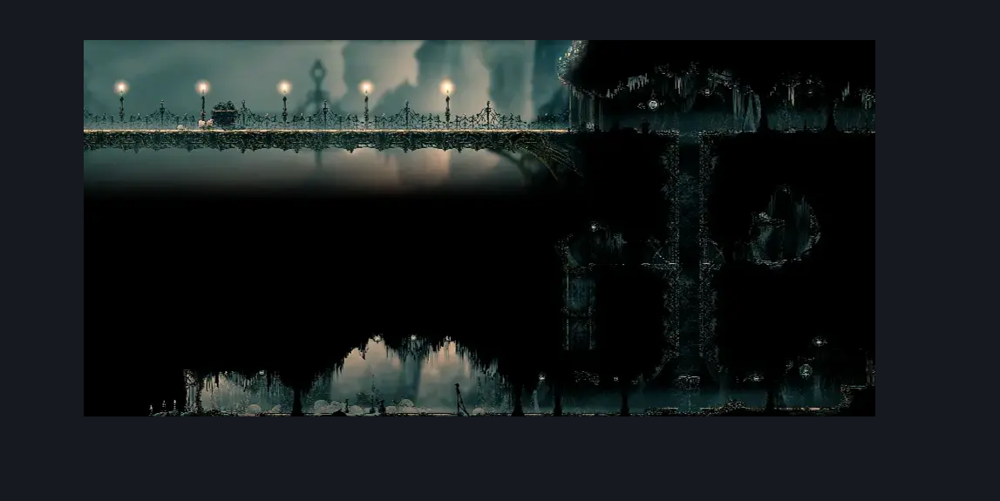

# Choral Chambers Outside Spa (Song_04)

**Game ID:** Song_04

**Contributors:** samupo, Gallos

## Subrooms

| No. | Subroom | Annotated |
| --- | --- | --- |
| S1 | Base | ✓ |
| S2 | Gauntlet | ✓ |
| S3 | Left | ✓ |
| S4 | Top | ✓ |

## Room Transitions

| Alias | Name | From subroom | Destination | Destination alias | Requirements | TODO | Verification | Annotated | Notes |
| --- | --- | --- | --- | --- | --- | --- | --- | --- | --- |
| B | bot1 | Left | [Choral Chambers Above Ventrica (Song_03)](choral-chambers-above-ventrica.md) | T | none |  | Verified | ✓ |  |
| L | left1 | Top | [Slab Bridge (Slab_01)](../the-slab/slab-bridge.md) | R | none |  | Verified | ✓ |  |
| R1 | right1 | Top | [Choral Chambers Western Shaft (Song_12)](choral-chambers-western-shaft.md) | BL | none |  | Verified | ✓ |  |
| R2 | right2 | Base | [Choral Chambers Spa (Song_10)](choral-chambers-spa.md) | L | none |  | Verified | ✓ |  |

## Subroom Connections

| Alias | Name | Source | Destination | Requirements | TODO | Verification | Annotated | Notes |
| --- | --- | --- | --- | --- | --- | --- | --- | --- |
| V | Vertical | Top | Base | none |  | Verified | ✓ | falling |
| V | Vertical | Base | Top | cling grip OR silk soar |  | Verified | ✓ |  |
| GL | Gauntlet Left | Left | Gauntlet | none |  | Verified | ✓ |  |
| GL | Gauntlet Left | Gauntlet | Left | defeat Gauntlet Fight |  | Verified | ✓ |  |
| GR | Gauntlet Right | Base | Gauntlet | none |  | Verified | ✓ |  |
| GR | Gauntlet Right | Gauntlet | Base | defeat Gauntlet Fight |  | Verified | ✓ |  |

## Check Locations

| No. | Check | Subroom | Requirements | TODO | Verification | Location Type | Annotated | Notes |
| --- | --- | --- | --- | --- | --- | --- | --- | --- |
| 1 | Heavy Rosary Necklace - Choral Chambers | Base | cling grip OR silk soar |  | Verified | collectible | ✓ | Secret hidden by breaking the ceiling |
| 2 | Second Sentinel Encounter | Gauntlet | defeat Gauntlet Fight AND Act 2 AND complete THE Second Sentinel Activation |  | Verified | resource |  | only act 2 per the wiki |
| 3 | Switch - Outside Spa | Left | none |  | Verified | switch | ✓ |  |
| 4 | Gauntlet Fight | Gauntlet | Normal World Spawn |  | Verified | event | ✓ |  |
| 5 | Choir Bellbearer 1 | Gauntlet | Normal World Spawn |  | Verified | gauntlet | ✓ |  |
| 6 | Choir Bellbearer 2 | Gauntlet | Black Thread World Spawn |  | Verified | enemy | ✓ |  |
| 7 | Drapemite 1 | Base | Normal World Spawn |  | Verified | enemy | ✓ |  |
| 8 | Choir Flyer 1 | Gauntlet | Normal World Spawn |  | Verified | gauntlet | ✓ |  |
| 9 | Choir Pouncer 1 | Gauntlet | Normal World Spawn |  | Verified | gauntlet | ✓ |  |
| 10 | Choristor 1 | Gauntlet | Normal World Spawn |  | Verified | gauntlet | ✓ |  |
| 11 | Choristor 2 | Gauntlet | Normal World Spawn |  | Verified | gauntlet | ✓ |  |
| 12 | Choristor 4 | Gauntlet | Black Thread World Spawn |  | Verified | enemy | ✓ |  |
| 13 | Clawmaiden 1 | Gauntlet | Normal World Spawn |  | Verified | gauntlet | ✓ | FSM Boolean flags: marionettesBurned |
| 14 | Clawmaiden 2 | Gauntlet | Normal World Spawn |  | Verified | gauntlet | ✓ | FSM Boolean flags: marionettesBurned |
| 15 | Reed 1 | Gauntlet | Normal World Spawn |  | Verified | gauntlet | ✓ |  |
| 16 | Reed 2 | Gauntlet | Normal World Spawn |  | Verified | gauntlet | ✓ |  |
| 17 | Song Knight 1 | Gauntlet | Normal World Spawn AND defeat Gauntlet Fight |  | Verified | enemy | ✓ | Spawn conditions: songChevalierActiveInSong_04=true, songChevalierSeenInSong_04=false, songChevalierEncounterCooldown=false, songChevalierQuestReady=false FSM Boolean flags: encounteredSongChevalierBoss |
| 18 | Reed 3 | Gauntlet | Normal World Spawn |  | Verified | gauntlet | ✓ |  |
| 19 | Choristor 3 | Gauntlet | Normal World Spawn AND defeat Gauntlet Fight |  | Verified | enemy | ✓ | Spawn conditions: songChevalierActiveInSong_04=true, songChevalierSeenInSong_04=false, songChevalierEncounterCooldown=false, songChevalierQuestReady=false |
| 20 | Reed 4 | Gauntlet | Normal World Spawn AND defeat Gauntlet Fight |  | Verified | enemy | ✓ | Spawn conditions: songChevalierActiveInSong_04=true, songChevalierSeenInSong_04=false, songChevalierEncounterCooldown=false, songChevalierQuestReady=false |
| 21 | Void Mass 1 | Gauntlet | Black Thread World Spawn |  | Verified | enemy | ✓ |  |

## Room Images

### Connections

### Checks

### Scene

