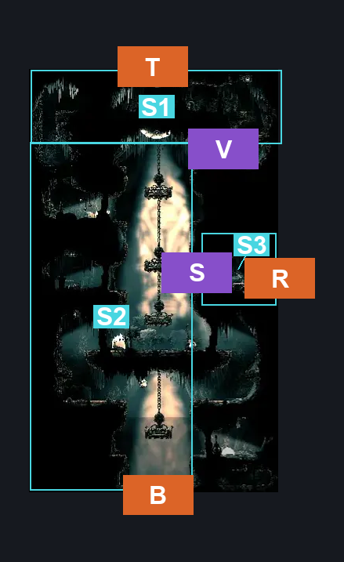
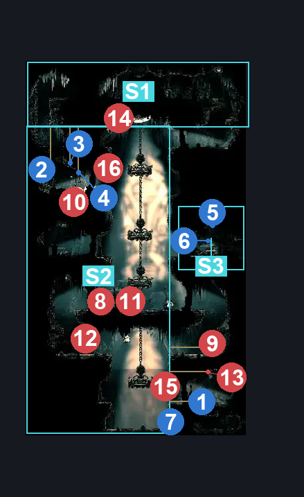

# Choral Chambers Over Dining (Song_09)

**Game ID:** Song_09

**Contributors:** samupo, Gallos

## Subrooms

| No. | Subroom | Annotated |
| --- | --- | --- |
| S1 | Top | ✓ |
| S2 | Base | ✓ |
| S3 | Right Secret | ✓ |

## Room Transitions

| Alias | Name | From subroom | Destination | Destination alias | Requirements | TODO | Verification | Annotated | Notes |
| --- | --- | --- | --- | --- | --- | --- | --- | --- | --- |
| R | right1 | Right Secret | [Cogwork Core West Gauntlet (Cog_05)](../cogwork-core/cogwork-core-west-gauntlet.md) | L | none |  | Verified | ✓ |  |
| T | top1 | Top | [High Halls Corridor (Hang_07)](high-halls-corridor.md) | B | none |  | Verified | ✓ |  |
| B | bot1 | Base | [Choral Chambers Dining Room (Song_09b)](choral-chambers-dining-room.md) | T | none |  | Verified | ✓ |  |

## Subroom Connections

| Alias | Name | Source | Destination | Requirements | TODO | Verification | Annotated | Notes |
| --- | --- | --- | --- | --- | --- | --- | --- | --- |
| V | Vertical | Top | Base | none |  | Verified | ✓ | falling |
| V | Vertical | Base | Top | cling grip either OR faydown cloak OR silk soar OR ((hard plasmium stall OR medium flea brew stall OR easy shaman pogo OR ledge grab either OR easy scuttlebrace) AND (easy [hunter, wanderer, reaper,beast,architect, Shaman] pogo OR easy pogo off [Choir Hornhead, Choir pouncer, Choir Flyer]) AND easy pogo off Choir Flyer) |  | Verified | ✓ |  |
| S | Secret | Right Secret | Base | activate switch over dining |  | Verified | ✓ |  |
| S | Secret | Base | Right Secret | activate switch over dining AND ((cling grip either OR faydown cloak OR silk soar OR ((hard plasmium stall OR medium flea brew stall OR easy shaman pogo OR ledge grab either OR easy scuttlebrace) AND (easy [hunter, wanderer, reaper,beast,architect, Shaman] pogo OR easy pogo off [Choir Hornhead, Choir pouncer, Choir Flyer])))) |  | Verified | ✓ |  |

## Check Locations

| No. | Check | Subroom | Requirements | TODO | Verification | Location Type | Annotated | Notes |
| --- | --- | --- | --- | --- | --- | --- | --- | --- |
| 1 | Rosary Necklace - Choral Chambers #2 | Base | activate Wall over dining AND (cling grip either OR ledge grab either OR easy shaman pogo OR silk soar OR easy scuttlebrace OR easy beast needle strike OR faydown OR easy damage boost off Drapefly OR easy [plasmium, flea brew, voltvessels] stall) |  | Verified | collectible | ✓ | hidden behind a breakable wall |
| 2 | Dining Hall's food budget | Top | none |  | Verified | collectible | ✓ | rosary cache |
| 3 | Mergwin's hidden stash | Top | none |  | Verified | collectible | ✓ | rosary cache |
| 4 | Great Gourmand's treasury | Top | none |  | Verified | collectible | ✓ | rosary cache |
| 5 | Mask Shard: Cogwork Core | Right Secret | none |  | Verified | collectible | ✓ |  |
| 6 | Switch over dining | Right Secret | none |  | Verified | switch | ✓ |  |
| 7 | Wall over dining | Base | break wall left |  | Verified | blockade | ✓ |  |
| 8 | Choir Pouncer 1 | Base | Normal World Spawn |  | Verified | enemy | ✓ |  |
| 9 | Drapemite 1 | Base | Normal World Spawn |  | Verified | enemy | ✓ |  |
| 10 | Drapemite 2 | Base | Normal World Spawn |  | Verified | enemy | ✓ |  |
| 11 | Choir Hornhead 1 | Base | Normal World Spawn |  | Verified | enemy | ✓ |  |
| 12 | Choir Flyer 1 | Base | Normal World Spawn |  | Verified | enemy | ✓ |  |
| 13 | Drapefly 1 | Base | Normal World Spawn |  | Verified | enemy | ✓ |  |
| 14 | Drapefly 2 | Top | Normal World Spawn |  | Verified | enemy | ✓ |  |
| 15 | Choir Flyer 2 | Base | Black Thread World Spawn |  | Verified | enemy | ✓ |  |
| 16 | Drapefly 3 | Base | Black Thread World Spawn |  | Verified | enemy | ✓ |  |

## Room Images

### Connections

### Checks

### Scene

