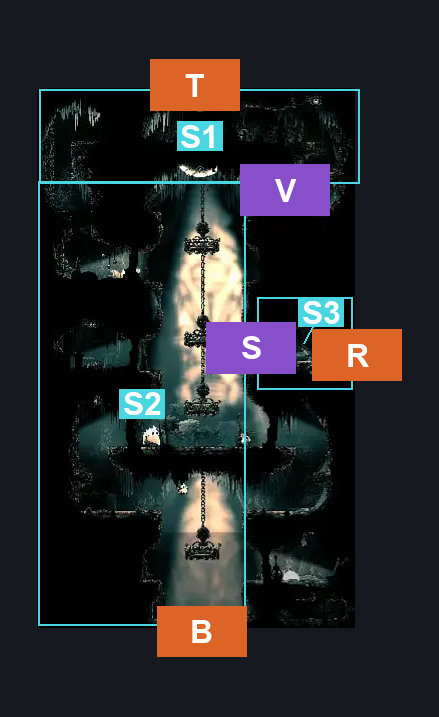
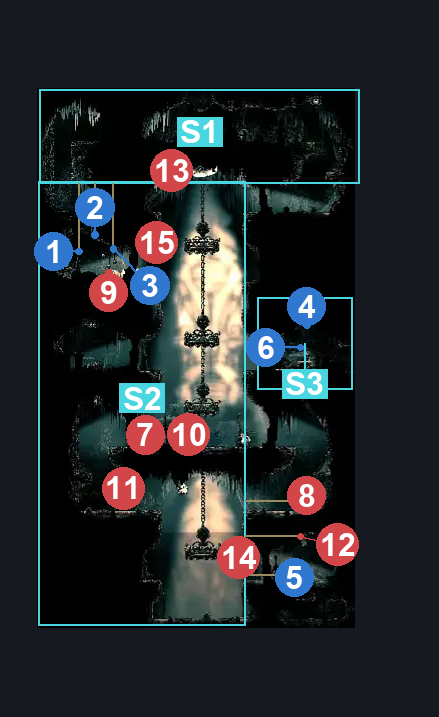
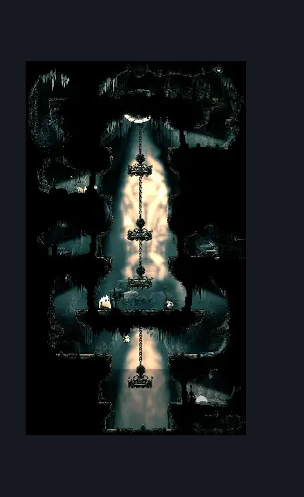

# Choral Chambers Over Dininig (Song_09)

**Game ID:** Song_09

**Contributors:** samupo

## Subrooms

| No. | Subroom | Annotated |
| --- | --- | --- |
| S1 | Top | ✓ |
| S2 | Base | ✓ |
| S3 | Right Secret | ✓ |

## Room Transitions

| Alias | Name | From subroom | Destination | Destination alias | Requirements | TODO | Verification | Annotated | Notes |
| --- | --- | --- | --- | --- | --- | --- | --- | --- | --- |
| R | right1 | Right Secret | [Cogwork Core West Gauntlet (Cog_05)](../cogwork-core/cogwork-core-west-gauntlet.md) | L | none |  | Verified | ✓ |  |
| T | top1 | Top | [High Halls Corridor (Hang_07)](high-halls-corridor.md) | B | none |  | Verified | ✓ |  |
| B | bot1 | Base | [Choral Chambers Dining Room (Song_09b)](choral-chambers-dining-room.md) | T | none |  | Verified | ✓ |  |

## Subroom Connections

| Alias | Name | Source | Destination | Requirements | TODO | Verification | Annotated | Notes |
| --- | --- | --- | --- | --- | --- | --- | --- | --- |
| V | Vertical | Top | Base | none |  | Verified | ✓ | falling |
| V | Vertical | Base | Top | cling grip OR faydown cloak OR silk soar OR (easy shaman pogo AND (easy pogo off Choir pouncer OR easy hazard respawn) AND easy pogo off Choir Flyer) OR (ledge grab AND easy pogo off Choir Flyer) |  | Verified | ✓ |  |
| S | Secret | Right Secret | Base | activate switch over dining |  | Verified | ✓ |  |

## Check Locations

| No. | Check | Subroom | Requirements | TODO | Verification | Location Type | Annotated | Notes |
| --- | --- | --- | --- | --- | --- | --- | --- | --- |
| 1 | Rosary Cache: Choral Chambers #11 | Top | none |  | Verified | collectible | ✓ | falling |
| 2 | Rosary Cache: Choral Chambers #12 | Top | none |  | Verified | collectible | ✓ | falling |
| 3 | Rosary Cache: Choral Chambers #13 | Top | none |  | Verified | collectible | ✓ | falling |
| 4 | Mask Shard: Cogwork Core | Right Secret | none |  | Verified | collectible | ✓ |  |
| 5 | Rosary Necklace - Choral Chambers #2 | Base | break wall right |  | Verified | collectible | ✓ | hidden behind a breakable wall |
| 6 | Switch over dining | Right Secret | none |  | Verified | switch | ✓ |  |
| 7 | Choir Pouncer 1 | Base | Normal World Spawn |  | Verified | enemy | ✓ |  |
| 8 | Drapemite 1 | Base | Normal World Spawn |  | Verified | enemy | ✓ |  |
| 9 | Drapemite 2 | Base | Normal World Spawn |  | Verified | enemy | ✓ |  |
| 10 | Choir Hornhead 1 | Base | Normal World Spawn |  | Verified | enemy | ✓ |  |
| 11 | Choir Flyer 1 | Base | Normal World Spawn |  | Verified | enemy | ✓ |  |
| 12 | Drapefly 1 | Base | Normal World Spawn |  | Verified | enemy | ✓ |  |
| 13 | Drapefly 2 | Top | Normal World Spawn |  | Verified | enemy | ✓ |  |
| 14 | Choir Flyer 2 | Base | Black Thread World Spawn |  | Verified | enemy | ✓ |  |
| 15 | Drapefly 3 | Base | Black Thread World Spawn |  | Verified | enemy | ✓ |  |

## Room Images

### Connections

### Checks

### Scene

