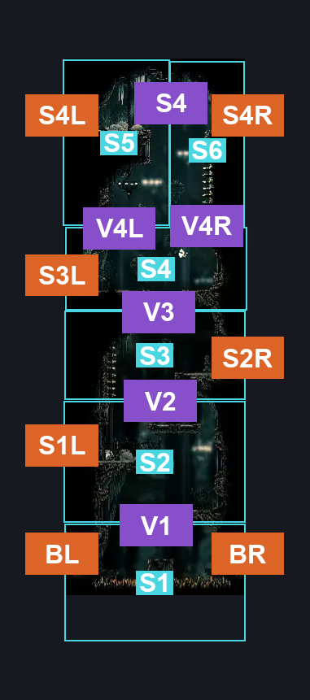
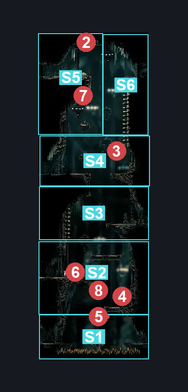
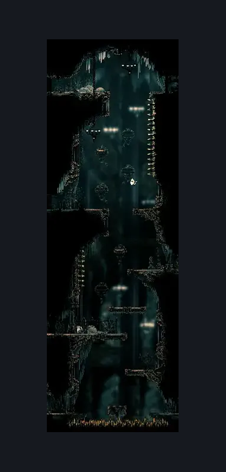

# Choral Chambers Western Shaft (Song_12)

**Game ID:** Song_12

**Contributors:** samupo, Gallos

## Subrooms

| No. | Subroom | Annotated |
| --- | --- | --- |
| S1 | Bottom | ✓ |
| S2 | Section 1 | ✓ |
| S3 | Section 2 | ✓ |
| S4 | Section 3 | ✓ |
| S5 | Section 4 Left | ✓ |
| S6 | Section 4 Right | ✓ |

## Room Transitions

| Alias | Name | From subroom | Destination | Destination alias | Requirements | TODO | Verification | Annotated | Notes |
| --- | --- | --- | --- | --- | --- | --- | --- | --- | --- |
| BL | left1 | Bottom | [Choral Chambers Outside Spa (Song_04)](choral-chambers-outside-spa.md) | R1 | none |  | Verified | ✓ |  |
| BR | right3 | Bottom | [Choral Chambers Above Spa (Song_13)](choral-chambers-above-spa.md) | L | none |  | Verified | ✓ |  |
| S1L | left4 | Section 1 | [Choral Chambers Shop (Song_28)](choral-chambers-shop.md) | R | none |  | Verified | ✓ |  |
| S2R | right2 | Section 2 | [Choral Chambers Flea Room (Song_14)](choral-chambers-flea-room.md) | L | none |  | Verified | ✓ |  |
| S3L | left2 | Section 3 | [Choral Chambers Cogheart Room (Song_26)](choral-chambers-cogheart-room.md) | R | none |  | Verified | ✓ |  |
| S4R | right1 | Section 4 Right | [Choral Chambers Maintenance Tunnel (Song_15)](choral-chambers-maintenance-tunnel.md) | L | none |  | Verified | ✓ |  |
| S4L | left3 | Section 4 Left | [Choral Chambers Grindle (Song_08)](choral-chambers-grindle.md) | R | none |  | Verified | ✓ |  |

## Subroom Connections

| Alias | Name | Source | Destination | Requirements | TODO | Verification | Annotated | Notes |
| --- | --- | --- | --- | --- | --- | --- | --- | --- |
| V1 | Bottom to Section 1 | Bottom | Section 1 | silk soar OR faydown OR (cling grip both AND (dash right OR easy [hunter,beast] pogo OR easy architect needle strike OR medium wanderer needle strike OR drifter's cloak OR easy scuttlebrace OR Flea brew OR clawline right OR sharpdart OR easy [voltvessels, plasmium, thread storm, cross stitch, pale nails] stall x 2 OR (easy heal stall AND easy rune rage stall) OR (ledge grab right AND easy [heal, flintslate, Rune rage] stall))) OR (easy scuttlebrace AND (sharpdart OR clawline right)) OR (ACT 3 AND easy pogo off Choir Elder) |  | Verified | ✓ |  |
| V1 | Bottom to Section 1 | Section 1 | Bottom | none |  | Verified | ✓ | falling |
| V2 | Section 1 to Section 2 | Section 1 | Section 2 | ledge grab right OR silk soar OR faydown cloak OR  easy [Hunter, Reaper,Wanderer, Beast, Architect,Shaman] pogo OR easy pogo off Choir pouncer OR easy scuttlebrace OR cling grip either |  | Verified | ✓ |  |
| V2 | Section 1 to Section 2 | Section 2 | Section 1 | none |  | Verified | ✓ | falling |
| V3 | Section 2 to Section 3 | Section 2 | Section 3 | silk soar OR cling grip left OR easy scuttlebrace OR (faydown cloak AND (cling grip right OR ledge grab either OR easy pogo off Choir flyer OR easy damage boost off Choir Flyer)) |  | Verified | ✓ |  |
| V3 | Section 2 to Section 3 | Section 3 | Section 2 | none |  | Verified | ✓ | falling |
| V4L | Section 3 to Section 4 Left | Section 3 | Section 4 Left | silk soar OR cling grip left OR (faydown cloak AND ledge grab left) OR  easy scuttlebrace |  | Verified | ✓ |  |
| V4L | Section 3 to Section 4 Left | Section 4 Left | Section 3 | none |  | Verified | ✓ | falling |
| V4R | Section 3 to Section 4 Right | Section 3 | Section 4 Right | silk soar OR spike pogo OR cling grip left OR (faydown cloak AND ledge grab right) |  | Verified | ✓ |  |
| V4R | Section 3 to Section 4 Right | Section 4 Right | Section 3 | none |  | Verified | ✓ | falling |
| S4 | Section 4 traversal | Section 4 Left | Section 4 Right | spike pogo OR clawline right OR drifter's cloak OR dash right OR faydown cloak OR sharpdart OR easy scuttlebrace OR run |  | Verified | ✓ |  |
| S4 | Section 4 traversal | Section 4 Right | Section 4 Left | clawline left OR run OR drifter's cloak OR dash left OR faydown cloak OR sharpdart OR easy scuttlebrace OR run |  | Verified | ✓ |  |

## Check Locations

| No. | Check | Subroom | Requirements | TODO | Verification | Location Type | Annotated | Notes |
| --- | --- | --- | --- | --- | --- | --- | --- | --- |
| 1 | Drapefly 1 | Section 4 Left | Normal World Spawn |  | Verified | enemy | ✓ |  |
| 2 | Choir Flyer 1 | Section 3 | Normal World Spawn |  | Verified | enemy | ✓ |  |
| 3 | Choir Bellbearer 1 | Section 1 | Invalid |  | Verified | enemy | ✓ | activeSelf=false, no FSM wake |
| 4 | Choir Elder 1 | Section 1 | Invalid |  | Verified | enemy | ✓ | activeSelf=false, no FSM wake |
| 5 | Choir Pouncer 1 | Section 1 | Normal World Spawn |  | Verified | enemy | ✓ |  |
| 6 | Drapefly 2 | Section 4 Left | Black Thread World Spawn |  | Verified | enemy | ✓ |  |
| 7 | Choir Elder 2 | Section 1 | Black Thread World Spawn |  | Verified | enemy | ✓ |  |

## Room Images

### Connections

### Checks

### Scene

