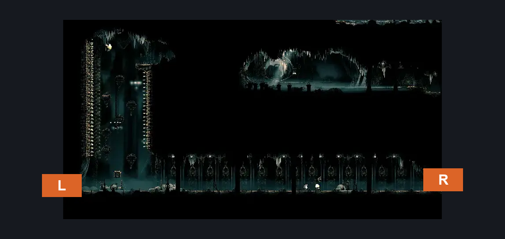
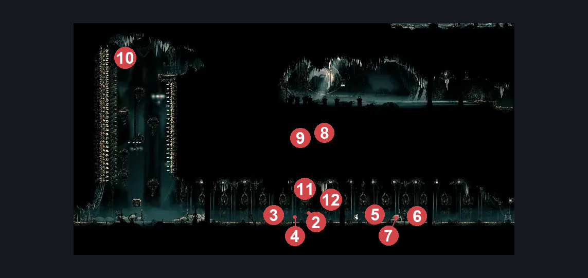
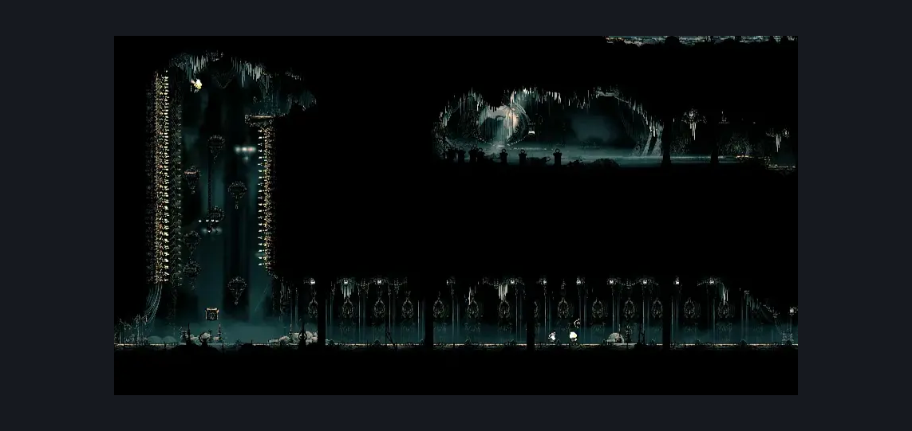

# Corridor to High Halls (Song_17)

**Game ID:** Song_17

**Contributors:** samupo

## Subrooms

No subrooms defined.

## Room Transitions

| Alias | Name | From subroom | Destination | Destination alias | Requirements | TODO | Verification | Annotated | Notes |
| --- | --- | --- | --- | --- | --- | --- | --- | --- | --- |
| R | right1 |  | [Choral Chambers Flea Shaft (Song_11)](choral-chambers-flea-shaft.md) | S3L |  |  |  | ✓ |  |
| L | left1 |  | [High Halls Entrance (Hang_01)](high-halls-entrance.md) | BR |  |  |  | ✓ |  |

## Subroom Connections

No subroom connections defined.

## Check Locations

| No. | Check | Subroom | Requirements | TODO | Verification | Location Type | Annotated | Notes |
| --- | --- | --- | --- | --- | --- | --- | --- | --- |
| 1 | import enemies |  |  | TODO | Needs verification |  |  |  |
| 2 | Rosary Chest - Choral Chambers #2 |  |  |  |  | collectible | ✓ |  |
| 3 | Envoy 1 |  |  |  |  | enemy | ✓ | FSM Boolean flags: marionettesBurned, marionettesMet, song_17_clearedOut |
| 4 | Choristor 1 |  |  |  |  | enemy | ✓ | FSM Boolean flags: song_17_clearedOut |
| 5 | Choir Pouncer 1 |  |  |  |  | enemy | ✓ | FSM Boolean flags: song_17_clearedOut |
| 6 | Envoy 2 |  |  |  |  | enemy | ✓ | FSM Boolean flags: marionettesBurned, marionettesMet, song_17_clearedOut |
| 7 | Choristor 2 |  |  |  |  | enemy | ✓ | FSM Boolean flags: song_17_clearedOut |
| 8 | Choir Pouncer 2 |  |  |  |  | enemy | ✓ | FSM Boolean flags: song_17_clearedOut |
| 9 | Clawmaiden 1 |  |  |  |  | enemy | ✓ | FSM Boolean flags: marionettesBurned, song_17_clearedOut |
| 10 | Clawmaiden 2 |  |  |  |  | enemy | ✓ | FSM Boolean flags: marionettesBurned, song_17_clearedOut |
| 11 | Reed 1 |  | Normal World Spawn |  |  | enemy | ✓ |  |
| 12 | Void Mass 1 |  | Black Thread World Spawn |  |  | enemy | ✓ |  |
| 13 | Reed 2 |  | Black Thread World Spawn |  |  | enemy | ✓ |  |

## Notes

needs to be imported from the Choral Chambers side?

## Room Images

### Connections

### Checks

### Scene

