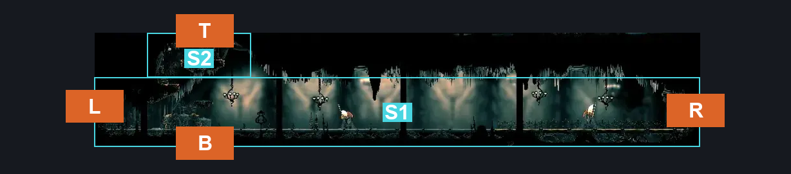
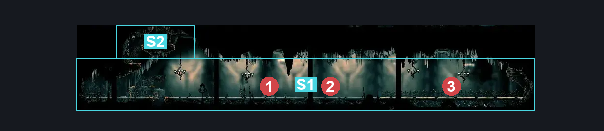
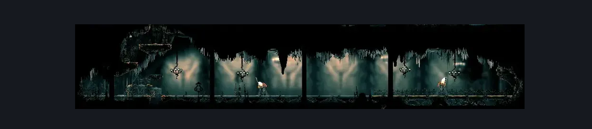

# High Halls Corridor (Hang_07)

**Game ID:** Hang_07

**Contributors:** samupo

## Subrooms

| No. | Subroom | Annotated |
| --- | --- | --- |
| S1 | Bottom | ✓ |
| S2 | Top | ✓ |

## Room Transitions

| Alias | Name | From subroom | Destination | Destination alias | Requirements | TODO | Verification | Annotated | Notes |
| --- | --- | --- | --- | --- | --- | --- | --- | --- | --- |
| L | left1 | Bottom | [Choral Chambers Flea Shaft (Song_11)](choral-chambers-flea-shaft.md) | S3R | none |  | Verified | ✓ | one way entrance, opens from the other side |
| R | right1 | Bottom | [Cog Dancers (Cog_Dancers)](../cogwork-core/cog-dancers.md) | L | none |  | Verified | ✓ |  |
| B | bot1 | Bottom | [Choral Chambers Over Dininig (Song_09)](choral-chambers-over-dininig.md) | T | none |  | Verified | ✓ |  |
| T | top1 | Top | [High Halls Vault (Hang_06)](../high-halls/high-halls-vault.md) | B | Activate Floor Lever IN High Halls Vault |  | Verified | ✓ | one way entrance, opens from the other side |

## Subroom Connections

| Alias | Name | Source | Destination | Requirements | TODO | Verification | Annotated | Notes |
| --- | --- | --- | --- | --- | --- | --- | --- | --- |
| V | Vertical | Bottom | Top | silk soar OR (cling grip OR ledge grab) OR faydown cloak |  | Verified | ✓ |  |
| V | Vertical | Top | Bottom | none |  | Verified | ✓ | falling |

## Check Locations

| No. | Check | Subroom | Requirements | TODO | Verification | Location Type | Annotated | Notes |
| --- | --- | --- | --- | --- | --- | --- | --- | --- |
| 1 | Grand Reed 1 | Bottom | Normal World Spawn |  | Verified | enemy | ✓ | FSM Boolean flags: marionettesBurned, marionettesMet |
| 2 | Song Knight 1 | Bottom | Black Thread World Spawn AND  complete THE Second Sentinel Activation |  | Verified | enemy | ✓ | FSM Boolean flags: encounteredSongChevalierBoss |
| 3 | Grand Reed 2 | Bottom | Normal World Spawn |  | Verified | enemy | ✓ | FSM Boolean flags: marionettesBurned, marionettesMet |

## Room Images

### Connections

### Checks

### Scene

