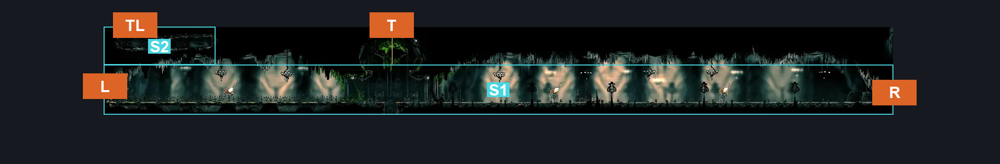
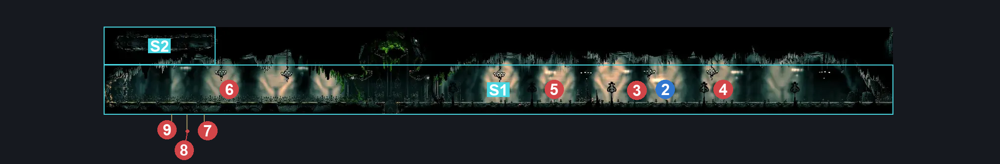
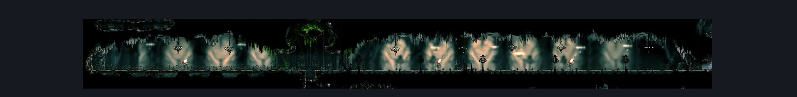

# Memorium Entrance Tunnel (Song_25)

**Game ID:** Song_25

**Contributors:** samupo, heric, Gallos

## Subrooms

| No. | Subroom | Annotated |
| --- | --- | --- |
| S1 | Base | ✓ |
| S2 | Secret Platform | ✓ |

## Room Transitions

| Alias | Name | From subroom | Destination | Destination alias | Requirements | TODO | Verification | Annotated | Notes |
| --- | --- | --- | --- | --- | --- | --- | --- | --- | --- |
| TL | top2 | Secret Platform | [Cogwork Core Breakable Walls (Cog_10_Destroyed)](../cogwork-core/cogwork-core-breakable-walls.md) | B | ACT 3 AND silk soar |  | Verified | ✓ |  |
| L | left1 | Base | [Cog Dancers (Cog_Dancers)](../cogwork-core/cog-dancers.md) | R | none |  | Verified | ✓ |  |
| T | top1 | Base | [Memorium Start Shaft (Arborium_01)](../memorium/memorium-start-shaft.md) | B | silk soar OR ((ledge grab both OR faydown cloak OR cling grip either OR scuttlebrace) AND easy pogo off Grand Reed) OR (faydown cloak AND (ledge grab either OR scuttlebrace OR cling grip either)) |  | Verified | ✓ |  |
| R | right1 | Base | [Songclave (Song_Enclave)](songclave.md) | TL | none |  | Verified | ✓ |  |
| B | bot1 | Base | [Rotating Tunnel (Song_20b)](rotating-tunnel.md) | T | none |  | Verified |  |  |

## Subroom Connections

| Alias | Name | Source | Destination | Requirements | TODO | Verification | Annotated | Notes |
| --- | --- | --- | --- | --- | --- | --- | --- | --- |
| V | Vertical Secret | Base | Secret Platform | ACT 3 AND silk soar |  | Verified |  |  |
| V | Vertical Secret | Secret Platform | Base | none |  | Verified |  | falling |

## Check Locations

| No. | Check | Subroom | Requirements | TODO | Verification | Location Type | Annotated | Notes |
| --- | --- | --- | --- | --- | --- | --- | --- | --- |
| 1 | Memorium entrance vines | Base | break wall up |  | Verified | blockade |  | one way wall and also logic can be improved for more skips |
| 2 | Second Sentinel Encounter | Base | complete THE Second Sentinel Activation |  | Verified | event | ✓ | Spawn conditions: songChevalierActiveInSong_25=true, songChevalierSeenInSong_25=false, songChevalierEncounterCooldown=false, songChevalierQuestReady=false FSM Boolean flags: encounteredSongChevalierBoss |
| 3 | Grand Reed 1 | Base | prereq Second Sentinel Encounter |  | Verified | enemy | ✓ | Spawn conditions: songChevalierActiveInSong_25=true, songChevalierSeenInSong_25=false, songChevalierEncounterCooldown=false, songChevalierQuestReady=false |
| 4 | Grand Reed 2 | Base | Normal World Spawn |  | Verified | enemy | ✓ | FSM Boolean flags: marionettesBurned, marionettesMet |
| 5 | Grand Reed 3 | Base | Normal World Spawn |  | Verified | enemy | ✓ | FSM Boolean flags: marionettesBurned, marionettesMet |
| 6 | Grand Reed 4 | Base | Normal World Spawn |  | Verified | enemy | ✓ | FSM Boolean flags: marionettesBurned, marionettesMet |
| 7 | Clawmaiden 1 | Base | Normal World Spawn |  | Verified | enemy | ✓ | FSM Boolean flags: marionettesBurned |
| 8 | Clawmaiden 2 | Base | Normal World Spawn |  | Verified | enemy | ✓ | FSM Boolean flags: marionettesBurned |
| 9 | Clawmaiden 3 | Base | Normal World Spawn |  | Verified | enemy | ✓ | FSM Boolean flags: marionettesBurned |

## Room Images

### Connections

### Checks

### Scene

