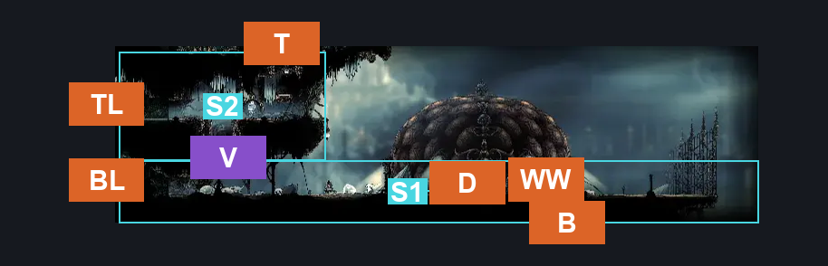
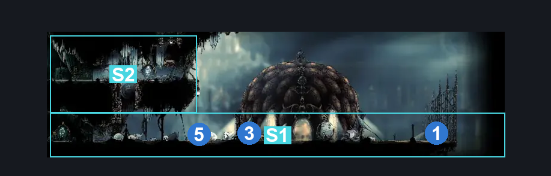
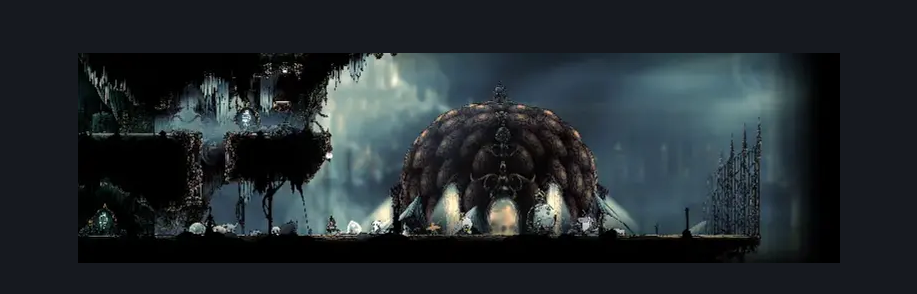

# Songclave (Song_Enclave)

**Game ID:** Song_Enclave

**Contributors:** Gallos

## Subrooms

| No. | Subroom | Annotated |
| --- | --- | --- |
| S1 | Base | ✓ |
| S2 | Top Platform | ✓ |

## Room Transitions

| Alias | Name | From subroom | Destination | Destination alias | Requirements | TODO | Verification | Annotated | Notes |
| --- | --- | --- | --- | --- | --- | --- | --- | --- | --- |
| BL | left2 | Base | [Songclave Steam Tunnel (Library_02)](../whispering-vaults/songclave-steam-tunnel.md) | TR | none |  | Verified | ✓ |  |
| TL | left1 | Top Platform | [Memorium Entrance Tunnel (Song_25)](memorium-entrance-tunnel.md) | R | none |  | Verified | ✓ |  |
| B | bot1 | Base | [Whispering Vaults Hell (Library_04)](../whispering-vaults/whispering-vaults-hell.md) | T | break wall up |  | Verified | ✓ | only breakable in whispering vaults |
| T | top1 | Top Platform | [Songclave Tube (Song_Enclave_Tube)](songclave-tube.md) | B | none |  | Verified | ✓ |  |
| D | door1 | Base | [Songclave Bellshrine (Bellshrine_Enclave)](songclave-bellshrine.md) | L | none |  | Verified | ✓ |  |
| WW | wish wall | Base | [Songclave Wish Wall](../wish-menus/songclave-wish-wall.md) | SC | complete Meet the Caretaker AND ((prereq Lace Second Encounter IN choral chambers eastern shaft) OR (prereq Lace Second Encounter IN grand bellway shaft)) |  | Verified | ✓ |  |

## Subroom Connections

| Alias | Name | Source | Destination | Requirements | TODO | Verification | Annotated | Notes |
| --- | --- | --- | --- | --- | --- | --- | --- | --- |
| V | Vertical | Base | Top Platform | silk soar OR cling grip left OR (cling grip right AND faydown cloak) OR scuttlebrace |  | Verified | ✓ |  |
| V | Vertical | Top Platform | Base | none |  | Verified | ✓ | falling |

## Check Locations

| No. | Check | Subroom | Requirements | TODO | Verification | Location Type | Annotated | Notes |
| --- | --- | --- | --- | --- | --- | --- | --- | --- |
| 1 | White Key | Base | none |  | Verified | collectible | ✓ |  |
| 2 | Wish: Pain, Anguish and Misery | Base | Act 3 AND Defeat Trobbio IN Trobbio |  | Verified | event |  |  |
| 3 | Meet the Caretaker | Base | activate Lever Bellshrine Enclave IN bellshrine-enclave |  | Verified | logic-point | ✓ |  |
| 4 | Reach Songclave | Base | none |  | Verified | logic-point |  | Used for Savage Beastfly wish. |
| 5 | Songclave bench | Base | none |  | Verified | bench | ✓ |  |

## Room Images

### Connections

### Checks

### Scene

