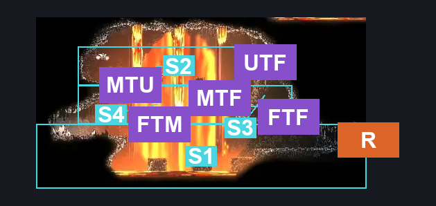
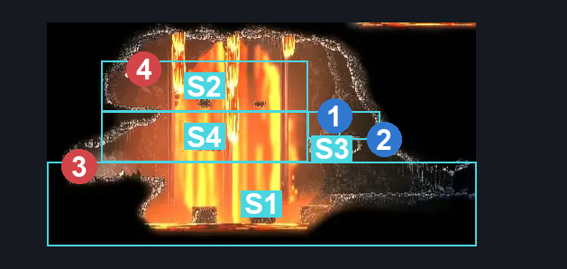
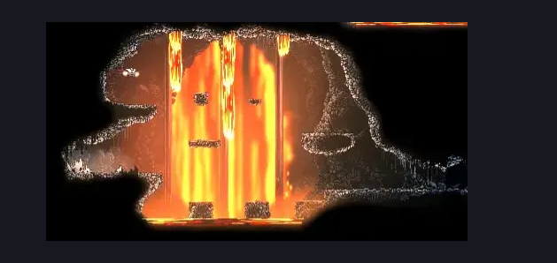

# Deep Docks Bellway Flea Rescue (Dock_16)

**Game ID:** Dock_16

**Contributors:** herounit,Rebel, Gallos

## Subrooms

| No. | Subroom | Annotated |
| --- | --- | --- |
| S1 | Floor | ✓ |
| S2 | Upper | ✓ |
| S3 | Flea | ✓ |
| S4 | Middle | ✓ |

## Room Transitions

| Alias | Name | From subroom | Destination | Destination alias | Requirements | TODO | Verification | Annotated | Notes |
| --- | --- | --- | --- | --- | --- | --- | --- | --- | --- |
| R | right1 | Floor | [Deep Docks Bellway (Bellway_02)](deep-docks-bellway.md) | L | none |  | Verified | ✓ |  |

## Subroom Connections

| Alias | Name | Source | Destination | Requirements | TODO | Verification | Annotated | Notes |
| --- | --- | --- | --- | --- | --- | --- | --- | --- |
| FTM | Floor <> Middle | Floor | Middle | Ledge Grab right OR Cling Grip right OR Faydown Cloak OR Silk Soar OR easy shaman pogo OR easy pogo off Skull brute OR easy [voltvessels,plasmium, flea brew] stall OR easy beast needle strike OR (have crest beast AND easy heal stall) OR easy scuttlebrace |  | Verified | ✓ |  |
| FTM | Floor <> Middle | Middle | Floor | Nothing. (Fall) |  | Verified | ✓ |  |
| MTF | Middle <> Flea | Middle | Flea | run OR clawline right OR sharpdart OR (drifter's AND (ledge grab right OR cling grip right OR dash right OR easy beast pogo)) OR (easy shaman pogo AND easy scuttlebrace) OR (easy plasmium stall AND (ledge grab right OR cling grip right OR easy hazard respawn OR easy beast pogo)) OR ((easy [voltvessels, flea brew] stall OR easy beast needle strike OR (have crest beast AND easy heal stall)) AND easy hazard respawn) |  | Verified | ✓ |  |
| MTU | Middle <> Upper | Middle | Upper | silk soar OR faydown OR medium shaman pogo OR ledge grab left OR cling grip left OR easy plasmium stall |  | Verified | ✓ |  |
| MTU | Middle <> Upper | Upper | Middle | none |  | Verified | ✓ | falling |
| UTF | Upper <> Flea | Upper | Flea | Nothing. |  | Verified | ✓ |  |
| FTF | Floor <> Flea | Floor | Flea | (Activate Flea Breakable Floor AND (Silk Soar OR (Faydown Cloak AND (Ledge Grab OR Cling Grip OR Scuttlebrace)))) |  | Verified | ✓ |  |
| FTF | Floor <> Flea | Flea | Floor | Activate Flea Breakable Floor AND (silk soar OR (faydown AND (cling grip either OR ledge grab right OR easy scuttlebrace OR easy shaman pogo))) |  | Verified | ✓ |  |

## Check Locations

| No. | Check | Subroom | Requirements | TODO | Verification | Location Type | Annotated | Notes |
| --- | --- | --- | --- | --- | --- | --- | --- | --- |
| 1 | flea rescue bellway | Flea | Nothing. |  | Verified | collectible | ✓ |  |
| 2 | flea breakable floor | Flea | Break Wall Down |  | Verified | blockade | ✓ | stand on it |
| 3 | Skull Brute 1 | Floor | none |  | Verified | enemy | ✓ |  |
| 4 | Caranid 1 | Upper | none |  | Verified | enemy | ✓ |  |

## Room Images

### Connections

### Checks

### Scene

