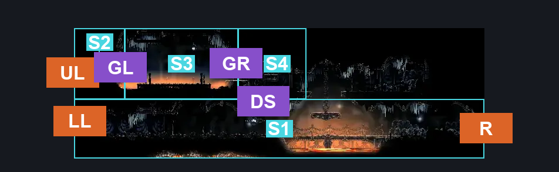
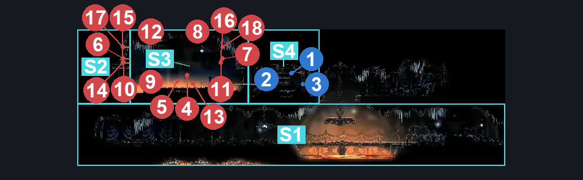
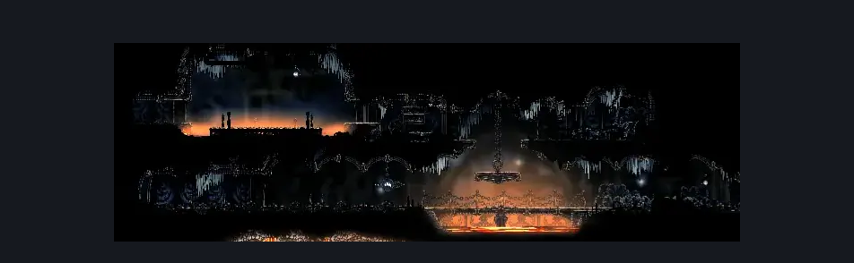

# Deep Docks Entrance (Dock_08)

**Game ID:** Dock_08

**Contributors:** herounit and Rebel

## Subrooms

| No. | Subroom | Annotated |
| --- | --- | --- |
| S1 | main pathway | ✓ |
| S2 | gauntlet left | ✓ |
| S3 | gauntlet | ✓ |
| S4 | gauntlet right | ✓ |

## Room Transitions

| Alias | Name | From subroom | Destination | Destination alias | Requirements | TODO | Verification | Annotated | Notes |
| --- | --- | --- | --- | --- | --- | --- | --- | --- | --- |
| UL | left2 | gauntlet left | [The Marrow Lava Docks (Bone_09)](../the-marrow/the-marrow-lava-docks.md) | UR | none |  | Verified | ✓ |  |
| LL | left1 | main pathway | [The Marrow Lava Docks (Bone_09)](../the-marrow/the-marrow-lava-docks.md) | LR | none |  | Verified | ✓ |  |
| R | right1 | main pathway | [Deep Docks Bench Shaft (Dock_01)](deep-docks-bench-shaft.md) | L | none |  | Verified | ✓ |  |

## Subroom Connections

| Alias | Name | Source | Destination | Requirements | TODO | Verification | Annotated | Notes |
| --- | --- | --- | --- | --- | --- | --- | --- | --- |
| DS | door switch | main pathway | gauntlet right | Activate Deep Docks Entrance Gate AND   (Silk Soar OR Ledge Grab Left OR Cling Grip Either OR Faydown Cloak OR Easy Scuttlebrace OR Easy [Shaman] Pogo OR Easy [beast] Charge OR Hard [Plasmium] Stall OR   (Ledge Grab Right AND  (Sprint Left OR Dash Left OR Clawline Left OR Easy [Hunter, Reaper, Beast, Architect] Pogo OR Easy [Reaper, Wanderer, Beast, Architect] Charge OR (Proficient Movement AND [Architect] Attack Left) OR Easy [Flintslate, Flea Brew, Plasmium, Voltvessels] Stall OR Flea Brew))) |  | Verified | ✓ | looooooooong requirement |
| DS | door switch | gauntlet right | main pathway | Activate Deep Docks Entrance Gate |  | Verified | ✓ |  |
| GL | gauntlet fight left | gauntlet left | gauntlet | Nothing. |  | Verified | ✓ |  |
| GL | gauntlet fight left | gauntlet | gauntlet left | Defeat Deep Docks Entrance Gauntlet |  | Verified | ✓ |  |
| GR | gauntlet fight right | gauntlet | gauntlet right | Defeat Deep Docks Entrance Gauntlet |  | Verified | ✓ |  |
| GR | gauntlet fight right | gauntlet right | gauntlet | Defeat Deep Docks Entrance Gauntlet |  | Verified | ✓ |  |

## Check Locations

| No. | Check | Subroom | Requirements | TODO | Verification | Location Type | Annotated | Notes |
| --- | --- | --- | --- | --- | --- | --- | --- | --- |
| 1 | Deep Docks Entrance Lever | gauntlet right | Flip Switch Right |  | Verified | switch | ✓ | WHY ARE THESE BLUE THEY'RE IN THE RIGHT SPOT nvm i figured it out. |
| 2 | Deep Docks Entrance - Mask Shard | gauntlet right | Nothing. |  | Verified | collectible | ✓ |  |
| 3 | Deep Docks Entrance Gate | gauntlet right | Activate Deep Docks Entrance Lever |  | Verified | logic-point | ✓ | no idea if this is needed. |
| 4 | Deep Docks Entrance Gauntlet | gauntlet | Combat Requirements |  | Verified | gauntlet | ✓ |  |
| 5 | Smelt Shoveller 1 | gauntlet | nada |  | Verified | enemy | ✓ | WHY ARE YOU BLUEEEEEEEEE |
| 6 | Beastfly 1 | gauntlet | free |  | Verified | enemy | ✓ |  |
| 7 | Beastfly 2 | gauntlet | none |  | Verified | enemy | ✓ |  |
| 8 | Flintstone Flyer 1 | gauntlet | nada |  | Verified | enemy | ✓ |  |
| 9 | Pilgrim Hulk 1 | gauntlet | nothing |  | Verified | enemy | ✓ |  |
| 10 | Beastfly 3 | gauntlet | zilch |  | Verified | enemy | ✓ |  |
| 11 | Beastfly 4 | gauntlet | nothing |  | Verified | enemy | ✓ |  |
| 12 | Flintstone Flyer 2 | gauntlet | nada |  | Verified | enemy | ✓ |  |
| 13 | Smokerock Sifter 1 | gauntlet | none |  | Verified | enemy | ✓ |  |
| 14 | Beastfly 5 | gauntlet | free |  | Verified | enemy | ✓ |  |
| 15 | Beastfly 6 | gauntlet | nothing |  | Verified | enemy | ✓ |  |
| 16 | Beastfly 7 | gauntlet | nada |  | Verified | enemy | ✓ |  |
| 17 | Beastfly 8 | gauntlet | zilch |  | Verified | enemy | ✓ |  |
| 18 | Beastfly 9 | gauntlet | nothing |  | Verified | enemy | ✓ |  |

## Room Images

### Connections

### Checks

### Scene

