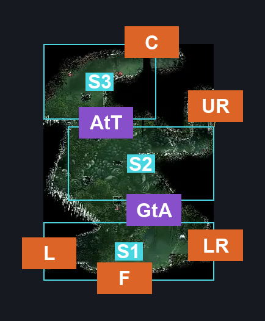
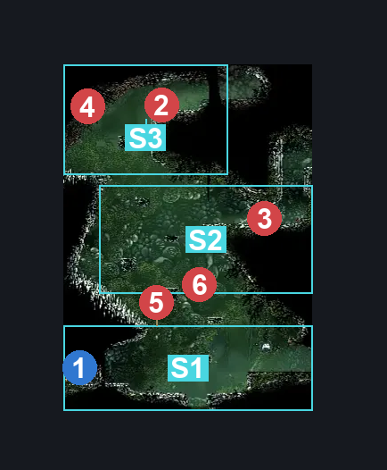
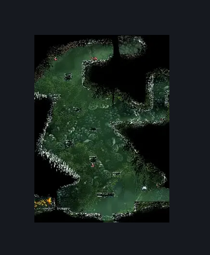

# Is this still Deep Docks? East (Bone_East_04)

**Game ID:** Bone_East_04

**Contributors:** herounit and Rebel

## Subrooms

| No. | Subroom | Annotated |
| --- | --- | --- |
| S1 | Ground | ✓ |
| S2 | Upper | ✓ |
| S3 | Upper Left | ✓ |

## Room Transitions

| Alias | Name | From subroom | Destination | Destination alias | Requirements | TODO | Verification | Annotated | Notes |
| --- | --- | --- | --- | --- | --- | --- | --- | --- | --- |
| C | top2 | Upper Left | [Hunter's March Deep Docks Passage (Ant_05b)](../hunter-s-march/hunter-s-march-deep-docks-passage.md) | RF | none |  | Verified | ✓ |  |
| UR | right2 | Upper | ["Deep Docks" March Side Room (Bone_East_04c)](deep-docks-march-side-room.md) | L | Nothing. |  | Verified | ✓ |  |
| LR | right1 | Ground | [Far Fields Deep Docks Loopback (Bone_East_15)](../far-fields/far-fields-deep-docks-loopback.md) | L | none |  | Verified | ✓ |  |
| L | left1 | Ground | [Is this still Deep Docks West (Bone_East_04b)](is-this-still-deep-docks-west.md) | R | Activate Deep Docks Is This Still Deep Docks West Blast Rock IN Is This Still Deep Docks West OR Activate Is this still Deep Docks East Blast Rock |  | Verified | ✓ | both blast rocks are connected and trigger the same shortcut. |
| F | bot1 | Ground | [Deep Docks Spire Lower (Bone_East_03)](deep-docks-spire-lower.md) | C | Activate Deep Docks Lower Spire Blast Rock IN deep docks spire lower |  | Verified | ✓ |  |

## Subroom Connections

| Alias | Name | Source | Destination | Requirements | TODO | Verification | Annotated | Notes |
| --- | --- | --- | --- | --- | --- | --- | --- | --- |
| GtA | Ground to Right | Ground | Upper | (Faydown Cloak AND Ledge Grab) OR Medium Pogo OFF {Skarrwing} OR Cling Grip Either OR Silk Soar |  | Verified | ✓ |  |
| GtA | Ground to Right | Upper | Ground | Nothing. (Fall) |  | Verified | ✓ |  |
| AtT | Ground to Left | Upper | Upper Left | Faydown Cloak OR Silk Soar OR  ((Cling Grip Left OR Ledge Grab Left) AND  (Easy Pogo OFF [skarrwing] OR Cling Grip Right OR Ledge Grab Right)) |  | Verified | ✓ | dash is included in the scuttlebrace use requirement so i dont think its necessary but i will anyway, |
| AtT | Ground to Left | Upper Left | Upper | Nothing. (Fall) |  | Verified | ✓ |  |

## Check Locations

| No. | Check | Subroom | Requirements | TODO | Verification | Location Type | Annotated | Notes |
| --- | --- | --- | --- | --- | --- | --- | --- | --- |
| 1 | Is this still Deep Docks East Blast Rock | Ground | Break Blast Rock Left |  | Verified | blockade | ✓ |  |
| 2 | Skarrlid 1 | Upper Left | nada |  | Verified | enemy | ✓ |  |
| 3 | Skarrlid 2 | Upper | free |  | Verified | enemy | ✓ |  |
| 4 | Skarrwing 1 | Upper Left | Normal World Spawn |  | Verified | enemy | ✓ |  |
| 5 | Skarrwing 2 | Ground | Normal World Spawn |  | Verified | enemy | ✓ |  |
| 6 | Skarrwing 3 | Upper | Black Thread World Spawn |  | Verified | enemy | ✓ |  |

## Room Images

### Connections

### Checks

### Scene

