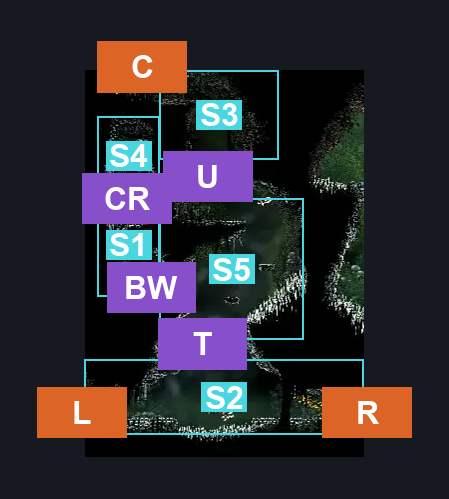
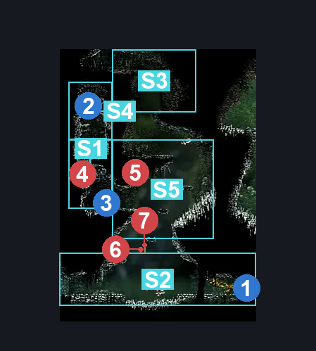
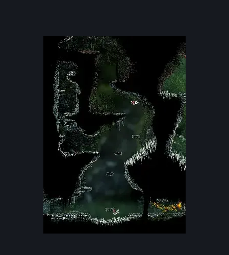

# Is this still Deep Docks West (Bone_East_04b)

**Game ID:** Bone_East_04b

**Contributors:** herounit and Rebel

## Subrooms

| No. | Subroom | Annotated |
| --- | --- | --- |
| S1 | side room | ✓ |
| S2 | ground | ✓ |
| S3 | upper level | ✓ |
| S4 | Rosary String | ✓ |
| S5 | Main Area | ✓ |

## Room Transitions

| Alias | Name | From subroom | Destination | Destination alias | Requirements | TODO | Verification | Annotated | Notes |
| --- | --- | --- | --- | --- | --- | --- | --- | --- | --- |
| R | right1 | ground | [Is this still Deep Docks? East (Bone_East_04)](is-this-still-deep-docks-east.md) | L | Activate Deep Docks Is This Still Deep Docks West Blast Rock OR Activate Is this still Deep Docks East Blast Rock IN Is this still Deep Docks East |  | Verified | ✓ | both blast rocks are connected and trigger the same shortcut. |
| C | top1 | upper level | [Hunter's March Deep Docks Passage (Ant_05b)](../hunter-s-march/hunter-s-march-deep-docks-passage.md) | LF | Nothing. |  | Verified | ✓ |  |
| L | left1 | ground | [Deep Docks Upper Spire (Bone_East_05)](deep-docks-upper-spire.md) | R | Nothing. |  | Verified | ✓ |  |

## Subroom Connections

| Alias | Name | Source | Destination | Requirements | TODO | Verification | Annotated | Notes |
| --- | --- | --- | --- | --- | --- | --- | --- | --- |
| T | Traversal | ground | Main Area | Ledge Grab Left OR Cling Grip Left OR Faydown Cloak OR Silk Soar OR Easy Pogo OFF [Skarrwing] |  | Verified | ✓ |  |
| T | Traversal | Main Area | ground | Nothing (fall) |  | Verified | ✓ |  |
| BW | Break Wall | Main Area | side room | Activate Rosary Wall |  | Verified | ✓ |  |
| BW | Break Wall | side room | Main Area | Activate Rosary Wall |  | Verified | ✓ |  |
| CR | Collect Rosary | side room | Rosary String | Ledge Grab Both OR Faydown Cloak OR Cling Grip Either OR Silk Soar |  | Verified | ✓ |  |
| CR | Collect Rosary | Rosary String | side room | Nothing. (Fall) |  | Verified | ✓ |  |
| U | Upper | Main Area | upper level | Silk Soar OR Cling Grip Left OR (Faydown Cloak AND (Ledge Grab Right OR Cling Grip Right)) |  | Verified | ✓ |  |
| U | Upper | upper level | Main Area | Nothing (Fall) |  | Verified | ✓ |  |

## Check Locations

| No. | Check | Subroom | Requirements | TODO | Verification | Location Type | Annotated | Notes |
| --- | --- | --- | --- | --- | --- | --- | --- | --- |
| 1 | Deep Docks Is This Still Deep Docks West Blast Rock | ground | Break Blast Rock Right |  | Verified | blockade | ✓ |  |
| 2 | Deep Docks Is This Still Deep Docks West - Frayed Rosary String | Rosary String | Nothing. |  | Verified | collectible | ✓ |  |
| 3 | Rosary Wall | Main Area | Break Wall Left |  | Verified | blockade | ✓ |  |
| 4 | Skarrwing 1 | side room | Normal World Spawn |  | Verified | enemy | ✓ |  |
| 5 | Skarrwing 2 | Main Area | Normal World Spawn |  | Verified | enemy | ✓ |  |
| 6 | Skarrwing 3 | ground | Normal World Spawn |  | Verified | enemy | ✓ |  |
| 7 | Skarrwing 4 | ground | Black Thread World Spawn |  | Verified | enemy | ✓ |  |

## Room Images

### Connections

### Checks

### Scene

