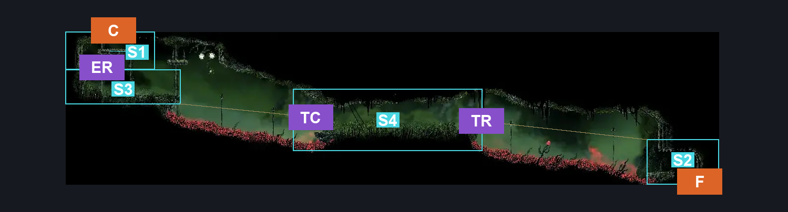
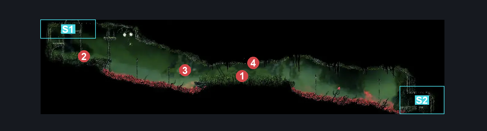
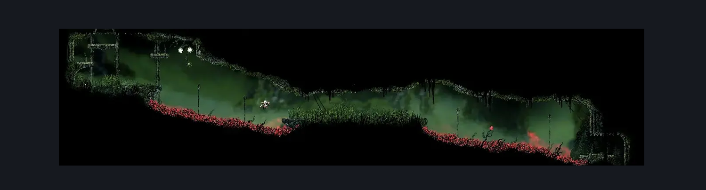

# Far Fields Deep Fort Passage (Bone_East_26)

**Game ID:** Bone_East_26

**Contributors:** herounit

## Subrooms

| No. | Subroom | Annotated |
| --- | --- | --- |
| S1 | ceiling exit platform | ✓ |
| S2 | floor exit area | ✓ |
| S3 | ceiling exit ledge | ✓ |
| S4 | thorn thicket plateau | ✓ |

## Room Transitions

| Alias | Name | From subroom | Destination | Destination alias | Requirements | TODO | Verification | Annotated | Notes |
| --- | --- | --- | --- | --- | --- | --- | --- | --- | --- |
| C | top1 | ceiling exit platform | [Far Fields Deep Fort Bench (Bone_East_27)](far-fields-deep-fort-bench.md) | F | none |  | Verified | ✓ |  |
| F | bot1 | floor exit area | [Far Fields Deep Lower East (Bone_East_18b)](far-fields-deep-lower-east.md) | C | none |  | Verified | ✓ |  |

## Subroom Connections

| Alias | Name | Source | Destination | Requirements | TODO | Verification | Annotated | Notes |
| --- | --- | --- | --- | --- | --- | --- | --- | --- |
| TC | thorn crossing | thorn thicket plateau | ceiling exit ledge | (clawline left AND (silkhearts x 1 OR clawline x 3)) OR (sharp dart AND run AND dash left AND faydown cloak AND (ledge grab right OR cling grip left)) |  | Verified | ✓ |  |
| TC | thorn crossing | ceiling exit ledge | thorn thicket plateau | ( clawline right AND ( silkhearts x 2 OR ( silkhearts x 1 AND ( faydown OR dash OR drifters ) ) ) ) OR ( run AND dash AND drifters AND faydown ) |  | Verified | ✓ |  |
| TR | thorn crossing left | floor exit area | thorn thicket plateau | (clawline left AND (silkhearts x 1 OR clawline x 3)) OR (sharp dart AND run AND dash left AND faydown cloak AND (ledge grab right OR cling grip left)) |  | Verified | ✓ |  |
| TR | thorn crossing left | thorn thicket plateau | floor exit area | ( clawline right AND ( silkhearts x 2 OR (silkhearts x 1 AND (faydown OR dash OR drifters ) ) ) ) OR ( run AND dash right AND drifters AND faydown ) |  | Verified | ✓ |  |
| ER | exit rise | ceiling exit platform | ceiling exit ledge | none (falling) |  | Verified | ✓ |  |
| ER | exit rise | ceiling exit ledge | ceiling exit platform | silk soar  OR faydown cloak  OR (ledge grab right  AND (hard pogo off Fertid OR easy shaman pogo OR easy flea brew stall)) |  | Verified | ✓ |  |

## Check Locations

| No. | Check | Subroom | Requirements | TODO | Verification | Location Type | Annotated | Notes |
| --- | --- | --- | --- | --- | --- | --- | --- | --- |
| 1 | Skarr Stalker 1 | thorn thicket plateau | none |  | Verified | enemy | ✓ |  |
| 2 | Fertid 1 | ceiling exit ledge | none |  | Verified | enemy | ✓ |  |
| 3 | Spear Skarr 1 | thorn thicket plateau | none |  | Verified | enemy | ✓ |  |
| 4 | Void Mass 1 | thorn thicket plateau | Black Thread World Spawn |  | Verified | enemy | ✓ |  |

## Room Images

### Connections

### Checks

### Scene

