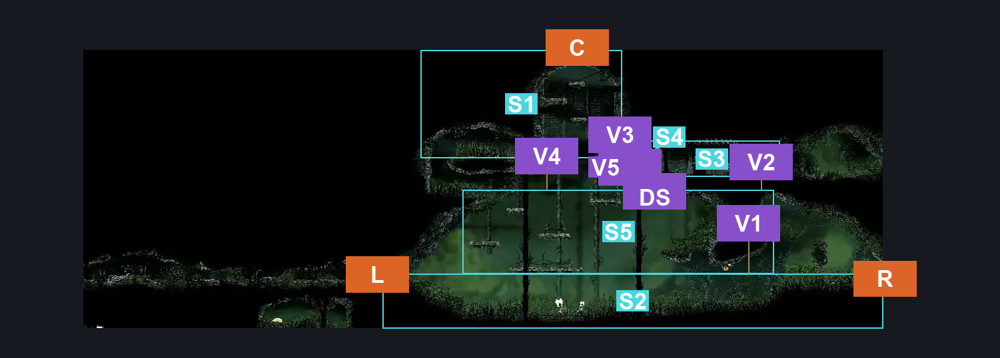
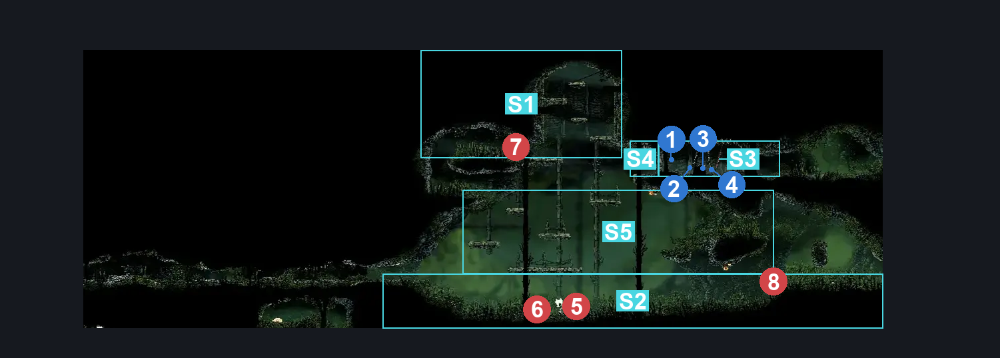
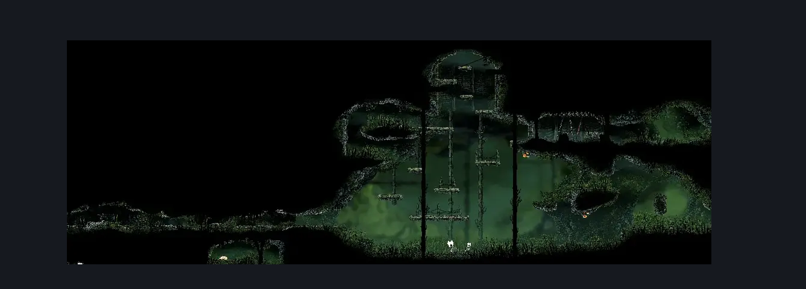

# Far Fields Deep Lower West (Bone_East_18)

**Game ID:** Bone_East_18

**Contributors:** herounit

## Subrooms

| No. | Subroom | Annotated |
| --- | --- | --- |
| S1 | ceiling exit area | ✓ |
| S2 | ground level | ✓ |
| S3 | upper right alcove | ✓ |
| S4 | left of alcove gate | ✓ |
| S5 | center scaffolds | ✓ |

## Room Transitions

| Alias | Name | From subroom | Destination | Destination alias | Requirements | TODO | Verification | Annotated | Notes |
| --- | --- | --- | --- | --- | --- | --- | --- | --- | --- |
| C | top1 | ceiling exit area | [Far Fields Deep Entrance (Bone_East_24)](far-fields-deep-entrance.md) | F | none |  | Verified | ✓ |  |
| L | left1 | ground level | [Far Fields Pilgrim's Rest Deep Passage (Bone_East_18c)](far-fields-pilgrim-s-rest-deep-passage.md) | R | none |  | Verified | ✓ |  |
| R | right1 | ground level | [Far Fields Deep Lower East (Bone_East_18b)](far-fields-deep-lower-east.md) | L | none |  | Verified | ✓ |  |

## Subroom Connections

| Alias | Name | Source | Destination | Requirements | TODO | Verification | Annotated | Notes |
| --- | --- | --- | --- | --- | --- | --- | --- | --- |
| V1 | vertical 1 | ground level | center scaffolds | silk soar OR scuttlebrace OR ( cling grip AND ( run OR dash OR drifter's cloak OR faydown cloak OR clawline OR sharpdart OR easy beast pogo OR proficient movement) ) OR faydown cloak |  | Verified | ✓ |  |
| V1 | vertical 1 | center scaffolds | ground level | none (falling) |  | Verified | ✓ |  |
| DS | door switch | upper right alcove | left of alcove gate | activate door switch far fields deep lower west |  | Verified | ✓ |  |
| DS | door switch | left of alcove gate | upper right alcove | activate door switch far fields deep lower west |  | Verified | ✓ |  |
| V2 | vertical 2 | center scaffolds | upper right alcove | silk soar OR faydown cloak OR ( ledge grab AND ( run OR clawline OR ( drifter's cloak AND ( dash OR sharpdart ) ) ) ) |  | Verified | ✓ |  |
| V2 | vertical 2 | upper right alcove | center scaffolds | none (falling) |  | Verified | ✓ |  |
| V3 | vertical 3 | left of alcove gate | ceiling exit area | silk soar OR clawline OR faydown cloak OR scuttlebrace OR (ledge grab AND (run left OR (drifter's cloak AND (easy beast needle strike OR easy architect needle strike OR architect slash left)))) OR ( cling grip AND (run left OR dash left OR sharpdart OR drifter's cloak ) ) |  | Verified | ✓ | no inverse because there isn't much point |
| V4 | vertical 4 | center scaffolds | ceiling exit area | faydown cloak OR cling grip OR scuttlebrace OR silk soar |  | Verified | ✓ |  |
| V4 | vertical 4 | ceiling exit area | center scaffolds | none (falling) |  | Verified | ✓ |  |
| V5 | vertical 5 | center scaffolds | left of alcove gate | faydown cloak OR cling grip OR scuttlebrace OR silk soar OR (ledge grab AND ((run AND drifter's cloak) OR dash OR easy beast pogo OR easy architect needle strike)) |  | Verified | ✓ | inverse is redundant |

## Check Locations

| No. | Check | Subroom | Requirements | TODO | Verification | Location Type | Annotated | Notes |
| --- | --- | --- | --- | --- | --- | --- | --- | --- |
| 1 | door switch far fields deep lower west | upper right alcove | none |  | Verified | switch | ✓ |  |
| 2 | AP Minor Cache - Shell Shard Cache: Far Fields #2 | upper right alcove | none |  | Verified | collectible | ✓ |  |
| 3 | AP Minor Cache - Shell Shard Cache: Far Fields #3 | upper right alcove | none |  | Verified | collectible | ✓ |  |
| 4 | AP Minor Cache - Rosary Cache: Far Fields #18 | upper right alcove | none |  | Verified | collectible | ✓ |  |
| 5 | Hardbone Elder 1 | ground level | none |  | Verified | enemy | ✓ |  |
| 6 | Hardbone Hopper 1 | ground level | none |  | Verified | enemy | ✓ |  |
| 7 | Fertid 1 | ceiling exit area | none |  | Verified | enemy | ✓ |  |
| 8 | Fertid 2 | ground level | none |  | Verified | enemy | ✓ |  |

## Room Images

### Connections

### Checks

### Scene

