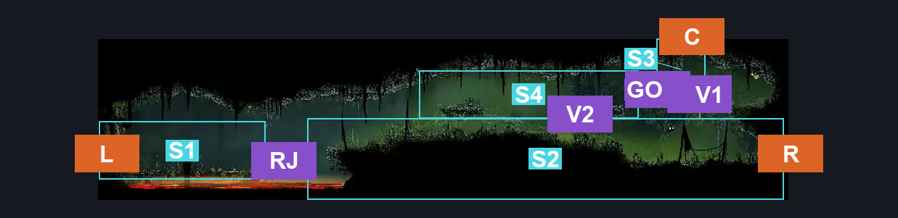
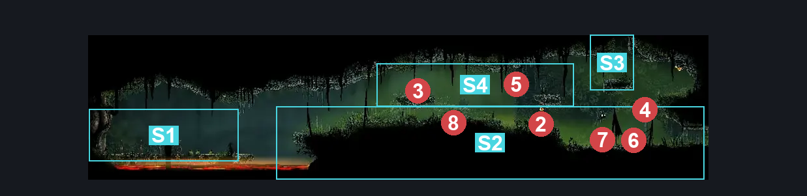
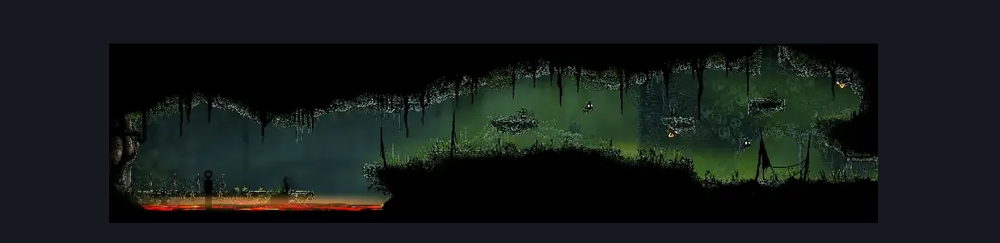

# Far Fields Entrance East (Bone_East_02)

**Game ID:** Bone_East_02

**Contributors:** herounit

## Subrooms

| No. | Subroom | Annotated |
| --- | --- | --- |
| S1 | deep docks platform | ✓ |
| S2 | main pathway | ✓ |
| S3 | ceiling exit platform | ✓ |
| S4 | main platforms | ✓ |

## Room Transitions

| Alias | Name | From subroom | Destination | Destination alias | Requirements | TODO | Verification | Annotated | Notes |
| --- | --- | --- | --- | --- | --- | --- | --- | --- | --- |
| C | top1 | ceiling exit platform | [Far Fields Deep Docks Loopback (Bone_East_15)](far-fields-deep-docks-loopback.md) | F | silk soar OR faydown cloak OR cling grip left OR (cling grip right AND ledge grab left) OR easy scuttlebrace |  | Verified | ✓ | car barely make it up with faydown cloak |
| L | left1 | deep docks platform | [Deep Docks Bellshrine (Bellshrine_05)](../deep-docks/deep-docks-bellshrine.md) | R | ( bellshrinesanity off AND activate bellshrine switch IN deep docks bellshrine )  OR ( bellshrinesanity on AND have bell deep docks ) |  | Verified | ✓ | must keep in sync with other side |
| R | right1 | main pathway | [Far Fields Entrance West (Bone_East_02b)](far-fields-entrance-west.md) | L | none |  | Verified | ✓ |  |

## Subroom Connections

| Alias | Name | Source | Destination | Requirements | TODO | Verification | Annotated | Notes |
| --- | --- | --- | --- | --- | --- | --- | --- | --- |
| RJ | running jump | deep docks platform | main pathway | run  OR faydown cloak  OR sharpdart  OR clawline right OR ( ledge grab right AND ( dash right OR drifter's cloak ) )  OR (proficient movement AND cling grip AND (easy beast pogo OR easy shaman pogo OR easy architect needle strike OR easy beast needle strike OR flea brew OR architect slash left)) |  | Verified | ✓ | couldn't get beast crest pogo to work, but might be possible |
| RJ | running jump | main pathway | deep docks platform | ledge grab left  OR run  OR dash left  OR easy [beast, hunter, reaper, architect] pogo OR easy naked pogo  OR easy [beast, architect] needle strike  OR architect slash left OR flea brew |  | Verified | ✓ |  |
| V1 | vertical 1 | main pathway | ceiling exit platform | silk soar  OR (faydown cloak AND (cling grip OR (ledge grab AND dash AND (clawline right OR easy architect needle strike OR easy beast needle strike)) OR clawline right x 2 )) |  | Verified | ✓ |  |
| V1 | vertical 1 | ceiling exit platform | main pathway | none (falling) |  | Verified | ✓ |  |
| V2 | vertical 2 | main pathway | main platforms | faydown cloak  OR (proficient movement AND scuttlebrace)  OR cling grip either OR easy beast needle strike  OR (easy shaman pogo AND easy pogo off Flapping Fertid) OR (ledge grab either AND (run OR dash right)) |  | Verified | ✓ |  |
| V2 | vertical 2 | main platforms | main pathway | none (falling) |  | Verified | ✓ |  |
| GO | gap out | main platforms | ceiling exit platform | faydown cloak  OR clawline right  OR (ledge grab right AND (run OR dash right OR drifter's cloak OR sharpdart OR architect slash right OR easy beast pogo ) )  OR (proficient movement AND (cling grip both OR easy scuttlebrace)) OR (easy beast pogo AND easy pogo off Flapping Fertid) |  | Verified | ✓ | enemy pogo reliant on Flapping Fertid; redundant invverse connection with V2/V!; connections invalid for act 3, the connecting platform is gone |

## Check Locations

| No. | Check | Subroom | Requirements | TODO | Verification | Location Type | Annotated | Notes |
| --- | --- | --- | --- | --- | --- | --- | --- | --- |
| 1 | Garmond and Zaza Act 3 Meeting Far Fields West | main pathway | Act 3 |  | Verified | event |  |  |
| 2 | Fertid 1 | main pathway | Normal World Spawn |  | Verified | enemy | ✓ |  |
| 3 | Fertid 2 | main platforms | Normal World Spawn |  | Verified | enemy | ✓ |  |
| 4 | Flapping Fertid 1 | main pathway | Normal World Spawn |  | Verified | enemy | ✓ |  |
| 5 | Flapping Fertid 2 | main platforms | Normal World Spawn |  | Verified | enemy | ✓ |  |
| 6 | Skarr Stalker 1 | main pathway | Black Thread World Spawn |  | Verified | enemy | ✓ |  |
| 7 | Skarr Scout 1 | main pathway | Black Thread World Spawn |  | Verified | enemy | ✓ |  |
| 8 | Skarr Scout 2 | main pathway | Black Thread World Spawn |  | Verified | enemy | ✓ |  |

## Room Images

### Connections

### Checks

### Scene

