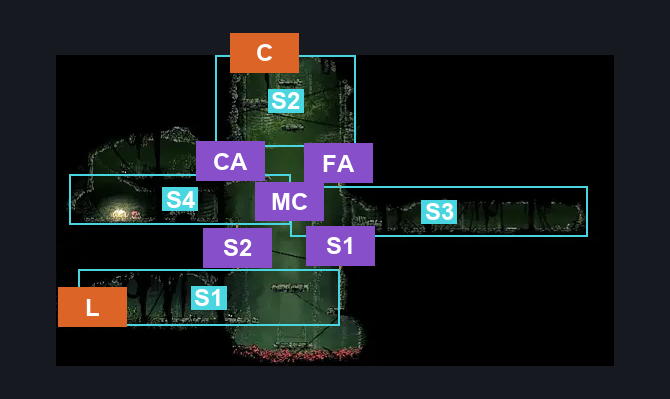
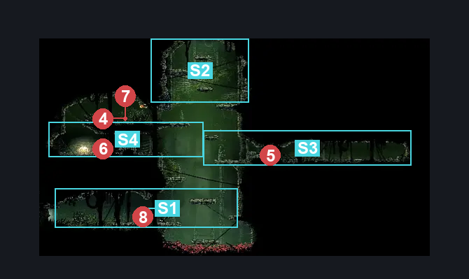
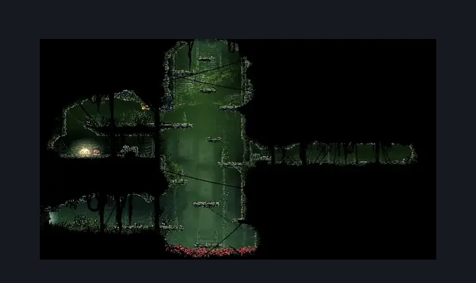

# Far Fields Fort Flea Rescue (Bone_East_17b)

**Game ID:** Bone_East_17b

**Contributors:** herounit

## Subrooms

| No. | Subroom | Annotated |
| --- | --- | --- |
| S1 | left exit area | ✓ |
| S2 | ceiling exit area | ✓ |
| S3 | flea rescue area | ✓ |
| S4 | camp | ✓ |

## Room Transitions

| Alias | Name | From subroom | Destination | Destination alias | Requirements | TODO | Verification | Annotated | Notes |
| --- | --- | --- | --- | --- | --- | --- | --- | --- | --- |
| L | left1 | left exit area | [Far Fields Fort Lower Passage (Bone_East_16)](far-fields-fort-lower-passage.md) | R | none |  | Verified | ✓ | break wall |
| C | top1 | ceiling exit area | [Far Fields Fort Upper Passage (Bone_East_17)](far-fields-fort-upper-passage.md) | B | none |  | Verified | ✓ | break wall (can be broken from either side) |

## Subroom Connections

| Alias | Name | Source | Destination | Requirements | TODO | Verification | Annotated | Notes |
| --- | --- | --- | --- | --- | --- | --- | --- | --- |
| S1 | shaft 1 | left exit area | flea rescue area | ledge grab both OR faydown cloak OR silk soar OR clawline right OR cling grip both |  | Verified | ✓ |  |
| S1 | shaft 1 | flea rescue area | left exit area | none (falling) |  | Verified | ✓ |  |
| S2 | shaft 2 | left exit area | camp | faydown cloak  OR silk soar OR (easy shaman pogo AND (easy pogo off Fertid OR run OR clawline right OR sharpdart)) OR (easy scuttlebrace AND easy [flea brew, cross stitch, rune rage, thread storm] stall) OR cling grip both  OR (cling grip left AND (run OR easy beast pogo  OR sharpdart  OR clawline right  OR easy [beast, architect] needle strike)) OR (cling grip right AND (dash left OR easy beast pogo  OR sharpdart  OR clawline left OR easy [beast, architect] needle strike OR drifter's cloak OR ledge grab left)) |  | Verified | ✓ |  |
| S2 | shaft 2 | camp | left exit area | none (falling) |  | Verified | ✓ |  |
| FA | flea ascend | flea rescue area | ceiling exit area | ledge grab both OR faydown cloak OR silk soar OR clawline left OR cling grip either |  | Verified | ✓ |  |
| FA | flea ascend | ceiling exit area | flea rescue area | none (falling) |  | Verified | ✓ |  |
| CA | camp ascend | camp | ceiling exit area | (easy pogo off Skarr Scout AND (ledge grab right OR easy scuttlebrace))  OR faydown cloak  OR silk soar  OR clawline right  OR cling grip either  OR run |  | Verified | ✓ |  |
| CA | camp ascend | ceiling exit area | camp | none (falling) |  | Verified | ✓ |  |
| MC | middling crossing | camp | flea rescue area | ledge grab left  OR run  OR dash right  OR sharpdart  OR drifter's cloak  OR faydown cloak  OR cling grip either  OR silk soar  OR easy scuttlebrace  OR clawline right  OR easy [shaman, beast] pogo  OR easy [beast, architect] needle strike OR architect slash right |  | Verified | ✓ |  |
| MC | middling crossing | flea rescue area | camp | ledge grab OR run OR sharpdart OR clawline OR faydown cloak OR cling grip OR silk soar OR scuttlebrace |  | Verified | ✓ |  |

## Check Locations

| No. | Check | Subroom | Requirements | TODO | Verification | Location Type | Annotated | Notes |
| --- | --- | --- | --- | --- | --- | --- | --- | --- |
| 1 | flea rescue | flea rescue area | none |  | Verified | collectible | ✓ | break cage |
| 2 | Fort Barracks Ration Rosaries | camp | none |  | Verified | collectible | ✓ | formerly rosary cache far fields 16 |
| 3 | Final Rosary Supplement - Queen's Final Chant "Hold fast, steel your mind against thread and my voice may yet reach you" | camp | none |  | Verified | collectible | ✓ | formerly rosary cache far fields 17 |
| 4 | Fertid 1 | camp | none |  | Verified | enemy | ✓ |  |
| 5 | Skarr Scout 1 | flea rescue area | none |  | Verified | enemy | ✓ |  |
| 6 | Skarr Scout 2 | camp | none |  | Verified | enemy | ✓ |  |
| 7 | Fertid 2 | left exit area | none |  | Verified | enemy | ✓ |  |

## Notes

this had no subrooms before ledge grab...

## Room Images

### Connections

### Checks

### Scene

