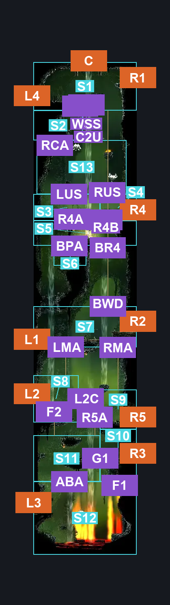
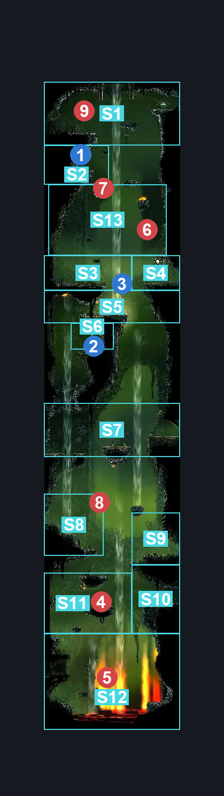
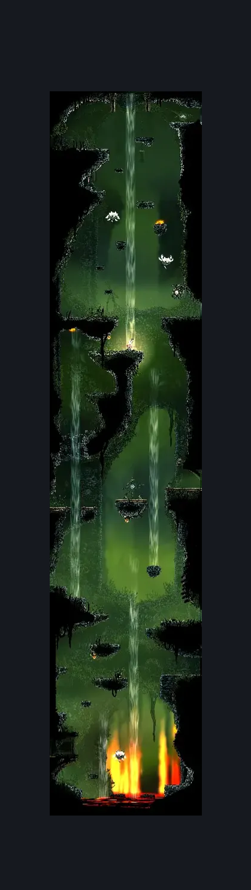

# Far Fields Wind Shaft (Bone_East_07)

**Game ID:** Bone_East_07

**Contributors:** herounit

## Subrooms

| No. | Subroom | Annotated |
| --- | --- | --- |
| S1 | upper crossing | ✓ |
| S2 | rosary cache spot | ✓ |
| S3 | R4 left | ✓ |
| S4 | R4 area | ✓ |
| S5 | below R4 | ✓ |
| S6 | mort corpse platform | ✓ |
| S7 | middle crossing | ✓ |
| S8 | L2 area | ✓ |
| S9 | R5 area | ✓ |
| S10 | R3 area | ✓ |
| S11 | left almost bottom | ✓ |
| S12 | the bottom | ✓ |
| S13 | wind shaft rock steps | ✓ |

## Room Transitions

| Alias | Name | From subroom | Destination | Destination alias | Requirements | TODO | Verification | Annotated | Notes |
| --- | --- | --- | --- | --- | --- | --- | --- | --- | --- |
| C | top1 | upper crossing | [Far Fields Upper Shaft (Bone_East_11)](far-fields-upper-shaft.md) | F | activate lower gate lever IN far fields upper shaft |  | Verified | ✓ |  |
| R1 | right1 | upper crossing | [Far Fields Pilgrim's Rest (Bone_East_10)](far-fields-pilgrim-s-rest.md) | LL | none |  | Verified | ✓ |  |
| R4 | right4 | R4 area | [Far Fields Target Practice (Bone_East_22)](far-fields-target-practice.md) | L | none |  | Verified | ✓ |  |
| R2 | right2 | middle crossing | [Far Fields Bellway (Bellway_03)](far-fields-bellway.md) | L | none |  | Verified | ✓ |  |
| R5 | right5 | R5 area | [Far Fields Map Shop (Bone_East_21)](far-fields-map-shop.md) | L | none |  | Verified | ✓ |  |
| R3 | right3 | R3 area | [Far Fields Chorus (Bone_East_08)](far-fields-chorus.md) | L | none |  | Verified | ✓ |  |
| L4 | left4 | upper crossing | [Far Fields Fort Upper Passage (Bone_East_17)](far-fields-fort-upper-passage.md) | R | none |  | Verified | ✓ |  |
| L1 | left1 | middle crossing | [Far Fields Entrance West (Bone_East_02b)](far-fields-entrance-west.md) | UR | none |  | Verified | ✓ |  |
| L2 | left2 | L2 area | [Far Fields Entrance West (Bone_East_02b)](far-fields-entrance-west.md) | LR | none |  | Verified | ✓ |  |
| L3 | left3 | the bottom | [Far Fields Deep Docks Backdoor (Dock_03b)](far-fields-deep-docks-backdoor.md) | R | none |  | Verified | ✓ |  |

## Subroom Connections

| Alias | Name | Source | Destination | Requirements | TODO | Verification | Annotated | Notes |
| --- | --- | --- | --- | --- | --- | --- | --- | --- |
| ABA | almost bottom ascent | the bottom | left almost bottom | ledge grab both OR faydown cloak OR scuttlebrace OR silk soar OR drifter's cloak OR easy shaman pogo |  | Verified | ✓ |  |
| ABA | almost bottom ascent | left almost bottom | the bottom | none (falling) |  | Verified | ✓ |  |
| G1 | gap 1 | left almost bottom | R3 area | run  OR dash  OR easy [beast, hunter, architect] pogo OR easy naked pogo OR drifter's cloak  OR faydown cloak  OR cling grip either OR silk soar  OR clawline right  OR sharpdart  OR scuttlebrace  OR flea brew OR (ledge grab AND easy reaper pogo)  OR easy [heal, cross stitch, thread storm, rune rage] stall |  | Verified | ✓ |  |
| G1 | gap 1 | R3 area | left almost bottom | ledge grab left  OR run  OR dash left  OR easy [beast, hunter, architect] pogo OR easy naked pogo OR drifter's cloak  OR faydown cloak  OR cling grip either OR silk soar  OR clawline left  OR sharpdart  OR scuttlebrace |  | Verified | ✓ | slightly lower, so ledge grab works here |
| F1 | fall 1 | R3 area | the bottom | none (falling) |  | Verified | ✓ |  |
| R5A | R5 ascent | left almost bottom | R5 area | ledge grab left  OR easy [shaman, beast, hunter, witch, wanderer, reaper, architect] pogo  OR easy naked pogo OR drifter's cloak  OR faydown cloak  OR clawline right OR silk soar  OR cling grip both |  | Verified | ✓ |  |
| R5A | R5 ascent | R5 area | left almost bottom | none (falling) |  | Verified | ✓ |  |
| L2C | L2 crossing | R5 area | L2 area | run  OR dash right OR easy beast pogo  OR drifter's cloak  OR faydown cloak  OR silk soar  OR clawline right OR sharpdart  OR scuttlebrace  OR (flea brew AND (cling grip right OR architect slash left))  OR easy [beast, architect] needle strike OR (ledge grab right AND (flea brew OR easy shaman pogo)) |  | Verified | ✓ |  |
| L2C | L2 crossing | L2 area | R5 area | ledge grab right OR run OR dash right OR easy beast pogo OR drifter's cloak OR faydown cloak OR silk soar OR clawline right OR sharpdart OR scuttlebrace |  | Verified | ✓ |  |
| F2 | fall 2 | L2 area | left almost bottom | none (falling) |  | Verified | ✓ |  |
| LMA | left middle ascent | L2 area | middle crossing | drifter's cloak OR silk soar OR (run AND ledge grab AND faydown cloak AND (easy beast pogo OR easy shaman pogo OR medium architect pogo OR (proficient movement AND easy flea brew stall AND (easy reaper pogo OR easy hunter pogo)))) |  | Verified | ✓ |  |
| LMA | left middle ascent | middle crossing | L2 area | none (falling) |  | Verified | ✓ |  |
| RMA | right middle ascent | R5 area | middle crossing | silk soar OR ( break blast rock down AND drifter's cloak ) OR ((cling grip OR scuttlebrace) AND faydown cloak AND (easy beast pogo OR easy shaman pogo OR medium architect pogo OR (proficient movement AND (easy flea brew stall AND (easy reaper pogo OR easy hunter pogo))) OR (easy reaper pogo AND(easy heal stall)))) |  | Verified | ✓ | rune rage stall will work |
| RMA | right middle ascent | middle crossing | R5 area | none (falling) |  | Verified | ✓ |  |
| BR4 | below R4 ascent | middle crossing | below R4 | silk soar  OR (break blast rock down AND ( drifter's cloak OR (faydown cloak AND scuttlebrace)))  OR (cling grip both AND ( faydown cloak OR clawline left OR dash left OR easy [beast, hunter, architect] pogo OR easy [beast, architect] needle strike OR medium shaman pogo  OR easy naked pogo  OR sharpdart  OR medium [heal, rune rage, cross stitch, thread storm] stall  OR flea brew) ) |  | Verified | ✓ | rune rage stall + cling grip works |
| BR4 | below R4 ascent | below R4 | middle crossing | none (falling) |  | Verified | ✓ |  |
| R4A | R4 ascent | below R4 | R4 left | clear r4 blast rock AND ( silk soar OR drifter's cloak OR cling grip left) |  | Verified | ✓ |  |
| R4A | R4 ascent | R4 left | below R4 | clear r4 blast rock (falling) |  | Verified | ✓ |  |
| R4C | R4C crossing | R4 left | R4 area | run  OR dash  OR easy beast pogo  OR drifter's cloak  OR faydown cloak  OR silk soar  OR clawline right OR sharpdart  OR easy scuttlebrace |  | Verified |  | this only applies if you break the right blast rock, but going with most restrictive solution |
| R4C | R4C crossing | R4 area | R4 left | none OR (clear r4 blast rock AND (run OR dash left OR easy beast pogo OR drifter's cloak OR faydown cloak OR silk soar OR clawline right OR sharpdart OR scuttlebrace)) |  | Verified |  | this only applies if you break the right blast rock, but going with most restrictive solution |
| BPA | belt platform access | below R4 | mort corpse platform | none (falling) |  | Verified | ✓ | no point in scaffolding the reverse because this is a logical dead-end |
| WSS | wind shaft steps | wind shaft rock steps | upper crossing | drifter's cloak OR ( faydown cloak AND cling grip ) |  | Verified | ✓ | take the wind stream or scale the wall |
| WSS | wind shaft steps | upper crossing | wind shaft rock steps | none (falling) |  | Verified | ✓ |  |
| RCA | rosary cache ascent | wind shaft rock steps | rosary cache spot | (ledge grab both AND (architect slash left OR easy hunter pogo OR easy naked pogo OR flea brew)) OR drifter's cloak OR faydown cloak OR silk soar OR easy beast pogo OR cling grip |  | Verified | ✓ |  |
| RCA | rosary cache ascent | rosary cache spot | wind shaft rock steps | none (falling) |  | Verified | ✓ |  |
| C2U | cache to upper crossing | rosary cache spot | upper crossing | ledge grab OR drifter's cloak OR faydown cloak OR clawline OR scuttlebrace OR cling grip |  | Verified | ✓ |  |
| C2U | cache to upper crossing | upper crossing | rosary cache spot | none (falling) |  | Verified | ✓ |  |
| RUA | right upper ascent | R4 area | upper crossing | cling grip OR (faydown cloak AND scuttlebrace AND ledge grab AND proficient movement AND (easy pogo off Vicious Caranid OR ledge grab)) OR silk soar |  | Verified | ✓ | must silk soar cancel to ride momentun around the ledge or do shorter silk soars along the platforms in other subrooms; enemy pogo uses Vicious Caranid |
| RUA | right upper ascent | upper crossing | R4 area | none (falling) |  | Verified | ✓ |  |
| LUS | left up steps | R4 left | wind shaft rock steps | ledge grab OR faydown OR cling grip OR silk soar |  | Verified | ✓ |  |
| RUS | right up steps | R4 area | wind shaft rock steps | cling grip  OR (faydown cloak AND scuttlebrace AND proficient movement AND (easy pogo off Vicious Caranid OR ledge grab)) OR silk soar |  | Verified | ✓ | enemy pogo uses Vicious Caranid |
| RUS | right up steps | wind shaft rock steps | R4 area | none (falling) |  | Verified | ✓ |  |
| R4B | r4 drop to below | R4 area | below R4 | none (falling) |  | Verified | ✓ |  |
| R4B | r4 drop to below | below R4 | R4 area | faydown cloak  OR silk soar |  | Verified | ✓ |  |
| BWD | pilgrims rest to bellway | upper crossing | middle crossing | clear r4 blast rock |  | Verified | ✓ |  |

## Check Locations

| No. | Check | Subroom | Requirements | TODO | Verification | Location Type | Annotated | Notes |
| --- | --- | --- | --- | --- | --- | --- | --- | --- |
| 1 | rosary cache far fields 1 | rosary cache spot | none |  | Verified | collectible | ✓ |  |
| 2 | Tool Weighted Belt | mort corpse platform | act 3 |  | Verified | collectible | ✓ | according to the wiki you can either buy it from pilgrim's rest in act 1/2 OR you can grab it from mort's corpse here in act 3 |
| 3 | r4 blast rock | R4 left | none (attack) |  | Verified | blockade | ✓ |  |
| 4 | Fertid 1 | left almost bottom | none |  | Verified | enemy | ✓ |  |
| 5 | Vicious Caranid 1 | the bottom | Normal World Spawn |  | Verified | enemy | ✓ |  |
| 6 | Vicious Caranid 2 | wind shaft rock steps | Normal World Spawn |  | Verified | enemy | ✓ |  |
| 7 | Vicious Caranid 3 | wind shaft rock steps | Normal World Spawn |  | Verified | enemy | ✓ |  |
| 8 | Vicious Caranid 4 | L2 area | Black Thread World Spawn |  | Verified | enemy | ✓ |  |
| 9 | Vicious Caranid 5 | upper crossing | Black Thread World Spawn |  | Verified | enemy | ✓ |  |

## Room Images

### Connections

### Checks

### Scene

