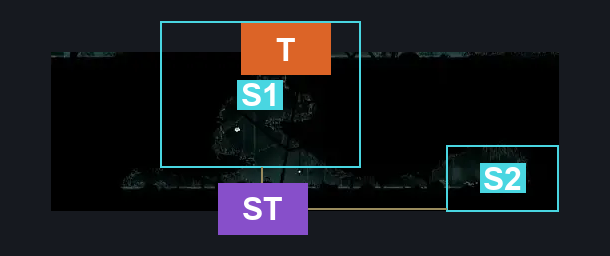
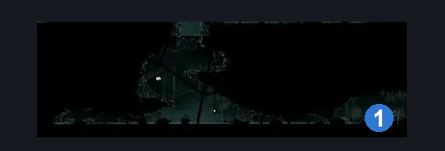
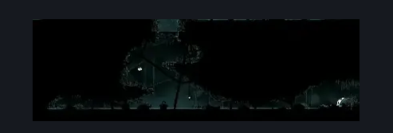

# Greymoor Bone Scroll Room (Greymoor_21)

**Game ID:** Greymoor_21

**Contributors:** Isssma

## Subrooms

| No. | Subroom | Annotated |
| --- | --- | --- |
| S1 | entrance section | ✓ |
| S2 | bug resting place | ✓ |

## Room Transitions

| Alias | Name | From subroom | Destination | Destination alias | Requirements | TODO | Verification | Annotated | Notes |
| --- | --- | --- | --- | --- | --- | --- | --- | --- | --- |
| T | top | entrance section | [Greymoor Lower Halfway Home Path (Greymoor_13)](greymoor-lower-halfway-home-path.md) | D | Ledge grab right OR faydown cloak OR silk soar OR cling grip right OR cling grip left OR medium shaman pogo |  | Verified | ✓ |  |

## Subroom Connections

| Alias | Name | Source | Destination | Requirements | TODO | Verification | Annotated | Notes |
| --- | --- | --- | --- | --- | --- | --- | --- | --- |
| ST | swim transition | entrance section | bug resting place | swim |  | Verified | ✓ |  |
| ST | swim transition | bug resting place | entrance section | swim AND (ledge grab left OR cling grip left OR faydown cloak) |  | Verified | ✓ |  |

## Check Locations

| No. | Check | Subroom | Requirements | TODO | Verification | Location Type | Annotated | Notes |
| --- | --- | --- | --- | --- | --- | --- | --- | --- |
| 1 | Relic: Bone Scroll (Greymoor) at bugs lonely resting place | bug resting place | nothing |  | Verified | collectible | ✓ |  |

## Room Images

### Connections

### Checks

### Scene

