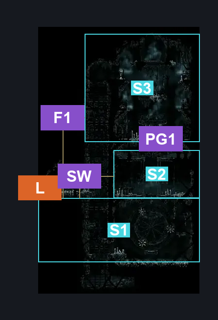
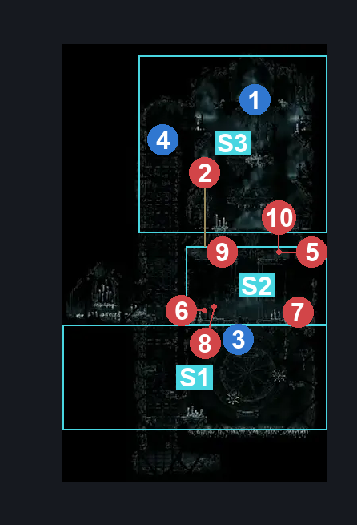
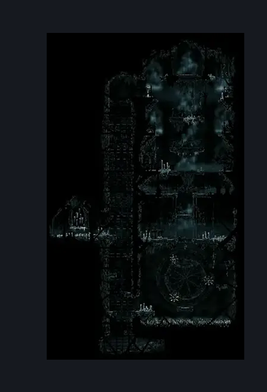

# Greymoor Chapel of The Reaper (Greymoor_20c)

**Game ID:** Greymoor_20c

**Contributors:** Isssma

## Subrooms

| No. | Subroom | Annotated |
| --- | --- | --- |
| S1 | entrance section | ✓ |
| S2 | gauntlet room | ✓ |
| S3 | upper area | ✓ |

## Room Transitions

| Alias | Name | From subroom | Destination | Destination alias | Requirements | TODO | Verification | Annotated | Notes |
| --- | --- | --- | --- | --- | --- | --- | --- | --- | --- |
| L | left | entrance section | [Greymoor Chapel of The Reaper Entrance (Greymoor_20b)](greymoor-chapel-of-the-reaper-entrance.md) | CHE | nothing |  | Verified | ✓ |  |

## Subroom Connections

| Alias | Name | Source | Destination | Requirements | TODO | Verification | Annotated | Notes |
| --- | --- | --- | --- | --- | --- | --- | --- | --- |
| SW | spike wheel | entrance section | gauntlet room | unlock gauntlet airlock AND ( spike pogo OR faydown cloak OR easy beast needle strike OR (ledge grab right AND (ledge grab left OR cling grip left OR clawline left x 1)) OR (cling grip right AND (ledge grab left OR clawline left x 1 OR sharpdart x 1 OR progressive swift step 2 left)) OR (silk soar AND (clawline right x 1 OR sharpdart x 1 OR drifters cloak OR progressive swift step 2 right))) |  | Verified | ✓ |  |
| SW | spike wheel | gauntlet room | entrance section | unlock gauntlet airlock |  | Verified | ✓ |  |
| PG1 | platform gap | gauntlet room | upper area | complete Chapel of the Reaper Gauntlet AND (ledge grab either OR cling grip either OR faydown cloak OR silk soar) |  | Verified | ✓ |  |
| PG1 | platform gap | upper area | gauntlet room | complete Chapel of the Reaper Gauntlet |  | Verified | ✓ |  |
| F1 | fall 1 | upper area | entrance section | clear tied platform |  | Verified | ✓ |  |
| F1 | fall 1 | entrance section | upper area | clear tied platform AND ( cling grip either OR silk soar OR easy scuttlebrace) |  | Verified | ✓ |  |

## Check Locations

| No. | Check | Subroom | Requirements | TODO | Verification | Location Type | Annotated | Notes |
| --- | --- | --- | --- | --- | --- | --- | --- | --- |
| 1 | Crest: Reaper | upper area | nothing |  | Verified | collectible | ✓ |  |
| 2 | Chapel of the Reaper Gauntlet | gauntlet room | Combat Requirements |  | Verified | gauntlet | ✓ |  |
| 3 | gauntlet airlock | entrance section | hit lever right OR hit lever left OR hit lever up |  | Verified | blockade | ✓ |  |
| 4 | tied platform | upper area | break vines left OR break vines up OR break vines right |  | Verified | blockade | ✓ |  |
| 5 | Silk Snipper 1 | gauntlet room | nothing |  | Verified | enemy | ✓ |  |
| 6 | Dreg Catcher 1 | gauntlet room | nothing |  | Verified | enemy | ✓ |  |
| 7 | Dreg Catcher 2 | gauntlet room | nothing |  | Verified | enemy | ✓ |  |
| 8 | Thread Raker 1 | gauntlet room | nothing |  | Verified | enemy | ✓ |  |
| 9 | Silk Snipper 2 | gauntlet room | nothing |  | Verified | enemy | ✓ |  |
| 10 | Silk Snipper 3 | gauntlet room | nothing |  | Verified | enemy | ✓ |  |

## Room Images

### Connections

### Checks

### Scene

