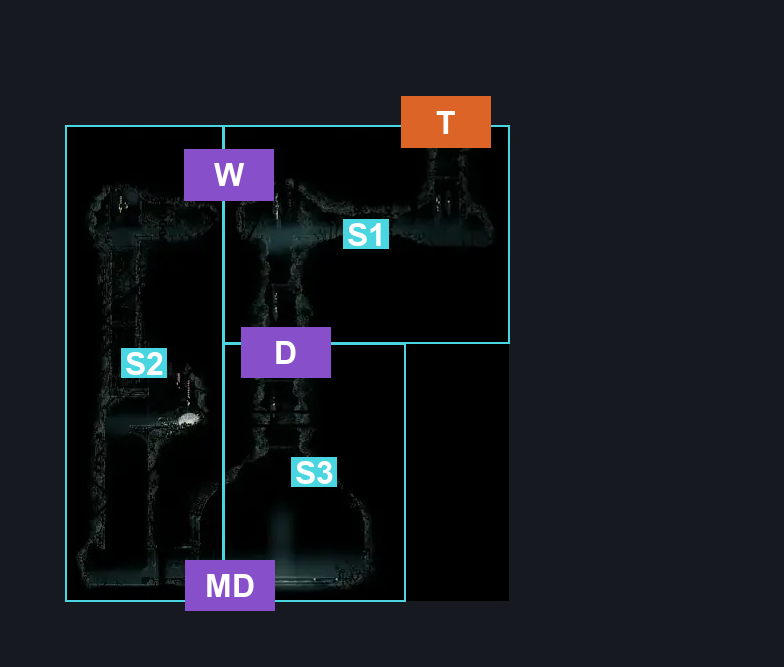
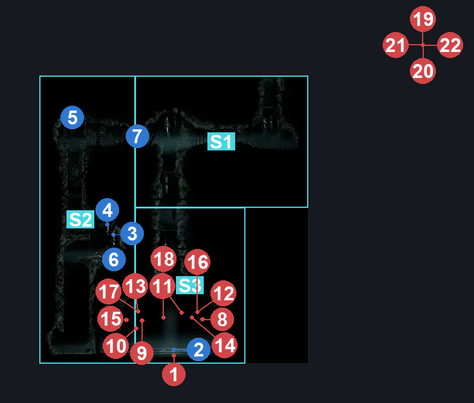
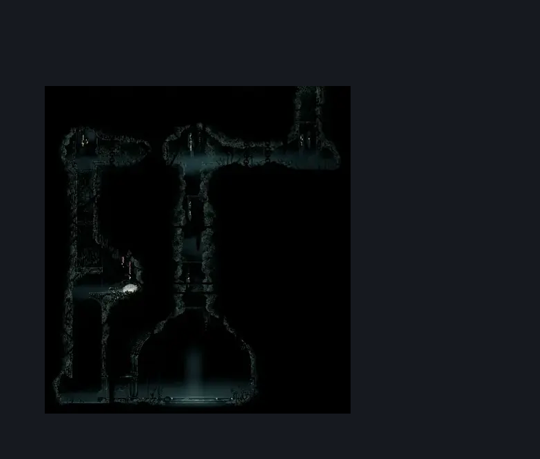

# Greymoor Craw Court (Room_CrowCourt_02)

**Game ID:** Room_CrowCourt_02

**Contributors:** Isssma

## Subrooms

| No. | Subroom | Annotated |
| --- | --- | --- |
| S1 | entrance | ✓ |
| S2 | left shaft | ✓ |
| S3 | the court | ✓ |

## Room Transitions

| Alias | Name | From subroom | Destination | Destination alias | Requirements | TODO | Verification | Annotated | Notes |
| --- | --- | --- | --- | --- | --- | --- | --- | --- | --- |
| T | top1 | entrance | [Greymoor Craw Nest (Room_CrowCourt)](greymoor-craw-nest.md) | b | cling grip OR scuttlebrace |  | Verified | ✓ |  |

## Subroom Connections

| Alias | Name | Source | Destination | Requirements | TODO | Verification | Annotated | Notes |
| --- | --- | --- | --- | --- | --- | --- | --- | --- |
| D | drop | entrance | the court | none (just fall) |  | Verified | ✓ |  |
| D | drop | the court | entrance | defeat Crow Father AND silk soar |  | Verified | ✓ |  |
| MD | metal door | the court | left shaft | defeat Crow Father |  | Verified | ✓ |  |
| MD | metal door | left shaft | the court | defeat Crow Father |  | Verified | ✓ |  |
| W | wall | left shaft | entrance | clear wood wall AND (cling grip OR (easy scuttlebrace AND (ledge grab OR faydown cloak OR clawline))) |  | Verified | ✓ |  |
| W | wall | entrance | left shaft | clear wood wall |  | Verified | ✓ |  |

## Check Locations

| No. | Check | Subroom | Requirements | TODO | Verification | Location Type | Annotated | Notes |
| --- | --- | --- | --- | --- | --- | --- | --- | --- |
| 1 | Crow Father | the court | nothing |  | Verified | boss | ✓ |  |
| 2 | craw memento | the court | defeat Crow Father |  | Verified | collectible | ✓ |  |
| 3 | Greymoor - craw court rosary vault stash | left shaft | cling grip OR (easy scuttlebrace AND (ledge grab OR faydown cloak OR clawline OR easy beast pogo)) |  | Verified | resource | ✓ |  |
| 4 | Greymoor - the other craw court rosary vault stash | left shaft | cling grip OR (easy scuttlebrace AND (ledge grab OR faydown cloak OR clawline OR easy beast pogo)) |  | Verified | resource | ✓ |  |
| 5 | Greymoor - the final craw court rosary vault stash | left shaft | cling grip OR (easy scuttlebrace AND (ledge grab OR faydown cloak OR clawline OR easy beast pogo)) |  | Verified | resource | ✓ |  |
| 6 | Crow bell | left shaft | cling grip OR (easy scuttlebrace AND (ledge grab OR faydown cloak OR clawline OR easy beast pogo)) |  | Verified | collectible | ✓ |  |
| 7 | wood wall | left shaft | break wall right OR break wall up |  | Verified | blockade | ✓ |  |
| 8 | Tallcraw Juror 1 |  |  |  |  | enemy | ✓ | FSM Boolean flags: defeatedCrowCourt |
| 9 | Squatcraw Juror 1 |  |  |  |  | enemy | ✓ | FSM Boolean flags: defeatedCrowCourt |
| 10 | Tallcraw Juror 2 |  |  |  |  | enemy | ✓ | FSM Boolean flags: defeatedCrowCourt |
| 11 | Tallcraw Juror 3 |  |  |  |  | enemy | ✓ | FSM Boolean flags: defeatedCrowCourt |
| 12 | Craw Juror 1 |  |  |  |  | enemy | ✓ | FSM Boolean flags: defeatedCrowCourt |
| 13 | Craw Juror 2 |  |  |  |  | enemy | ✓ | FSM Boolean flags: defeatedCrowCourt |
| 14 | Squatcraw Juror 2 |  |  |  |  | enemy | ✓ | FSM Boolean flags: defeatedCrowCourt |
| 15 | Squatcraw Juror 3 |  |  |  |  | enemy | ✓ | FSM Boolean flags: defeatedCrowCourt |
| 16 | Craw Juror 3 |  |  |  |  | enemy | ✓ | FSM Boolean flags: defeatedCrowCourt |
| 17 | Craw Juror 4 |  |  |  |  | enemy | ✓ | FSM Boolean flags: defeatedCrowCourt |
| 18 | Crawfather 1 |  |  |  |  | enemy | ✓ | FSM Boolean flags: defeatedCrowCourt |
| 19 | Tallcraw Juror 4 |  |  |  |  | enemy | ✓ | FSM Boolean flags: defeatedCrowCourt |
| 20 | Squatcraw Juror 4 |  |  |  |  | enemy | ✓ | FSM Boolean flags: defeatedCrowCourt |
| 21 | Craw Juror 5 |  |  |  |  | enemy | ✓ | FSM Boolean flags: defeatedCrowCourt |
| 22 | Craw Juror 6 |  |  |  |  | enemy | ✓ | FSM Boolean flags: defeatedCrowCourt |

## Room Images

### Connections

### Checks

### Scene

