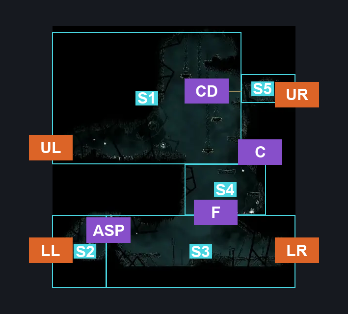
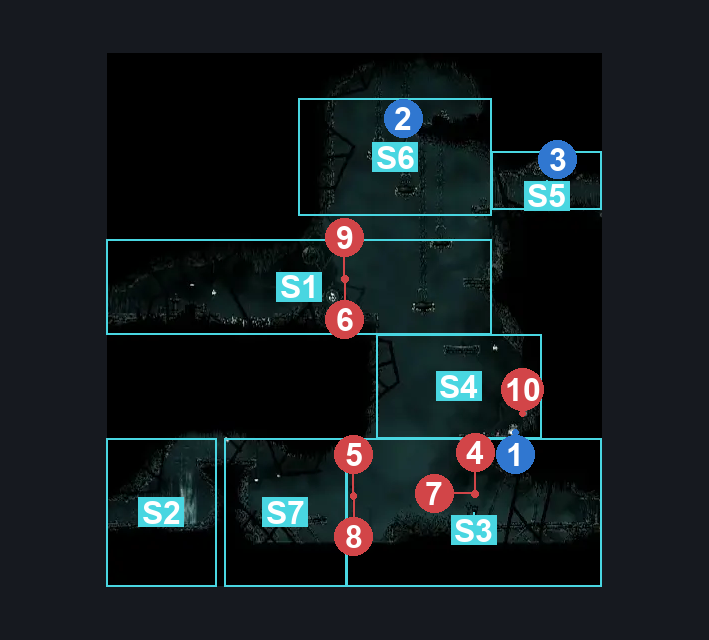
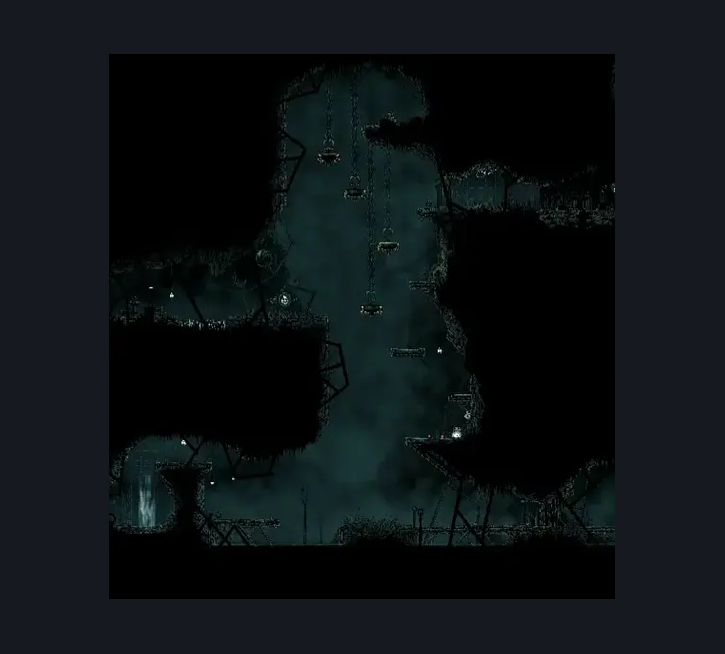

# Greymoor Craw Lake Entrance (Greymoor_15)

**Game ID:** Greymoor_15

**Contributors:** Isssma

## Subrooms

| No. | Subroom | Annotated |
| --- | --- | --- |
| S1 | upper section | ✓ |
| S2 | lower left section | ✓ |
| S3 | lower right section | ✓ |
| S4 | middle section | ✓ |
| S5 | craw lake middle entrance | ✓ |
| S6 | the very top | ✓ |
| S7 | i should have added this before | ✓ |

## Room Transitions

| Alias | Name | From subroom | Destination | Destination alias | Requirements | TODO | Verification | Annotated | Notes |
| --- | --- | --- | --- | --- | --- | --- | --- | --- | --- |
| LL | lower left | lower left section | [Greymoor East Bellshrine Room (Greymoor_02)](greymoor-east-bellshrine-room.md) | LR | none |  | Verified | ✓ |  |
| LR | lower right | lower right section | [Greymoor Craw Lake (Greymoor_15b)](greymoor-craw-lake.md) | LL | nothing |  | Verified | ✓ |  |
| UR | upper right | craw lake middle entrance | [Greymoor Craw Lake (Greymoor_15b)](greymoor-craw-lake.md) | ML | none |  | Verified | ✓ |  |
| UL | upper left | upper section | [Greymoor East Bellshrine Room (Greymoor_02)](greymoor-east-bellshrine-room.md) | MR | none |  | Verified | ✓ |  |

## Subroom Connections

| Alias | Name | Source | Destination | Requirements | TODO | Verification | Annotated | Notes |
| --- | --- | --- | --- | --- | --- | --- | --- | --- |
| ASP | air shaft platform | lower left section | i should have added this before | drifters cloak OR silk soar OR (faydown cloak AND (cling grip right OR ledge grab right)) |  | Verified | ✓ |  |
| ASP | air shaft platform | i should have added this before | lower left section | silk soar OR cling grip left OR easy pogo off craw OR (faydown cloak AND ledge grab left) |  | Verified | ✓ |  |
| F | fall | lower right section | middle section | silk soar OR hard pogo off craw |  | Verified | ✓ |  |
| F | fall | middle section | lower right section | nothing (just fall) |  | Verified | ✓ |  |
| C | climb | middle section | upper section | ((ledge grab left OR cling grip left OR hard pogo off mite) AND (ledge grab right OR cling grip right)) OR faydown cloak OR silk soar OR cling grip OR medium scuttlebrace |  | Verified | ✓ |  |
| C | climb | upper section | middle section | nothing (just fall) |  | Verified | ✓ |  |
| CD | closed door | the very top | craw lake middle entrance | prereq crawlake door |  | Verified | ✓ |  |
| CD | closed door | craw lake middle entrance | the very top | prereq crawlake door |  | Verified | ✓ |  |
| PG | platform gap | upper section | the very top | silk soar OR faydown cloak OR hard pogo off craw OR easy  beast needle strike OR ((ledge grab left OR cling grip left OR medium pogo off craw) AND (ledge grab right OR cling grip right OR medium pogo off craw)) |  | Verified | ✓ |  |
| PG | platform gap | the very top | upper section | nothing |  | Verified | ✓ |  |
| lG | lake gap | i should have added this before | lower right section | swim OR easy pogo off craw OR flea brew OR progressive swift step 1 right OR clawline right x 1 OR sharpdart x 1 OR drifters cloak OR faydown cloak |  | Verified | ✓ |  |
| lG | lake gap | lower right section | i should have added this before | (swim AND (ledge grab left OR cling grip left)) OR easy pogo off craw OR flea brew OR progressive swift step 1 OR clawline left x 1 OR sharpdart x 1 OR drifters cloak OR faydown cloak |  | Verified | ✓ |  |

## Check Locations

| No. | Check | Subroom | Requirements | TODO | Verification | Location Type | Annotated | Notes |
| --- | --- | --- | --- | --- | --- | --- | --- | --- |
| 1 | Greymoor - Frayed Rosary String from dead bug guarded by rat | middle section | nothing |  | Verified | resource | ✓ |  |
| 2 | Greymoor - Rosary Cache at the very top | the very top | silk soar OR faydown cloak OR hard pogo off craw OR ((ledge grab left OR cling grip left OR medium pogo off craw) AND (progressive swift step 1 left OR sharpdart x 1 OR clawline left x 1 OR drifters cloak OR flea brew)) |  | Verified | resource | ✓ |  |
| 3 | crawlake door | craw lake middle entrance | flip lever up OR flip lever right OR flip lever left |  | Verified | switch | ✓ |  |
| 4 | Craw Juror 1 | lower right section | Craw Summons Ready |  | Verified | enemy | ✓ | Spawn conditions: hitCrowCourtSwitch=false FSM Boolean flags: CrowCourtInSession |
| 5 | Craw Juror 2 | lower right section | Craw Summons Ready |  | Verified | enemy | ✓ | FSM Boolean flags: CrowCourtInSession |
| 6 | Craw Juror 3 | upper section | Craw Summons Ready |  | Verified | enemy | ✓ | FSM Boolean flags: CrowCourtInSession |
| 7 | Craw 1 | lower right section | nothing |  | Verified | enemy | ✓ | Spawn conditions: hitCrowCourtSwitch=false  despawns after clearing balloon lever in craw nest  FSM Boolean flags: CrowCourtInSession |
| 8 | Craw 2 | lower right section | nothing |  | Verified | enemy | ✓ | FSM Boolean flags: CrowCourtInSession |
| 9 | Craw 3 | upper section | nothing |  | Verified | enemy | ✓ | FSM Boolean flags: CrowCourtInSession |
| 10 | Mite 1 | middle section | nothing |  | Verified | enemy | ✓ |  |

## Room Images

### Connections

### Checks

### Scene

