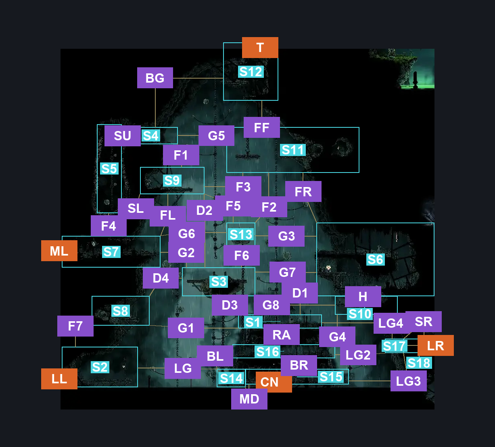
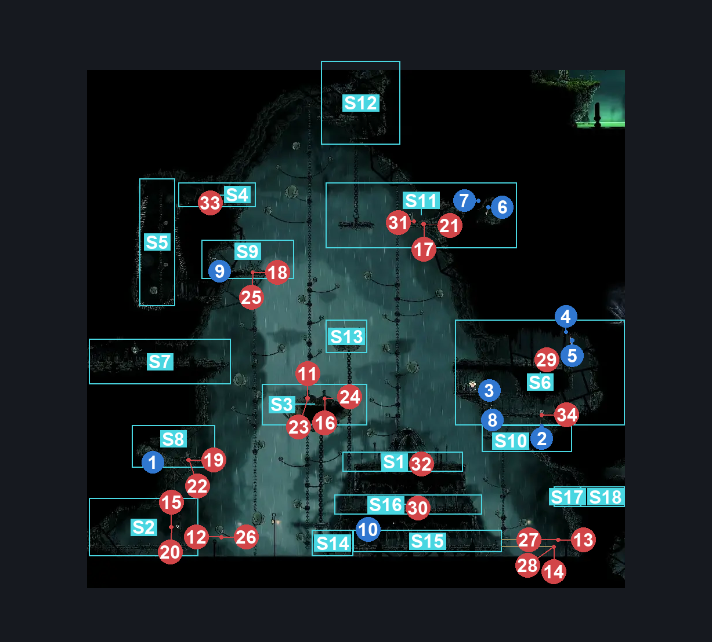
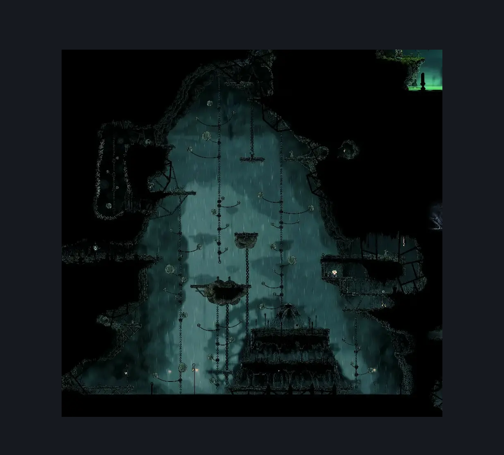

# Greymoor Craw Lake (Greymoor_15b)

**Game ID:** Greymoor_15b

**Contributors:** Isssma

## Subrooms

| No. | Subroom | Annotated |
| --- | --- | --- |
| S1 | craw building roof | ✓ |
| S2 | lower left section | ✓ |
| S3 | middle craw nest | ✓ |
| S4 | left top craw nest | ✓ |
| S5 | spiked room | ✓ |
| S6 | flea room | ✓ |
| S7 | middle craw nest left | ✓ |
| S8 | small ass platform | ✓ |
| S9 | upper craw nest | ✓ |
| S10 | lower flea room | ✓ |
| S11 | right top craw nest | ✓ |
| S12 | lil top | ✓ |
| S13 | stupid platform i hate | ✓ |
| S14 | craw building lower left | ✓ |
| S15 | craw building lower right | ✓ |
| S16 | craw building middle | ✓ |
| S17 | verdania ledge | ✓ |
| S18 | stupid space behind stupid wall | ✓ |

## Room Transitions

| Alias | Name | From subroom | Destination | Destination alias | Requirements | TODO | Verification | Annotated | Notes |
| --- | --- | --- | --- | --- | --- | --- | --- | --- | --- |
| T | top | lil top | [Greymoor Weaver Shrine (Greymoor_22)](greymoor-weaver-shrine.md) | B | silk soar OR ledge grab OR faydown cloak OR cling grip right OR (ledge grab right AND (cling grip left OR ledge grab left OR easy [beast, shaman] pogo)) |  | Verified | ✓ |  |
| ML | middle left | middle craw nest left | [Greymoor Craw Lake Entrance (Greymoor_15)](greymoor-craw-lake-entrance.md) | UR | none |  | Verified | ✓ |  |
| LR | lower right | verdania ledge | [Dead Verdania Main (Clover_01)](../verdania/dead-verdania-main.md) | L | nothing |  | Verified | ✓ |  |
| CN | craw nest entrance | craw building lower right | [Greymoor Craw Nest (Room_CrowCourt)](greymoor-craw-nest.md) | L | nothing |  | Verified | ✓ |  |
| LL | lower left | lower left section | [Greymoor Craw Lake Entrance (Greymoor_15)](greymoor-craw-lake-entrance.md) | LR | none |  | Verified | ✓ |  |

## Subroom Connections

| Alias | Name | Source | Destination | Requirements | TODO | Verification | Annotated | Notes |
| --- | --- | --- | --- | --- | --- | --- | --- | --- |
| LG | lake gap | lower left section | craw building lower left | swim OR clawline x 3 OR ((progressive swift step 2 right OR sharpdart x 1 OR clawline right x 1) AND faydown cloak AND drifters cloak) OR (progressive swift step 2 right AND (sharpdart x 1 OR clawline right x 2) AND faydown cloak) OR (progressive swift step 1 AND (clawline right x 1 OR sharpdart x 1) AND (drifters cloak)) OR cbt pogo off craw OR (hard pogo off craw AND faydown cloak) OR (silk soar AND drifters cloak AND (faydown cloak OR sharpdart x 1 OR clawline right x 1 OR progressive swift step 2 right)) OR prereq balloon lever IN greymoor craw nest |  | Verified | ✓ |  |
| LG | lake gap | craw building lower left | lower left section | swim OR clawline x 3 OR ((progressive swift step 2 left OR sharpdart x 1 OR clawline left x 1) AND faydown cloak AND drifters cloak) OR (progressive swift step 2 left AND (sharpdart x 1 OR clawline left x 1)  AND faydown cloak) OR (progressive swift step 1 AND (sharpdart x 1 OR clawline left x 1) AND (drifters cloak OR faydown cloak)) OR prereq balloon lever IN greymoor craw nest |  | Verified | ✓ |  |
| FR | fall right | right top craw nest | flea room | progressive swift step 2 right OR clawline right x 1 OR sharpdart x 1 OR drifters cloak OR faydown cloak OR prereq balloon lever IN greymoor craw nest |  | Verified | ✓ |  |
| FL | fall left | upper craw nest | middle craw nest left | progressive swift step 2 left OR clawline left x 1 OR sharpdart x 1 OR drifters cloak OR (faydown cloak AND ledge grab left) |  | Verified | ✓ |  |
| FL | fall left | middle craw nest left | upper craw nest | silk soar |  | Verified | ✓ | must drop to middle craw nest |
| G1 | gap 1 | craw building roof | small ass platform | (drifters cloak AND ((progressive swift step 1 AND (((clawline left x 2 OR sharpdart x 2)) OR (faydown cloak AND (sharpdart x 1 OR clawline left x 1)))))) OR (progressive swift step 2 left AND (sharpdart x 2 OR clawline left x 2) AND faydown cloak) OR prereq balloon lever IN greymoor craw nest |  | Verified | ✓ |  |
| G1 | gap 1 | small ass platform | craw building roof | (drifters cloak AND ((progressive swift step 1 AND (((clawline left x 2 OR sharpdart x 2)) OR (faydown cloak AND (sharpdart x 1 OR clawline left x 1)))))) OR (progressive swift step 2 left AND (sharpdart x 2 OR clawline left x 2) AND faydown cloak) OR prereq balloon lever IN greymoor craw nest |  | Verified | ✓ |  |
| G2 | gap 2 | middle craw nest left | middle craw nest | none (normal jump) |  | Verified | ✓ |  |
| G2 | gap 2 | middle craw nest | middle craw nest left | (progressive swift step 1 AND faydown cloak AND ledge grab left) OR  prereq balloon lever IN greymoor craw nest OR (silk soar AND (clawline left x 1 OR sharpdart x 1 OR progressive swift step 2 left)) |  | Verified | ✓ |  |
| G3 | gap 3 | stupid platform i hate | flea room | drifters cloak OR clawline x 2 OR progressive swift step 2 right OR (clawline right x 1 AND (cling grip right OR faydown cloak)) OR (progressive swift step 1 AND faydown cloak AND (ledge grab right OR cling grip right OR sharpdart x 1)) OR medium scuttlebrace OR prereq balloon lever IN greymoor craw nest |  | Verified | ✓ |  |
| G3 | gap 3 | flea room | stupid platform i hate | ((progressive swift step 1 OR drifters cloak) AND faydown cloak AND (clawline left x 1 OR sharpdart x 1) AND (ledge grab left OR cling grip left)) OR prereq balloon lever IN greymoor craw nest |  | Verified | ✓ |  |
| G4 | gap 4 | craw building roof | lower flea room | faydown cloak OR silk soar OR (hard pogo off squatcraw AND prereq balloon lever IN greymoor craw nest) |  | Verified | ✓ |  |
| G4 | gap 4 | lower flea room | craw building roof | none |  | Verified | ✓ |  |
| G5 | gap 5 | left top craw nest | right top craw nest | clawline right x 2 OR drifters cloak OR (progressive swift step 1 right AND (sharpdart x 1 OR (faydown cloak AND flea brew) OR clawline right x 1)) OR (progressive swift step 2 right AND faydown cloak) OR prereq balloon lever IN greymoor craw nest |  | Verified | ✓ |  |
| G5 | gap 5 | right top craw nest | left top craw nest | (progressive swift step 1 left AND faydown cloak AND (drifters cloak OR sharpdart x 1)) OR (clawline x 1 AND ((progressive swift step 2 left AND ledge grab left) OR (progressive swift step 1 left AND (medium beast pogo OR faydown cloak)) OR (faydown cloak AND (drifters cloak OR easy beast pogo)))) OR (progressive swift step 2 left AND faydown cloak AND flea brew) OR (sharpdart x 1 AND faydown cloak AND drifters cloak) OR (prereq balloon lever IN greymoor craw nest AND (clawline x 1 OR faydown cloak OR sharpdart x 1 OR (drifters cloak AND progressive swift step 1 left) OR progressive swift step 2 left)) |  | Verified | ✓ |  |
| D1 | drop 1 | craw building roof | flea room | silk soar |  | Verified | ✓ |  |
| D1 | drop 1 | flea room | craw building roof | none (just fall) |  | Verified | ✓ |  |
| D2 | drop 2 | upper craw nest | middle craw nest | none (just fall) |  | Verified | ✓ |  |
| D2 | drop 2 | middle craw nest | upper craw nest | silk soar OR prereq balloon lever IN greymoor craw nest |  | Verified | ✓ |  |
| D3 | drop 3 | middle craw nest | craw building roof | none (just fall) |  | Verified | ✓ |  |
| D3 | drop 3 | craw building roof | middle craw nest | silk soar OR prereq balloon lever IN greymoor craw nest |  | Verified | ✓ |  |
| D4 | drop 4 | small ass platform | middle craw nest | prereq balloon lever IN greymoor craw nest |  | Verified | ✓ |  |
| D4 | drop 4 | middle craw nest | small ass platform | clawline left x 1 OR sharpdart x 1 OR progressive swift step 2 left OR faydown cloak OR drifters cloak OR (progressive swift step 1 left AND (ledge grab left OR flea brew OR silkspeed anklets)) |  | Verified | ✓ |  |
| H | hatch | lower flea room | flea room | prereq flea airlock OR (faydown cloak AND ledge grab right AND proficient movement) |  | Verified | ✓ |  |
| H | hatch | flea room | lower flea room | prereq flea airlock |  | Verified | ✓ |  |
| SL | spike lower | spiked room | upper craw nest | prereq spike room lever AND (clawline right x 1 AND faydown cloak AND (ledge grab left OR progressive swift step 1)) |  | Verified | ✓ |  |
| SL | spike lower | upper craw nest | spiked room | ((easy beast pogo AND (sharpdart x 1 OR clawline left x 1 OR (faydown cloak AND ledge grab))) OR (clawline left x 1 AND (progressive swift step 2 left OR faydown cloak OR drifters cloak OR sharpdart x 1)) OR (sharpdart x 1 AND (faydown cloak OR drifters cloak OR progressive swift step 2 left)) OR (progressive swift step 2 left AND drifters cloak)) AND prereq spike room lever |  | Verified | ✓ |  |
| SU | spike upper | spiked room | left top craw nest | (proficient movement AND spike pogo) OR prereq balloon lever IN greymoor craw nest |  | Verified | ✓ |  |
| SU | spike upper | left top craw nest | spiked room | none |  | Verified | ✓ |  |
| F1 | fall 1 | left top craw nest | upper craw nest | none (just fall) |  | Verified | ✓ |  |
| F1 | fall 1 | upper craw nest | left top craw nest | silk soar OR (cling grip left AND ((easy pogo off craw AND prereq balloon lever IN greymoor craw nest) OR faydown cloak)) |  | Verified | ✓ |  |
| F2 | fall 2 | right top craw nest | stupid platform i hate | nothing (just fall) |  | Verified | ✓ |  |
| F2 | fall 2 | stupid platform i hate | right top craw nest | silk soar OR (prereq balloon lever IN greymoor craw nest AND faydown cloak AND (ledge grab right OR cling grip right)) |  | Verified | ✓ |  |
| F3 | fall 3 | right top craw nest | upper craw nest | drifters cloak OR progressive swift step 1 left OR clawline left x 1 OR sharpdart x 1 OR faydown cloak OR (flea brew AND ledge grab left) |  | Verified | ✓ |  |
| F4 | fall 4 | spiked room | middle craw nest left | prereq spike room lever |  | Verified | ✓ |  |
| F4 | fall 4 | middle craw nest left | spiked room | (prereq balloon lever IN greymoor craw nest OR silk soar) AND prereq spike room lever |  | Verified | ✓ |  |
| FF | free fall | lil top | right top craw nest | nothing (just fall) |  | Verified | ✓ |  |
| FF | free fall | right top craw nest | lil top | silk soar |  | Verified | ✓ |  |
| BG | balloon gap | left top craw nest | lil top | prereq balloon lever IN greymoor craw nest |  | Verified | ✓ |  |
| BG | balloon gap | lil top | left top craw nest | prereq balloon lever IN greymoor craw nest OR clawline left x 1 OR sharpdart x 1 OR drifters cloak OR progressive swift step 2 left OR (faydown cloak AND (ledge grab left OR flea brew OR progressive swift step 1 left)) |  | Verified | ✓ |  |
| G6 | gap 6 | middle craw nest left | stupid platform i hate | (faydown cloak AND (clawline x 2 OR sharpdart x 2 OR (clawline x 1 AND (sharpdart x 1 OR (drifters cloak AND ((progressive swift step 1 AND ledge grab right) OR flea brew)))) OR (sharpdart x 1 AND drifters cloak AND ledge grab right AND (progressive swift step 1 OR flea brew)))) OR prereq balloon lever IN greymoor craw nest |  | Verified | ✓ |  |
| G6 | gap 6 | stupid platform i hate | middle craw nest left | clawline x 2 OR sharpdart x 2 OR drifters cloak OR (faydown cloak AND (progressive swift step 2 left OR clawline left x 1 OR sharpdart x 1 OR (progressive swift step 1 AND (flea brew OR easy [hunter, beast, architect] pogo)))) OR ((clawline left x 1 OR sharpdart x 1) AND (easy beast pogo OR progressive swift step 1)) OR (easy beast pogo AND progressive swift step 2 left) OR prereq balloon lever IN greymoor craw nest |  | Verified | ✓ |  |
| F5 | fall 5 | upper craw nest | stupid platform i hate | progressive swift step 1 right OR sharpdart x 1 OR drifters cloak OR faydown cloak OR flea brew OR clawline right x 1 OR easy [hunter, reaper, beast, architect, witch] pogo OR easy wanderer needle strike OR prereq balloon lever IN greymoor craw nest |  | Verified | ✓ |  |
| F5 | fall 5 | stupid platform i hate | upper craw nest | silk soar OR prereq balloon lever IN greymoor craw nest |  | Verified | ✓ |  |
| F6 | fall 6 | stupid platform i hate | middle craw nest | nothing |  | Verified | ✓ |  |
| F6 | fall 6 | middle craw nest | stupid platform i hate | silk soar OR prereq balloon lever IN greymoor craw nest |  | Verified | ✓ |  |
| G7 | gap 7 | middle craw nest | flea room | prereq balloon lever IN greymoor craw nest OR ((cling grip right OR medium scuttlebrace) AND (clawline x 2 OR (faydown cloak AND (sharpdart x 2  OR (drifters cloak AND (flea brew OR progressive swift step 1 right OR sharpdart x 1 OR clawline x 1)))) OR ((clawline x 1 OR sharpdart x 1) AND progressive swift step 2 right))) |  | Verified | ✓ | im tired boss, placed scuttlebrace medium cuz i know some of this are between easy or very tight in timing but got no energy atm to test that |
| G7 | gap 7 | flea room | middle craw nest | drifters cloak OR clawline x 2 OR sharpdart x 2 OR (progressive swift step 2 left AND faydown cloak) OR (progressive swift step 1 AND (clawline left x 1 OR sharpdart x 1 OR (faydown cloak AND flea brew))) OR prereq balloon lever IN greymoor craw nest |  | Verified | ✓ |  |
| G8 | gap 8 | middle craw nest | lower flea room | (drifters cloak AND (clawline right x 1 OR sharpdart x 1 OR progressive swift step 1 OR faydown cloak OR (easy beast pogo AND flea brew))) OR (progressive swift step 2 AND (clawline right x 1 OR sharpdart x 1)) OR (faydown cloak AND (clawline right x 2 OR sharpdart)) OR (prereq balloon lever IN greymoor craw nest AND (clawline right x 1 OR sharpdart x 1 OR progressive swift step 2 right OR (faydown cloak AND (ledge grab right OR flea brew)))) |  | Verified | ✓ | missing balloon reqs |
| G8 | gap 8 | lower flea room | middle craw nest | faydown cloak AND ((clawline left x 2 AND (sharpdart x 1 OR (drifters cloak AND ledge grab left))) OR (sharpdart x 2 AND progressive swift step 2 left AND ledge grab)) |  | Verified | ✓ |  |
| BL | building left | craw building lower left | craw building middle | ledge grab left OR cling grip left OR faydown cloak OR silk soar OR medium pogo off craw OR prereq balloon lever IN greymoor craw nest |  | Verified | ✓ |  |
| BL | building left | craw building middle | craw building lower left | nothing |  | Verified | ✓ |  |
| BR | building right | craw building lower right | craw building middle | (ledge grab left AND faydown cloak) OR cling grip left OR silk soar OR prereq balloon lever IN greymoor craw nest |  | Verified | ✓ |  |
| BR | building right | craw building middle | craw building lower right | nothing |  | Verified | ✓ |  |
| RA | roof access | craw building middle | craw building roof | prereq balloon lever IN greymoor craw nest OR silk soar OR cling grip either |  | Verified | ✓ |  |
| RA | roof access | craw building roof | craw building middle | nothing |  | Verified | ✓ |  |
| MD | metal door | craw building lower left | craw building lower right | prereq metal door OR swim |  | Verified | ✓ |  |
| MD | metal door | craw building lower right | craw building lower left | prereq metal door OR swim |  | Verified | ✓ |  |
| LG2 | lake gap 2 | craw building middle | verdania ledge | clawline right x 2 OR (easy beast pogo OR (clawline right x 1 OR sharpdart x 1)) OR ((clawline right x 1 OR sharpdart x 1 OR progressive swift step 2 right) AND faydown cloak) OR (progressive swift step 1 AND (clawline right x 1 OR sharpdart x 1 OR (drifters cloak AND (faydown cloak OR (proficient movement AND ledge grab right))) OR (faydown cloak AND (drifters cloak OR flea brew)))) OR (drifters cloak AND (clawline right x 1 OR sharpdart x 1)) OR  (prereq balloon lever IN greymoor craw nest AND (clawline right x 1 OR faydown cloak OR drifters cloak OR sharpdart x 1 OR progressive swift step 2 right OR ledge grab right OR easy [hunter, beast, architect, shaman] pogo)) |  | Verified | ✓ |  |
| LG2 | lake gap 2 | verdania ledge | craw building middle | clawline left x 2 OR sharpdart x 2 OR ((progressive swift step 1 OR faydown cloak) AND (clawline left x 1 OR sharpdart x 1 OR faydown cloak OR drifters cloak OR easy beast pogo)) OR (faydown cloak AND progressive swift step 1) OR (drifters cloak AND (clawline left x 1 OR sharpdart x 1 OR easy [hunter, wanderer, beast, reaper, witch, architect, shaman] pogo OR flea brew)) OR (clawline left x 1 AND (easy [beast, architect] pogo OR (easy hunter pogo AND ledge grab left))) |  | Verified | ✓ |  |
| LG3 | lage gap 3 | verdania ledge | craw building lower right | faydown cloak OR drifters cloak OR clawline x 1 OR progressive swift step 1 OR sharpdart x 1 OR easy [hunter, beast, architect] pogo OR (easy reaper pogo AND ledge grab left) OR swim OR prereq balloon lever IN greymoor craw nest |  | Verified | ✓ |  |
| LG4 | lage gap 4 | craw building roof | verdania ledge | drifters cloak OR clawline right x 2 OR sharpdart x 2 OR (faydown cloak AND (clawline right x 1 OR sharpdart x 1 OR progressive swift step 2 OR (progressive swift step 1 AND (easy [beast, architect] pogo OR (easy reaper pogo AND ledge grab))))) OR (clawline right x 1 AND (progressive swift step 1 OR easy [hunter, beast, architect] pogo)) OR (sharpdart x 1 AND (easy [beast, hunter] pogo OR progressive swift step 1)) |  | Verified | ✓ |  |
| LG4 | lage gap 4 | verdania ledge | craw building roof | faydown cloak AND (clawline left x 2 OR sharpdart x 2 OR ((clawline left x 1 OR sharpdart x 1) AND (progressive swift step 1 OR (drifters cloak AND ledge grab left)))) |  | Verified | ✓ |  |
| F7 | fall 7 | small ass platform | lower left section | nothing |  | Verified | ✓ |  |
| SR | stupid room | verdania ledge | stupid space behind stupid wall | ACT 3 AND have Simple Key Green Prince AND activate Lever Bellshrine Enclave IN bellshrine-enclave AND defeat Cogwork Dancers Boss Fight IN cog dancers |  | Verified | ✓ | Missing: green prince talk in cog dancers room |
| SR | stupid room | stupid space behind stupid wall | verdania ledge | ACT 3 AND have Simple Key Green Prince AND activate Lever Bellshrine Enclave IN bellshrine-enclave AND defeat Cogwork Dancers Boss Fight IN cog dancers |  | Verified | ✓ | Missing: green prince talk in cog dancers room |

## Check Locations

| No. | Check | Subroom | Requirements | TODO | Verification | Location Type | Annotated | Notes |
| --- | --- | --- | --- | --- | --- | --- | --- | --- |
| 1 | Greymoor - Frayed Rosary String in tiny ass hole above left lower entrance | small ass platform | none |  | Verified | resource | ✓ |  |
| 2 | Greymoor - Rosary Cache under the flea below the hatch | lower flea room | none |  | Verified | resource | ✓ |  |
| 3 | Flea Freymoor - Craw Lake | flea room | silk soar OR ledge grab left OR faydown cloak OR cling grip either OR easy pogo off mite |  | Verified | collectible | ✓ |  |
| 4 | Greymoor - the other flea segment rosaries | flea room | none |  | Verified | resource | ✓ |  |
| 5 | Greymoor - flea segment rosaries | flea room | none |  | Verified | resource | ✓ |  |
| 6 | Greymoor - mathematician nest rosaries if you know you know | right top craw nest | nothing |  | Verified | resource | ✓ |  |
| 7 | Threefold Pin | right top craw nest | nothing |  | Verified | collectible | ✓ |  |
| 8 | flea airlock | flea room | open airlock left OR open airlock right OR open airlock up |  | Verified | switch | ✓ |  |
| 9 | spike room lever | upper craw nest | flip lever up OR flip lever left OR flip lever right |  | Verified | switch | ✓ |  |
| 10 | metal door | craw building lower right | flip lever up OR flip lever left OR flip lever right OR flip lever up |  | Verified | switch | ✓ |  |
| 11 | Craw Juror 1 |  |  |  |  | enemy | ✓ | FSM Boolean flags: CrowCourtInSession |
| 12 | Craw Juror 2 |  |  |  |  | enemy | ✓ | Spawn conditions: hitCrowCourtSwitch=false FSM Boolean flags: CrowCourtInSession |
| 13 | Craw Juror 3 |  |  |  |  | enemy | ✓ | FSM Boolean flags: CrowCourtInSession |
| 14 | Craw Juror 4 |  |  |  |  | enemy | ✓ | FSM Boolean flags: CrowCourtInSession |
| 15 | Craw Juror 5 |  |  |  |  | enemy | ✓ | FSM Boolean flags: CrowCourtInSession |
| 16 | Craw Juror 6 |  |  |  |  | enemy | ✓ | FSM Boolean flags: CrowCourtInSession |
| 17 | Craw Juror 7 |  |  |  |  | enemy | ✓ | FSM Boolean flags: CrowCourtInSession |
| 18 | Craw Juror 8 |  |  |  |  | enemy | ✓ | FSM Boolean flags: CrowCourtInSession |
| 19 | Craw Juror 9 |  |  |  |  | enemy | ✓ | FSM Boolean flags: CrowCourtInSession |
| 20 | Craw 1 | lower left section | nothing |  |  | enemy | ✓ | FSM Boolean flags: CrowCourtInSession  spawns before baloon lever is hit |
| 21 | Craw 2 |  |  |  |  | enemy | ✓ | FSM Boolean flags: CrowCourtInSession  doesnt spawn after hitting baloon lever or before it so will need to test with craw court |
| 22 | Craw 3 | small ass platform | nothing |  | Verified | enemy | ✓ | FSM Boolean flags: CrowCourtInSession  spawns before baloon lever is hit |
| 23 | Craw 4 | middle craw nest | prereq balloon lever IN greymoor craw nest |  | Verified | enemy | ✓ | Spawn conditions: hitCrowCourtSwitch=true FSM Boolean flags: CrowCourtInSession |
| 24 | Craw 5 | middle craw nest | prereq balloon lever IN greymoor craw nest |  | Verified | enemy | ✓ | Spawn conditions: hitCrowCourtSwitch=true FSM Boolean flags: CrowCourtInSession |
| 25 | Craw 6 | upper craw nest | prereq balloon lever IN greymoor craw nest |  | Verified | enemy | ✓ | Spawn conditions: hitCrowCourtSwitch=true FSM Boolean flags: CrowCourtInSession |
| 26 | Craw 7 | lower left section | nothing |  | Verified | enemy | ✓ | Spawn conditions: hitCrowCourtSwitch=false FSM Boolean flags: CrowCourtInSession  spawns before baloon lever is hit  despawns after baloon lever is hit |
| 27 | Craw 8 | craw building lower right | swim OR clawline right x 1 OR sharpdart x 1 OR progressive swift step 1 OR drifters cloak OR easy wanderer needle strike OR easy [hunter, reaper, beast, shaman, witch] pogo |  | Verified | enemy | ✓ | Spawn conditions: hitCrowCourtSwitch=false FSM Boolean flags: CrowCourtInSession  spawns before baloon lever is hit  despawns after hitting baloon lever  this abuses the fact of the hazard respawn that happens for not having swim, we take agro and they follow you |
| 28 | Craw 9 | craw building lower right | swim OR clawline right x 1 OR sharpdart x 1 OR progressive swift step 1 OR drifters cloak OR easy wanderer needle strike OR easy [hunter, reaper, beast, shaman, witch] pogo |  | Verified | enemy | ✓ | Spawn conditions: hitCrowCourtSwitch=false FSM Boolean flags: CrowCourtInSession  spawns before baloon lever is hit  despawns after hitting baloon lever  this abuses the fact of the hazard respawn that happens for not having swim, we take agro and they follow you |
| 29 | Tallcraw 1 | flea room | nothing |  | Verified | enemy | ✓ | Spawn conditions: CrowCourtInSession=false  spawns before baloon lever is hit |
| 30 | Tallcraw 2 | craw building middle | nothing |  | Verified | enemy | ✓ | Spawn conditions: CrowCourtInSession=false, hitCrowCourtSwitch=false  spawns before baloon lever is hit  dissapears after clearing balloon lever in craw nest |
| 31 | Tallcraw 3 | right top craw nest | nothing |  | Verified | enemy | ✓ | Spawn conditions: CrowCourtInSession=false  spawns before baloon lever is hit |
| 32 | Squatcraw 1 | craw building roof | prereq balloon lever IN greymoor craw nest |  | Verified | enemy | ✓ | Spawn conditions: CrowCourtInSession=false, hitCrowCourtSwitch=true |
| 33 | Squatcraw 2 | left top craw nest | prereq balloon lever IN greymoor craw nest |  | Verified | enemy | ✓ | Spawn conditions: CrowCourtInSession=false, hitCrowCourtSwitch=true |
| 34 | Mite 1 | flea room | nothing |  | Verified | enemy | ✓ |  |

## Notes

lord give me mercy to do a pass in this whole room

## Room Images

### Connections

### Checks

### Scene

