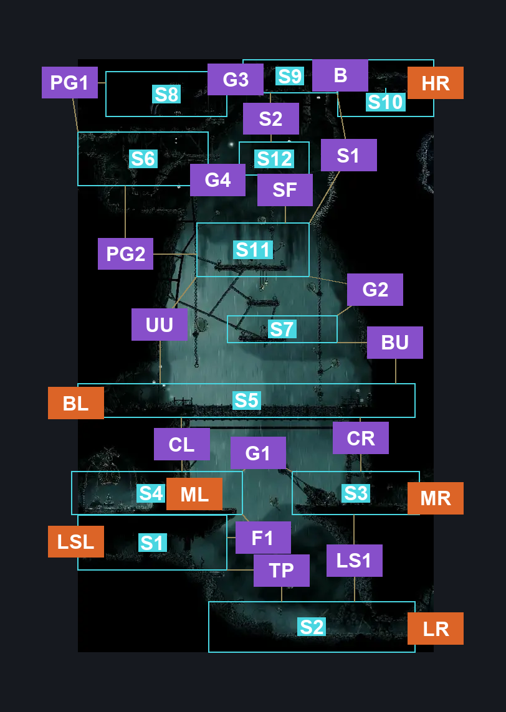
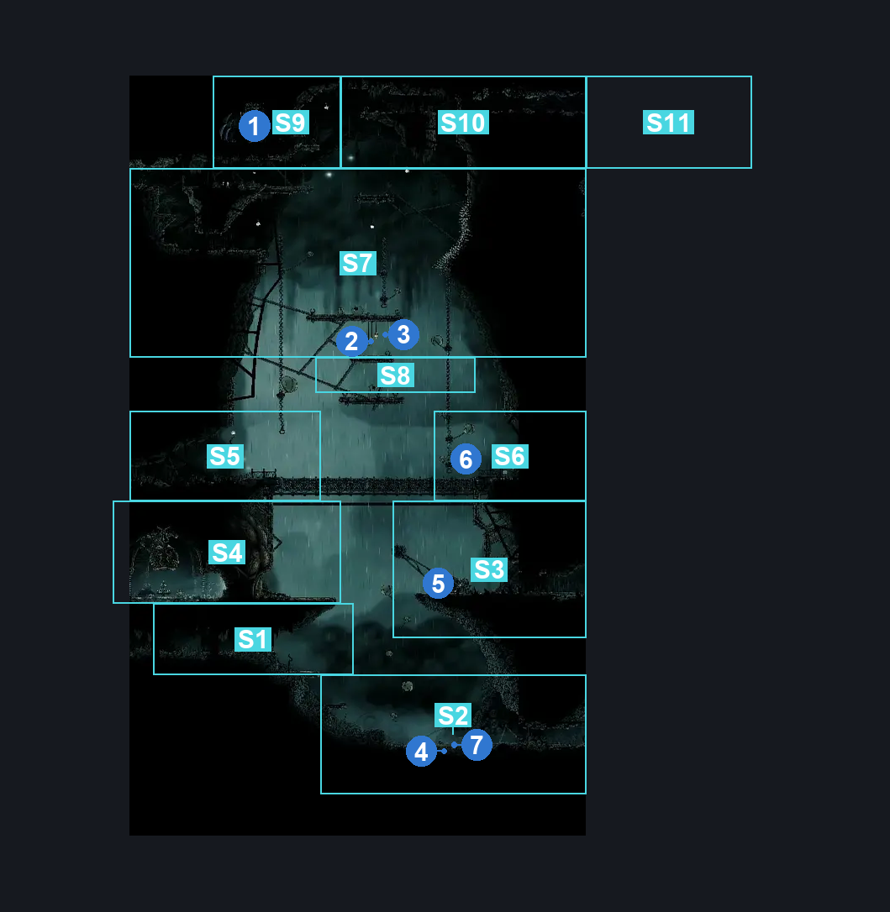
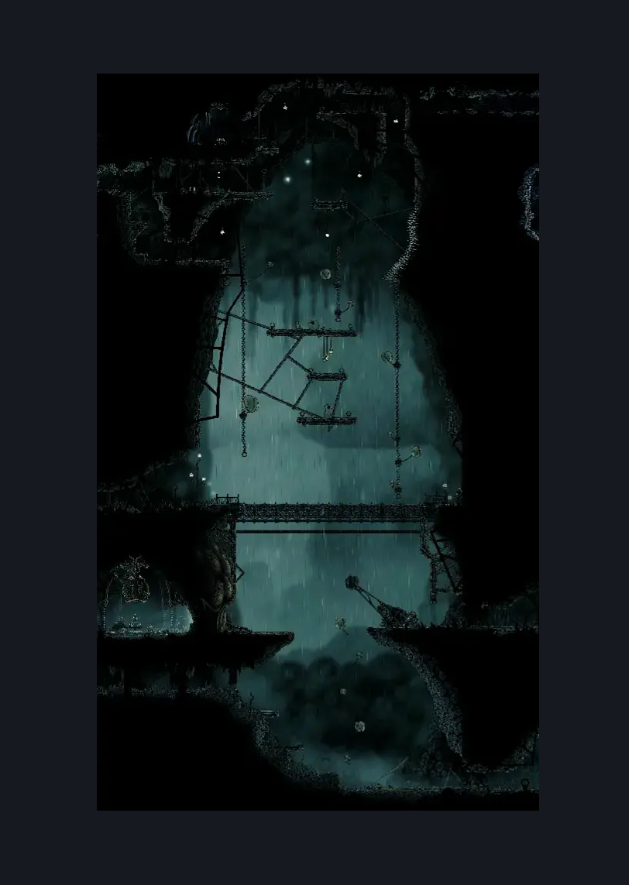

# Greymoor East Bellshrine Room (Greymoor_02)

**Game ID:** Greymoor_02

**Contributors:** Isssma

## Subrooms

| No. | Subroom | Annotated |
| --- | --- | --- |
| S1 | lower section left | ✓ |
| S2 | lower section right | ✓ |
| S3 | middle section right | ✓ |
| S4 | middle section left | ✓ |
| S5 | bridge section | ✓ |
| S6 | upper craw nest | ✓ |
| S7 | lone crow platform | ✓ |
| S8 | top left | ✓ |
| S9 | top right | ✓ |
| S10 | hidden exit | ✓ |
| S11 | craw gang hangout place | ✓ |
| S12 | stupid platform | ✓ |

- **hidden exit:** it has the black screen thing when wall has not been broken

## Room Transitions

| Alias | Name | From subroom | Destination | Destination alias | Requirements | TODO | Verification | Annotated | Notes |
| --- | --- | --- | --- | --- | --- | --- | --- | --- | --- |
| LSL | lower left | lower section left | [Greymoor West Bellshrine Room (Greymoor_01)](greymoor-west-bellshrine-room.md) | LR | none |  | Verified | ✓ |  |
| LR | lower right | lower section right | [Greymoor Craw Lake Entrance (Greymoor_15)](greymoor-craw-lake-entrance.md) | LL | none |  | Verified | ✓ |  |
| ML | middle left | middle section left | [Greymoor Bellshrine (Bellshrine_02)](greymoor-bellshrine.md) | R | none |  | Verified | ✓ |  |
| MR | middle right | middle section right | [Greymoor Craw Lake Entrance (Greymoor_15)](greymoor-craw-lake-entrance.md) | UL | none |  | Verified | ✓ |  |
| BL | bridge left | bridge section | [Greymoor West Bellshrine Room (Greymoor_01)](greymoor-west-bellshrine-room.md) | TR | none |  | Verified | ✓ |  |
| HR | hidden right | hidden exit | [Greymoor Silver Shells Room (Greymoor_17)](greymoor-silver-shells-room.md) | L | none |  | Verified | ✓ |  |

## Subroom Connections

| Alias | Name | Source | Destination | Requirements | TODO | Verification | Annotated | Notes |
| --- | --- | --- | --- | --- | --- | --- | --- | --- |
| TP | tall platform | lower section right | lower section left | ledge grab left OR faydown cloak OR silk soar OR cling grip left |  | Verified | ✓ |  |
| TP | tall platform | lower section left | lower section right | nothing (just fall) |  | Verified | ✓ |  |
| F1 | fall 1 | middle section left | lower section left | nothing (just fall) |  | Verified | ✓ |  |
| LS1 | lever switch 1 | lower section right | middle section right | silk soar OR prereq balloon switch |  | Verified | ✓ |  |
| LS1 | lever switch 1 | middle section right | lower section right | none (just fall) |  | Verified | ✓ |  |
| G1 | gap 1 | middle section right | middle section left | prereq balloon switch OR progressive swift step 1 left OR clawline left x 1 OR sharpdart x 1 OR drifters cloak OR faydown cloak OR silk soar |  | Verified | ✓ |  |
| G1 | gap 1 | middle section left | middle section right | Progressive swift step 2 right OR clawline right x 1 OR sharpdart  x 1 OR drifters cloak OR silksoar OR (progressive swift step 1 right AND (faydown cloak OR ledge grab right)) OR prereq balloon switch |  | Verified | ✓ |  |
| CR | climb right | middle section right | bridge section | (prereq bridge lever  OR prereq cooler bridge lever) AND (cling grip right OR silk soar) |  | Verified | ✓ |  |
| CR | climb right | bridge section | middle section right | prereq bridge lever OR prereq cooler bridge lever |  | Verified | ✓ |  |
| CL | climb left | middle section left | bridge section | (prereq bridge lever  OR prereq cooler bridge lever) AND (silk soar OR (cling grip left AND faydown cloak)) |  | Verified | ✓ |  |
| CL | climb left | bridge section | middle section left | prereq bridge lever OR prereq cooler bridge lever |  | Verified | ✓ |  |
| UU | up upper | bridge section | craw gang hangout place | silk soar |  | Verified | ✓ |  |
| UU | up upper | craw gang hangout place | bridge section | none (fall) |  | Verified | ✓ |  |
| BU | balloon up | bridge section | lone crow platform | nothing |  | Verified | ✓ |  |
| BU | balloon up | lone crow platform | bridge section | none (fall) |  | Verified | ✓ |  |
| G2 | gap 2 | lone crow platform | craw gang hangout place | silk soar OR faydown cloak OR hard pogo off tallcraw OR clawline right x 1 OR sharpdart x 1 OR progressive swift step 2 right OR drifters cloak |  | Verified | ✓ |  |
| G2 | gap 2 | craw gang hangout place | lone crow platform | nothing |  | Verified | ✓ |  |
| S1 | shaft 1 | craw gang hangout place | top right | silk soar OR (cling grip right AND proficient movement AND spike pogo) |  | Verified | ✓ |  |
| S1 | shaft 1 | top right | craw gang hangout place | nada |  | Verified | ✓ |  |
| PG1 | platform gap | upper craw nest | top left | silk soar OR faydown cloak OR (hard pogo off craw OR hard pogo off squatcraw) |  | Verified | ✓ |  |
| PG1 | platform gap | top left | upper craw nest | nothing |  | Verified | ✓ |  |
| G3 | gap 3 | top left | top right | faydown cloak OR (ledge grab right AND (clawline right x 1 OR progressive swift step 1 right OR sharpdart x 1)) |  | Verified | ✓ |  |
| G3 | gap 3 | top right | top left | nothing |  | Verified | ✓ |  |
| B | blockade | top right | hidden exit | break wall right OR break wall up |  | Verified | ✓ |  |
| B | blockade | hidden exit | top right | break wall left OR break wall up |  | Verified | ✓ |  |
| S2 | shaft 2 | stupid platform | top right | silk soar OR (cling grip right AND (progressive swift step 1 right OR clawline right x 1 OR sharpdart x 1 OR drifters cloak OR (medium pogo off craw OR medium pogo off squatcraw))) |  | Verified | ✓ |  |
| S2 | shaft 2 | top right | stupid platform | nothing |  | Verified | ✓ |  |
| PG2 | platform gap 2 | craw gang hangout place | upper craw nest | silk soar OR faydown cloak OR cling grip right OR (ledge grab left AND (cling grip left OR easy shaman pogo)) OR (medium pogo off craw OR medium pogo off squatcraw) |  | Verified | ✓ |  |
| PG2 | platform gap 2 | upper craw nest | craw gang hangout place | nothing |  | Verified | ✓ |  |
| G4 | gap 4 | upper craw nest | stupid platform | nothing |  | Verified | ✓ |  |
| G4 | gap 4 | stupid platform | upper craw nest | progressive swift step 1 left OR clawline left x 1 OR sharpdart x 1 OR faydown cloak OR easy [beast, architect, reaper, shaman, hunter] pogo OR cling grip left OR (medium pogo off craw) OR flea brew OR drifters cloak OR silk soar |  | Verified | ✓ |  |
| SF | stupid fall | craw gang hangout place | stupid platform | silk soar OR cbt pogo off squatcraw |  | Verified | ✓ |  |
| SF | stupid fall | stupid platform | craw gang hangout place | nothing |  | Verified | ✓ |  |

## Check Locations

| No. | Check | Subroom | Requirements | TODO | Verification | Location Type | Annotated | Notes |
| --- | --- | --- | --- | --- | --- | --- | --- | --- |
| 1 | Greymoor - Spool Fragment | top left | nothing |  | Verified | collectible | ✓ |  |
| 2 | Greymoor - Craw gang lunch money | craw gang hangout place | nothing |  | Verified | resource | ✓ |  |
| 3 | Greymoor - Craw gang savings | craw gang hangout place | nothing |  | Verified | resource | ✓ |  |
| 4 | Greeymoor - map purchase | lower section right | nothing |  | Verified | collectible | ✓ |  |
| 5 | balloon switch | middle section right | flip lever up OR flip lever right OR flip lever left |  | Verified | switch | ✓ |  |
| 6 | bridge lever | bridge section | flip lever up OR flip lever right OR flip lever left |  | Verified | switch | ✓ |  |
| 7 | cooler bridge lever | bridge section | flip lever up OR flip lever right OR flip lever left |  | Verified | switch | ✓ |  |
| 8 | Seth Meeting Greymoor | lower section right | defeat THE Boss: Shrine Guardian Seth AND (  have everbloom OR have encrusted heart OR have hunters heart OR have conjoined heart ) |  | Verified | event | ✓ | requirements per the wiki |
| 9 | Craw 1 | craw gang hangout place | nothing |  | Verified | enemy | ✓ | FSM Boolean flags: CrowCourtInSession |
| 10 | Mite 1 | upper craw nest | Normal World Spawn |  | Verified | enemy | ✓ |  |
| 11 | Tallcraw 1 | lone crow platform | Normal World Spawn |  | Verified | enemy | ✓ | Spawn conditions: CrowCourtInSession=false |
| 12 | Squatcraw 1 | craw gang hangout place | Normal World Spawn |  | Verified | enemy | ✓ | Spawn conditions: CrowCourtInSession=false |
| 13 | Craw 2 | stupid platform | Normal World Spawn |  | Verified | enemy | ✓ |  |
| 14 | Tallcraw 2 | stupid platform | Black Thread World Spawn |  | Verified | enemy | ✓ |  |
| 15 | Squatcraw 2 | stupid platform | Black Thread World Spawn |  | Verified | enemy | ✓ |  |
| 16 | Void Mass 1 | stupid platform | Black Thread World Spawn |  | Verified | enemy | ✓ |  |

## Room Images

### Connections

### Checks

### Scene

