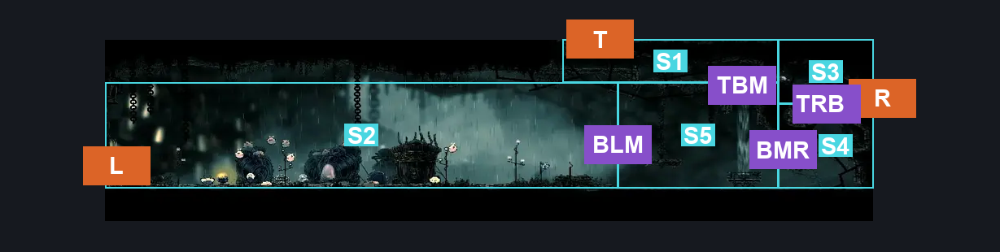
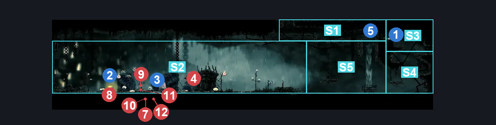
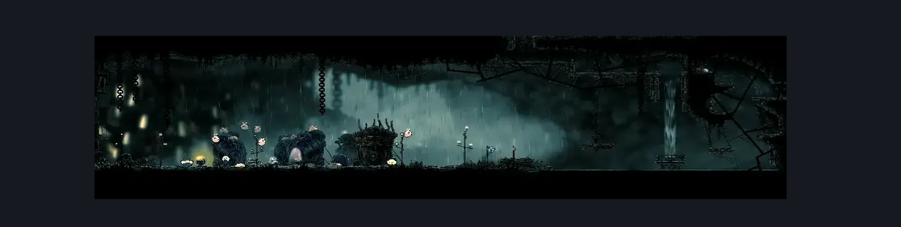

# Greymoor Entry to Bellhart (Greymoor_08)

**Game ID:** Greymoor_08

**Contributors:** skai AND Isssma

## Subrooms

| No. | Subroom | Annotated |
| --- | --- | --- |
| S1 | Top Section | ✓ |
| S2 | Bottom Left Section | ✓ |
| S3 | Top Right Section | ✓ |
| S4 | Bottom Right Section | ✓ |

## Room Transitions

| Alias | Name | From subroom | Destination | Destination alias | Requirements | TODO | Verification | Annotated | Notes |
| --- | --- | --- | --- | --- | --- | --- | --- | --- | --- |
| L | Left | Bottom Left Section | [Bellhart Right Entrance (Belltown_06)](../bellhart/bellhart-right-entrance.md) | R | nothing |  | Verified | ✓ |  |
| T | Top | Top Section | [Greymoor Western Room (Greymoor_07)](greymoor-western-room.md) | D | nothing |  | Verified | ✓ |  |
| R | Right | Top Right Section | [Greymoor Rat Tunnel (Greymoor_16)](greymoor-rat-tunnel.md) | L | nothing |  | Verified | ✓ |  |

## Subroom Connections

| Alias | Name | Source | Destination | Requirements | TODO | Verification | Annotated | Notes |
| --- | --- | --- | --- | --- | --- | --- | --- | --- |
| TBM | Top to Bottom Middle | Top Section | Bottom Right Section | prereq tied airstream |  | Verified | ✓ |  |
| TBM | Top to Bottom Middle | Bottom Right Section | Top Section | (Drifters Cloak OR Silk Soar OR (Faydown AND Cling Grip right)) AND prereq tied airstream |  | Verified | ✓ |  |
| TRB | Top Right to Bottom Right | Bottom Right Section | Top Right Section | Ledge Grab left OR Faydown OR cling grip left OR easy shaman pogo OR easy flea brew stall OR (cling grip right AND (clawline left x 1 OR sharpdart x 1)) |  | Verified | ✓ |  |
| TRB | Top Right to Bottom Right | Top Right Section | Bottom Right Section | nothing (Fall) |  | Verified | ✓ |  |
| BC | Bottom Crossing | Bottom Left Section | Bottom Right Section | Dash right OR Sprint right OR Ledge Grab right OR Silk Soar OR Faydown OR Clawline right x 1 OR Cling Grip right OR easy flea brew stall OR sharpdart x 1 OR drifters cloak OR easy beast needle strike OR easy beast pogo OR easy architect needle strike |  | Verified | ✓ | swim is possible but like other greymoor spots, cleating tied airstream removes the swim option |
| BC | Bottom Crossing | Bottom Right Section | Bottom Left Section | progressive swift step 1 left OR clawline left x 1 OR sharpdart x 1 OR silk soar OR swim OR faydown cloak OR (flea brew AND (ledge grab left OR cling grip left OR prereq tied airstream)) OR easy beast needle strike OR drifters cloak OR easy beast pogo OR easy architect needle strike |  | Verified | ✓ |  |

## Check Locations

| No. | Check | Subroom | Requirements | TODO | Verification | Location Type | Annotated | Notes |
| --- | --- | --- | --- | --- | --- | --- | --- | --- |
| 1 | Greymoor - Secret dead bug rosaries near rat tunnel | Top Right Section | nothing |  | Verified | resource | ✓ |  |
| 2 | Flea Brew | Bottom Left Section | complete THE The Lost Fleas Wish Granted |  | Verified | collectible | ✓ |  |
| 3 | Flea Caravan - Spool fragment | Bottom Left Section | after flea caravan move to blasted steps |  | Verified | collectible | ✓ | reward for the move is the spool fragment |
| 4 | Boss: Moorwing | Bottom Left Section | invalid |  | Verified | boss | ✓ | randomizer should always force moorwing at other spot for consitent logic - hero, 9/26 |
| 5 | tied airstream | Top Section | break switch left OR break switch up OR break switch right |  | Verified | blockade | ✓ |  |
| 6 | flea caravan move to blasted steps | Bottom Left Section | after THE flea caravan move to greymoor AND get 12 fleas AND defeat THE boss last judge |  | Verified | event | ✓ | per the wiki |
| 7 | Elder Pilgrim 1 | Bottom Left Section | Black Thread World Spawn |  | Verified | enemy | ✓ | FSM Boolean flags: mapperIsFightingAct3 |
| 8 | Winged Pilgrim 1 | Bottom Left Section | Black Thread World Spawn |  | Verified | enemy | ✓ | FSM Boolean flags: mapperIsFightingAct3 |
| 9 | Winged Pilgrim 2 | Bottom Left Section | Black Thread World Spawn |  | Verified | enemy | ✓ | FSM Boolean flags: mapperIsFightingAct3 |
| 10 | Pilgrim Hornfly 1 | Bottom Left Section | Black Thread World Spawn |  | Verified | enemy | ✓ | FSM Boolean flags: mapperIsFightingAct3 |
| 11 | Winged Pilgrim 3 | Bottom Left Section | Black Thread World Spawn |  | Verified | enemy | ✓ | FSM Boolean flags: mapperIsFightingAct3 |
| 12 | Elder Pilgrim 2 | Bottom Left Section | Black Thread World Spawn |  | Verified | enemy | ✓ | FSM Boolean flags: mapperIsFightingAct3 |

## Room Images

### Connections

### Checks

### Scene

