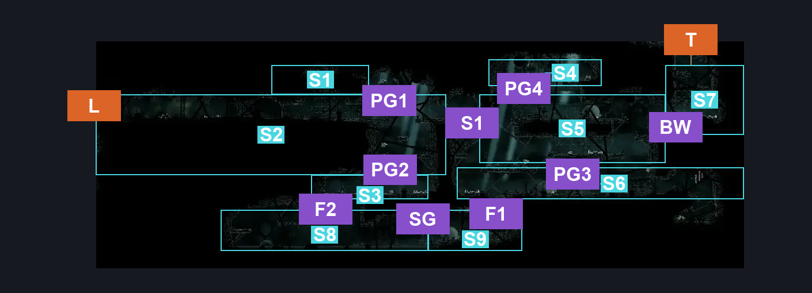
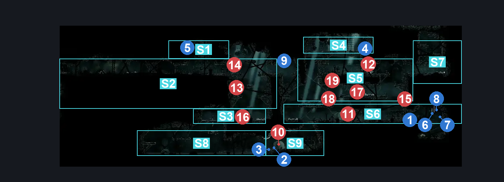
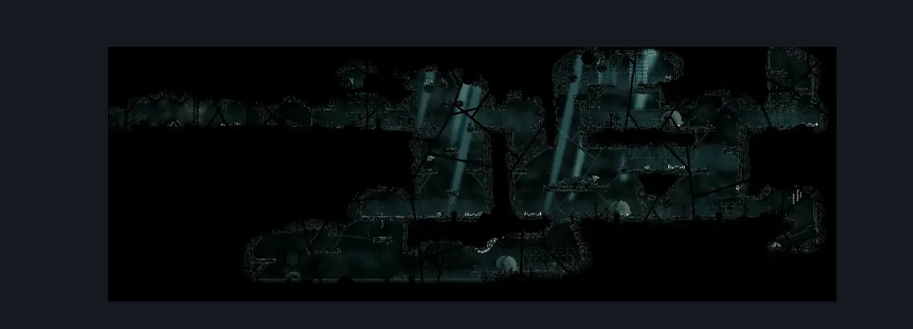

# Greymoor Rat Tunnel (Greymoor_16)

**Game ID:** Greymoor_16

**Contributors:** skai AND Isssma

## Subrooms

| No. | Subroom | Annotated |
| --- | --- | --- |
| S1 | Top Left Shaft (Upper) | ✓ |
| S2 | Top Left Shaft (Center) | ✓ |
| S3 | Top Left Shaft (bottom) | ✓ |
| S4 | Top Right Section (Upper) | ✓ |
| S5 | Top Right Section (Center) | ✓ |
| S6 | Top Right Section (Bottom) | ✓ |
| S7 | bellway secret entrance | ✓ |
| S8 | bottom section left | ✓ |
| S9 | bottom section right | ✓ |
| S10 | small pit | ✓ |

- **bottom section right:** fat fuck rat inside
- **small pit:** this was just added in case one of the rosary checks is down there, when i have the time to check in an AP run ill properlly adress it

## Room Transitions

| Alias | Name | From subroom | Destination | Destination alias | Requirements | TODO | Verification | Annotated | Notes |
| --- | --- | --- | --- | --- | --- | --- | --- | --- | --- |
| L | Left | Top Left Shaft (Center) | [Greymoor Entry to Bellhart (Greymoor_08)](greymoor-entry-to-bellhart.md) | R | nothing |  | Verified | ✓ |  |
| T | Top | bellway secret entrance | [Greymoor Bellway (Bellway_04)](greymoor-bellway.md) | D | nothing |  | Verified | ✓ |  |

## Subroom Connections

| Alias | Name | Source | Destination | Requirements | TODO | Verification | Annotated | Notes |
| --- | --- | --- | --- | --- | --- | --- | --- | --- |
| PG1 | platform gap 1 | Top Left Shaft (Center) | Top Left Shaft (Upper) | ledge grab either OR silk soar OR faydown cloak OR cling grip either OR easy scuttlebrace OR (easy pogo off fluttermite AND (clawline left x 1 OR progressive swift step 1 left OR sharpdart x 1 OR drifters cloak OR easy [beast, shaman, hunter, architect, reaper] pogo OR proficient movement)) OR (ponder the orb AND hard [shaman, reaper, beast] pogo) OR easy damage boost off fluttermite OR medium [voltvessels, flea brew] stall OR hard heal stall |  | Verified | ✓ |  |
| PG1 | platform gap 1 | Top Left Shaft (Upper) | Top Left Shaft (Center) | nothing (just fall) |  | Verified | ✓ |  |
| PG2 | platform gap 2 | Top Left Shaft (Center) | Top Left Shaft (bottom) | nothing (just fall) |  | Verified | ✓ |  |
| PG2 | platform gap 2 | Top Left Shaft (bottom) | Top Left Shaft (Center) | ledge grab left OR ledge grab right OR silk soar OR faydown cloak OR cling grip left OR cling grip right OR easy scuttlebrace OR (medium pogo off fluttermite  AND normal world spawn) OR (ponder the orb AND (easy shaman pogo OR medium [reaper, beast] pogo)) |  | Verified | ✓ |  |
| S1 | shaft 1 | Top Left Shaft (Center) | Top Right Section (Center) | clear tied blockade |  | Verified | ✓ |  |
| S1 | shaft 1 | Top Right Section (Center) | Top Left Shaft (Center) | clear tied blockade AND (cling grip left OR easy scuttlebrace OR silksoar OR (faydown cloak AND (ledge grab right OR ledge grab left OR medium shaman pogo OR cling grip right))) |  | Verified | ✓ |  |
| PG3 | platform gap 3 | Top Right Section (Center) | Top Right Section (Bottom) | nothing (just fall) |  | Verified | ✓ |  |
| PG3 | platform gap 3 | Top Right Section (Bottom) | Top Right Section (Center) | faydown cloak OR silk soar OR cling grip right OR cling grip left OR ledge grab left OR ledge grab right OR (easy scuttlebrace AND drifters cloak) OR (medium pogo off mitemother) |  | Verified | ✓ |  |
| PG4 | platform gap 4 | Top Right Section (Center) | Top Right Section (Upper) | medium pogo off mitemother OR cling grip left OR faydown cloak OR silk soar OR ledge grab right OR (cling grip right AND (progressive swift step 2 right OR sharpdart x 1 OR clawline right x 1 OR drifters cloak)) |  | Verified | ✓ |  |
| PG4 | platform gap 4 | Top Right Section (Upper) | Top Right Section (Center) | nothing (jsut fall) |  | Verified | ✓ |  |
| F1 | fall 1 | Top Right Section (Bottom) | bottom section right | nothing (just fall) |  | Verified | ✓ |  |
| F1 | fall 1 | bottom section right | Top Right Section (Bottom) | silk soar OR (hard pogo off mitemother AND faydown cloak AND (cling grip left OR cling grip right OR ledge grab left OR ledge grab right)) |  | Verified | ✓ |  |
| SG | swimming gap | bottom section right | bottom section left | (swim AND (ledge grab left OR faydown cloak OR cling grip left)) OR (clawline left x 2 AND faydown cloak AND (ledge grab left OR cling grip left)) |  | Verified | ✓ |  |
| SG | swimming gap | bottom section left | bottom section right | swim OR ((clawline right x 1 OR sharpdart x 1) AND (faydown cloak OR drifters cloak)) OR (faydown cloak AND progressive swift step 2 right AND drifters cloak) OR (clawline right x 1 AND hard beast pogo) |  | Verified | ✓ |  |
| F2 | fall 2 | Top Left Shaft (bottom) | bottom section left | open airlock left OR open airlock right OR open airlock up |  | Verified | ✓ |  |
| F2 | fall 2 | bottom section left | Top Left Shaft (bottom) | (open airlock left OR open airlock right OR open airlock up) AND (progressive swift step 1 right OR clawline right x 2 OR sharpdart x 2 OR faydown cloak OR easy beast pogo OR drifters cloak OR easy architect needle strike) |  | Verified | ✓ |  |
| BW | breakable wall | Top Right Section (Center) | bellway secret entrance | break wall right OR break wall up |  | Verified | ✓ |  |
| BW | breakable wall | bellway secret entrance | Top Right Section (Center) | break wall left OR break wall up |  | Verified | ✓ |  |
| P | placeholder | Top Right Section (Bottom) | small pit | nothing |  | Verified | ✓ |  |
| P | placeholder | small pit | Top Right Section (Bottom) | silk soar OR ledge grab left OR ledge grab right OR cling grip right OR cling grip left OR faydown cloak |  | Verified | ✓ |  |

## Check Locations

| No. | Check | Subroom | Requirements | TODO | Verification | Location Type | Annotated | Notes |
| --- | --- | --- | --- | --- | --- | --- | --- | --- |
| 1 | Breakable wooden Wall | Top Right Section (Bottom) | break wall right OR break wall up |  | Verified | blockade | ✓ |  |
| 2 | Greymoor - Shell Shard Cache next to the pit with with fat fuck | bottom section right | none |  | Verified | resource | ✓ |  |
| 3 | Greymoor - The other Shell Shard Cache in the pit with the fat fuck | bottom section right | none |  | Verified | resource | ✓ |  |
| 4 | Greymoor - Memory Locket | Top Right Section (Upper) | none |  | Verified | collectible | ✓ |  |
| 5 | Greymoor - Cage Record | Top Left Shaft (Upper) | nothing |  | Verified | lore | ✓ |  |
| 6 | Greymoor - Rosary Cache behind the big rat above the pit | Top Right Section (Bottom) | clear Breakable wooden Wall |  | Verified | resource | ✓ |  |
| 7 | Greymoor - the other Rosary Cache behind the big rat above the pit with the other big rat | Top Right Section (Bottom) | clear Breakable wooden Wall |  | Verified | resource | ✓ |  |
| 8 | Greymoor - Another rosary cache behind the big rat above the pit | Top Right Section (Bottom) | clear Breakable wooden Wall |  | Verified | resource | ✓ |  |
| 9 | tied blockade | Top Left Shaft (Center) | break switch left OR break switch up OR break switch right |  | Verified | blockade | ✓ |  |
| 10 | Mitemother 1 | bottom section right | nothing |  | Verified | enemy | ✓ |  |
| 11 | Mitemother 2 | Top Right Section (Bottom) | nothing |  | Verified | enemy | ✓ |  |
| 12 | Mitemother 3 | Top Right Section (Center) | nothing |  | Verified | enemy | ✓ |  |
| 13 | Fluttermite 1 | Top Left Shaft (Center) | nothing |  | Verified | enemy | ✓ |  |
| 14 | Fluttermite 2 | Top Left Shaft (Center) | nothing |  | Verified | enemy | ✓ |  |
| 15 | Mite 1 | Top Right Section (Bottom) | nothing |  | Verified | enemy | ✓ |  |
| 16 | Mite 2 | Top Left Shaft (bottom) | Normal World Spawn |  | Verified | enemy | ✓ | he is capable of killing himself |
| 17 | Mite 3 | Top Right Section (Center) | nada |  | Verified | enemy | ✓ |  |
| 18 | Fluttermite 3 | Top Right Section (Center) | Normal World Spawn |  | Verified | enemy | ✓ |  |
| 19 | Void Mass 1 | Top Right Section (Center) | Black Thread World Spawn |  | Verified | enemy | ✓ |  |

## Room Images

### Connections

### Checks

### Scene

