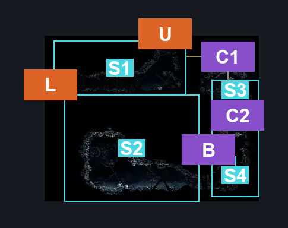
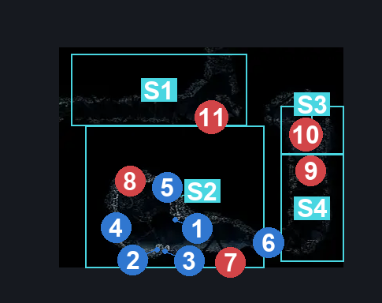
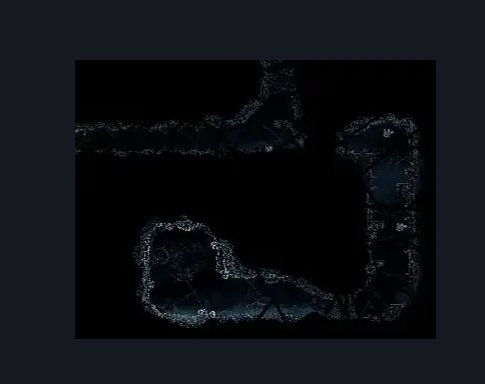

# Greymoor Silver Shells Room (Greymoor_17)

**Game ID:** Greymoor_17

**Contributors:** Isssma

## Subrooms

| No. | Subroom | Annotated |
| --- | --- | --- |
| S1 | main path | ✓ |
| S2 | hidden area | ✓ |
| S3 | hidden shaft upper | ✓ |
| S4 | hidden shaft loower | ✓ |

## Room Transitions

| Alias | Name | From subroom | Destination | Destination alias | Requirements | TODO | Verification | Annotated | Notes |
| --- | --- | --- | --- | --- | --- | --- | --- | --- | --- |
| L | left | main path | [Greymoor East Bellshrine Room (Greymoor_02)](greymoor-east-bellshrine-room.md) | HR | none |  | Verified | ✓ |  |
| U | upper | main path | [Sinner's Road Styx Room (Dust_11)](../sinner-s-road/sinner-s-road-styx-room.md) | B | faydown cloak OR cling grip either OR easy scuttlebrace OR silk soar |  | Verified | ✓ |  |

## Subroom Connections

| Alias | Name | Source | Destination | Requirements | TODO | Verification | Annotated | Notes |
| --- | --- | --- | --- | --- | --- | --- | --- | --- |
| C1 | climb 1 | main path | hidden shaft upper | none (just fall) |  | Verified | ✓ |  |
| C1 | climb 1 | hidden shaft upper | main path | ledge grab right OR (easy enemy pogo AND prereq Fluttermite 1) OR silk soar OR faydown cloak OR cling grip either OR easy scuttlebrace |  | Verified | ✓ |  |
| C2 | climb 2 | hidden shaft loower | hidden shaft upper | cling grip either OR ledge grab left OR silk soar OR faydown cloak OR easy scuttlebrace |  | Verified | ✓ |  |
| C2 | climb 2 | hidden shaft upper | hidden shaft loower | nothing |  | Verified | ✓ |  |
| B | blockade | hidden shaft loower | hidden area | prereq wooden wall |  | Verified | ✓ |  |
| B | blockade | hidden area | hidden shaft loower | prereq wooden wall |  | Verified | ✓ |  |

## Check Locations

| No. | Check | Subroom | Requirements | TODO | Verification | Location Type | Annotated | Notes |
| --- | --- | --- | --- | --- | --- | --- | --- | --- |
| 1 | Greymoor - Shell Shard Cache of the silver room | hidden area | nothing |  | Verified | resource | ✓ |  |
| 2 | Greymoor - the other Shell Shard Cache of the silver room | hidden area | nothing |  | Verified | resource | ✓ |  |
| 3 | Greymoor - the other other Shell Shard Cache of the silver room | hidden area | nothing |  | Verified | resource | ✓ |  |
| 4 | Greymoor - the other other other Shell Shard Cache of the silver room | hidden area | nothing |  | Verified | resource | ✓ |  |
| 5 | Greymoor - the other other other other Shell Shard Cache of the silver room idk why so many | hidden area | nothing |  | Verified | resource | ✓ |  |
| 6 | wooden wall | hidden shaft loower | break wall: left OR break wall up |  | Verified | blockade | ✓ |  |
| 7 | Craw 1 | hidden area | nada AND invalid |  | Verified | enemy | ✓ | Spawn conditions: hitCrowCourtSwitch=false  this mf is a lie from the craw court, he is slacking not in his post (scrapped enemy probably) |
| 8 | Shardillard 1 | hidden area | silk soar OR ledge grab either OR cling grip either OR faydown cloak |  | Verified | enemy | ✓ |  |
| 9 | Fluttermite 1 | hidden shaft loower | nothing |  | Verified | enemy | ✓ |  |
| 10 | Fluttermite 2 | hidden shaft upper | nothing |  | Verified | enemy | ✓ |  |
| 11 | Mite 1 | main path | nothing |  | Verified | enemy | ✓ |  |

## Room Images

### Connections

### Checks

### Scene

