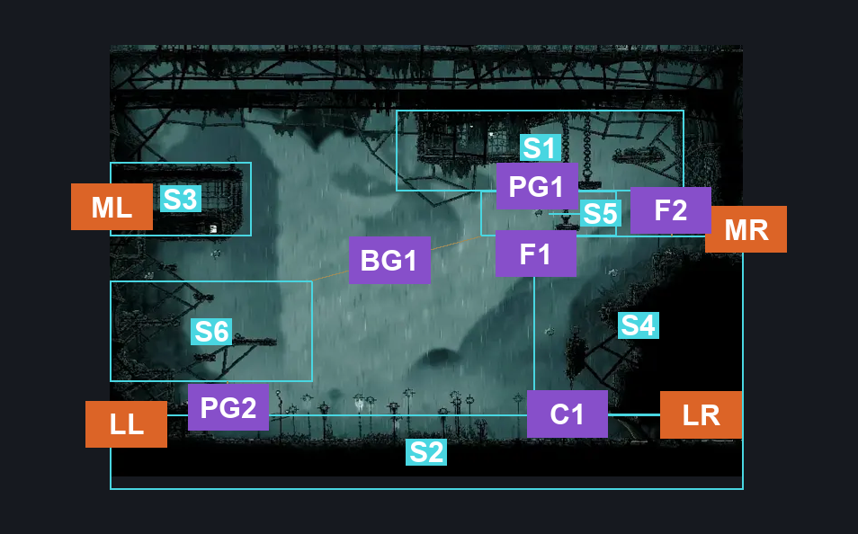
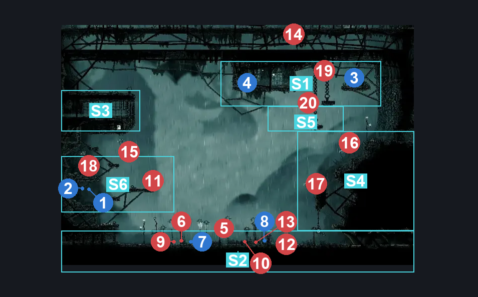
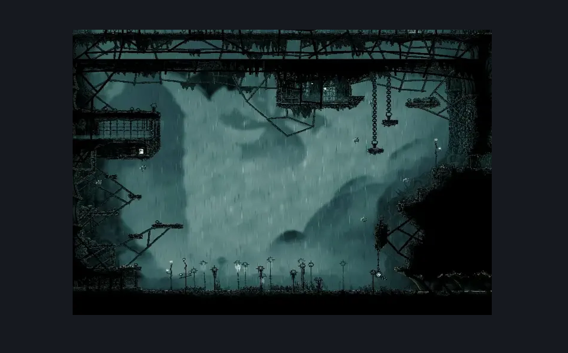

# Greymoor Towers Patio (Greymoor_05)

**Game ID:** Greymoor_05

**Contributors:** Isssma

## Subrooms

| No. | Subroom | Annotated |
| --- | --- | --- |
| S1 | upper area | ✓ |
| S2 | lower section | ✓ |
| S3 | garmond room | ✓ |
| S4 | east tower entrance | ✓ |
| S5 | lower hanging platforms | ✓ |
| S6 | left middle section | ✓ |
| S7 | fluttermite place | ✓ |
| S8 | above bellway | ✓ |
| S9 | hanging platform | ✓ |
| S10 | steep climb | ✓ |

## Room Transitions

| Alias | Name | From subroom | Destination | Destination alias | Requirements | TODO | Verification | Annotated | Notes |
| --- | --- | --- | --- | --- | --- | --- | --- | --- | --- |
| LR | lower right | lower section | [Greymoor Bellway (Bellway_04)](greymoor-bellway.md) | L | nothing |  | Verified | ✓ |  |
| LL | lower left | lower section | [Greymoor Western Tower (Greymoor_06)](greymoor-western-tower.md) | LR | nothing |  | Verified | ✓ |  |
| ML | middle left | garmond room | [Greymoor Western Tower (Greymoor_06)](greymoor-western-tower.md) | GR | nothing |  | Verified | ✓ |  |
| MR | middle right | east tower entrance | [Greymoor Eastern Tower (Greymoor_04)](greymoor-eastern-tower.md) | LL | nothing |  | Verified | ✓ |  |
| SC | slab capture | lower section | [Slab Capture](../fast-travel/slab-capture.md) | GM | after Get Kidnapped |  | Verified | ✓ |  |

## Subroom Connections

| Alias | Name | Source | Destination | Requirements | TODO | Verification | Annotated | Notes |
| --- | --- | --- | --- | --- | --- | --- | --- | --- |
| F1 | fall 1 | east tower entrance | lower hanging platforms | silk soar OR (ledge grab left AND (clawline left x {1} OR faydown cloak OR sharpdart x 1 OR progressive swift step 2 left OR (progressive swift step 1 left AND flea brew) OR (medium enemy pogo AND prereq fluttermite 1))) OR (faydown cloak AND (clawline left x {1} OR progressive swift step 1 left OR sharpdart x 1 OR drifters cloak OR (medium enemy pogo AND prereq fluttermite 1))) OR (easy scuttlebrace AND (clawline left x {2} OR (clawline left x {1} AND (sharpdart x 1 OR drifters cloak OR progressive swift step 2 left OR medium beast pogo)) OR (drifters cloak AND flea brew))) OR ((medium enemy pogo AND prereq fluttermite 1) AND (progressive swift step 2 left OR drifters cloak OR sharpdart x 1 OR clawline left x {1} OR easy beast pogo)) |  | Verified | ✓ |  |
| F1 | fall 1 | lower hanging platforms | east tower entrance | nothing (just fall) |  | Verified | ✓ |  |
| C1 | climb 1 | steep climb | east tower entrance | silk soar OR faydown cloak OR ledge grab right OR cling grip right OR (easy enemy pogo AND prereq fluttermite 1) OR easy scuttlebrace |  | Verified | ✓ |  |
| C1 | climb 1 | east tower entrance | steep climb | nothing (just fall) |  | Verified | ✓ |  |
| PG1 | platform gap 1 | lower hanging platforms | upper area | faydown cloak OR ((medium enemy pogo AND prereq fluttermite 1 AND (ACT 1 OR ACT 2))) OR silk soar OR ((easy enemy pogo AND prereq fluttermite 1) AND (ledge grab right OR progressive swift step 2 right OR clawline right x 1 OR sharpdart x 1 OR drifters cloak)) |  | Verified | ✓ |  |
| PG1 | platform gap 1 | upper area | lower hanging platforms | nothing (just fall) |  | Verified | ✓ |  |
| F2 | fall 2 | upper area | east tower entrance | nothing (just fall) |  | Verified | ✓ |  |
| F2 | fall 2 | east tower entrance | upper area | cling grip right OR silk soar OR (easy scuttlebrace AND (clawline left x 2 OR (clawline left x 1 AND (sharpdart x 1 OR drifters cloak OR easy beast pogo OR (ledge grab left AND progressive swift step 2 left))))) |  | Verified | ✓ |  |
| BG1 | big gap 1 | lower hanging platforms | left middle section | drifters cloak OR (sharpdart x 3 AND progressive swift step 2) OR sharpdart x 4 OR clawline left x 4 OR (clawline left x 3 AND progressive swift step 2 left) |  | Verified | ✓ |  |
| PG2 | platform gap 2 | lower section | left middle section | ledge grab left OR   silk soar OR faydown cloak OR cling grip left OR (easy scuttlebrace AND (medium enemy pogo AND (prereq Thread Raker 1 OR prereq Dreg catcher 1))) |  | Verified | ✓ |  |
| PG2 | platform gap 2 | left middle section | lower section | nothing (just fall) |  | Verified | ✓ |  |
| PG3 | platform gap 3 | left middle section | fluttermite place | ledge grab left OR cling grip left OR progressive swift step 1 left OR clawline left x 1 OR sharpdart x 3 OR drifters cloak OR silk soar OR faydown cloak OR easy beast pogo OR easy architect needle strike |  | Verified | ✓ |  |
| PG3 | platform gap 3 | fluttermite place | left middle section | nothing |  | Verified | ✓ |  |
| BG2 | big gap 2 | upper area | fluttermite place | clawline left x 5 OR (drifters cloak AND (clawline left x 2 OR (clawline left x 1 AND ((progressive swift step 2 left AND (ledge grab left OR easy beast pogo OR easy architect pogo)) OR (flea brew AND ledge grab left))) OR (sharpdart x 1 AND progressive swift step 2 left))) OR (clawline left x 4 AND progressive swift step 2 left) |  | Verified | ✓ |  |
| C2 | climb 2 | lower section | above bellway | silk soar OR ledge grab right OR faydown cloak OR cling grip right OR (easy scuttlebrace AND (medium enemy pogo AND (prereq Thread Raker 1 OR prereq Dreg catcher 1))) |  | Verified | ✓ |  |
| C2 | climb 2 | above bellway | lower section | nothing |  | Verified | ✓ |  |
| C3 | climb 3 | above bellway | hanging platform | easy beast needle strike OR silk soar OR ledge grab right OR cling grip right OR faydown cloak OR (proficient movement AND progressive swift step 2 left) OR (cling grip right AND (progressive swift step 2 left OR clawline left x 1 OR sharpdart x 1 OR architect needle left OR easy beast pogo OR drifters cloak)) |  | Verified | ✓ |  |
| C3 | climb 3 | hanging platform | above bellway | nothing |  | Verified | ✓ |  |
| C4 | climb 4 | hanging platform | steep climb | silk soar OR faydown cloak OR ledge grab right OR cling grip right OR (easy enemy pogo AND prereq fluttermite 1) OR easy scuttlebrace |  | Verified | ✓ |  |
| C4 | climb 4 | steep climb | hanging platform | nothing |  | Verified | ✓ |  |

## Check Locations

| No. | Check | Subroom | Requirements | TODO | Verification | Location Type | Annotated | Notes |
| --- | --- | --- | --- | --- | --- | --- | --- | --- |
| 1 | Greymoor - flying rat stolen rosaries above the west tower entrance | left middle section | nothing |  | Verified | resource | ✓ |  |
| 2 | Greymoor - poor soul rosaries that were stolen by flying rats above the west tower entrance | left middle section | nothing |  | Verified | resource | ✓ |  |
| 3 | Greymoor - someones mortage at the top of the room | upper area | nothing |  | Verified | resource | ✓ |  |
| 4 | Greymor - totally free to take shell shard cache at the top | upper area | faydown cloak OR progressive swift step 1 left OR (easy enemy pogo AND prereq fluttermite 1) OR silk soar OR sharpdart x 1 OR clawline left x 1 |  | Verified | resource | ✓ |  |
| 5 | Get Kidnapped | lower section | after Wardenfly 1 |  | Verified | event | ✓ |  |
| 6 | Garmond and Zaza Act 3 Meeting Greymoor | lower section | Act 3 |  | Verified | event | ✓ |  |
| 7 | Sleeping Garmond | garmond room | Act 2 |  | Verified | event | ✓ |  |
| 8 | Boos: MoorWing | lower section | nothing |  | Verified | boss | ✓ | moorwing is now forced to spawn here |
| 9 | Thread Raker 1 | lower section | Normal World Spawn |  | Verified | enemy | ✓ | Spawn conditions: greymoor_05_centipedeArrives=true FSM Boolean flags: greymoor05_clearedOut, defeatedVampireGnatBoss, VampireGnatBossInAltLoc, encounteredVampireGnat_05, hasWalljump, citadelWoken, greymoor05_killedJailer, visitedUpperSlab, slab_cloak_battle_completed, previouslyVisitedGreymoor_05, encounteredVampireGnatBoss |
| 10 | Thread Raker 2 | lower section | Black Thread World Spawn |  | Verified | enemy | ✓ | FSM Boolean flags: greymoor05_clearedOut, defeatedVampireGnatBoss, VampireGnatBossInAltLoc, encounteredVampireGnat_05, hasWalljump, citadelWoken, greymoor05_killedJailer, visitedUpperSlab, slab_cloak_battle_completed, previouslyVisitedGreymoor_05, encounteredVampireGnatBoss |
| 11 | Dreg Catcher 1 | left middle section | Normal World Spawn |  | Verified | enemy | ✓ | Spawn conditions: greymoor05_farmerPlatBroken=false FSM Boolean flags: greymoor05_clearedOut, defeatedVampireGnatBoss, VampireGnatBossInAltLoc, encounteredVampireGnat_05, hasWalljump, citadelWoken, greymoor05_killedJailer, visitedUpperSlab, slab_cloak_battle_completed, previouslyVisitedGreymoor_05, encounteredVampireGnatBoss |
| 12 | Dreg Catcher 2 | lower section | nothing |  | Verified | enemy | ✓ | Spawn conditions: CurseKilledFlyGreymoor=false FSM Boolean flags: greymoor05_clearedOut, defeatedVampireGnatBoss, VampireGnatBossInAltLoc, encounteredVampireGnat_05, hasWalljump, citadelWoken, greymoor05_killedJailer, visitedUpperSlab, slab_cloak_battle_completed, previouslyVisitedGreymoor_05, encounteredVampireGnatBoss |
| 13 | Wardenfly 1 | lower section | ( act 1 AND act 2 ) AND defeat THE bell beast boss fight |  | Verified | enemy | ✓ | per the wiki  Spawn conditions: visitedUpperSlab=false, UnlockedFastTravel=true FSM Boolean flags: hasWalljump, greymoor05_clearedOut, defeatedVampireGnatBoss, VampireGnatBossInAltLoc, encounteredVampireGnat_05, citadelWoken, greymoor05_killedJailer, visitedUpperSlab, slab_cloak_battle_completed, previouslyVisitedGreymoor_05, encounteredVampireGnatBoss |
| 14 | Silk Snipper 1 | upper area | faydown cloak OR progressive swift step 1 left OR (easy enemy pogo AND prereq fluttermite 1) OR silk soar OR sharpdart x 1 OR clawline left x 1 |  | Verified | enemy | ✓ |  |
| 15 | Fluttermite 1 | fluttermite place | nothing |  | Verified | enemy | ✓ |  |
| 16 | Fluttermite 2 | east tower entrance | nothing |  | Verified | enemy | ✓ |  |
| 17 | Fluttermite 3 | hanging platform | nothing |  | Verified | enemy | ✓ |  |
| 18 | Fluttermite 4 | fluttermite place | nothing |  | Verified | enemy | ✓ |  |
| 19 | Fluttermite 5 | upper area | nothing |  | Verified | enemy | ✓ |  |
| 20 | Fluttermite 6 | lower hanging platforms | Normal World Spawn |  | Verified | enemy | ✓ |  |

## Room Images

### Connections

### Checks

### Scene

